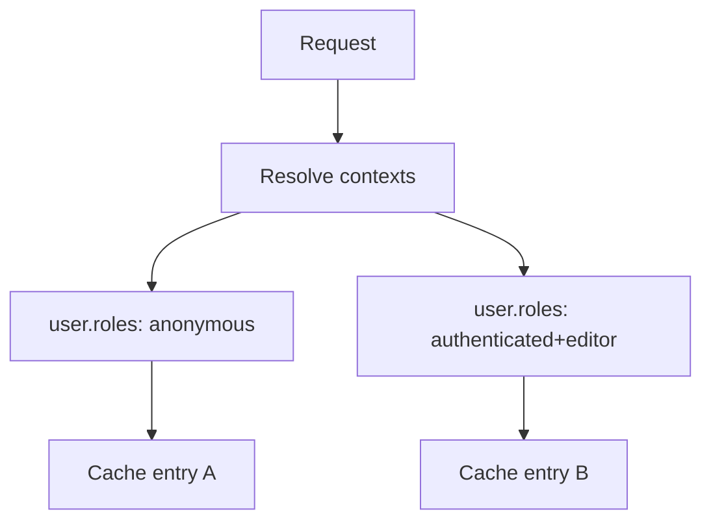
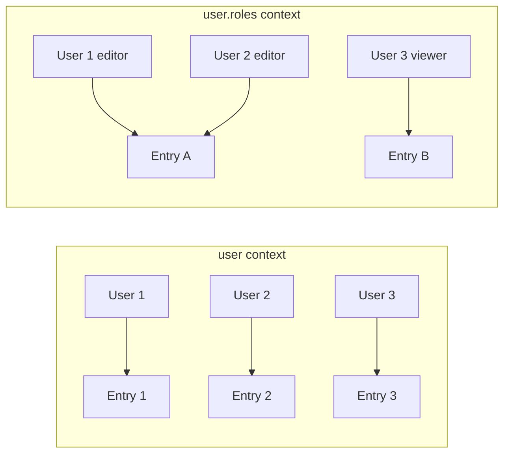

# Cache Contexts

Cache contexts define **variation dimensions** for cached content. Two users with different contexts get separate cache entries—even if the underlying data is identical.

## Contexts vs tags

| Concept | Purpose | Example |
|---------|---------|---------|
| **Cache tags** | When to invalidate | `node:42` |
| **Cache contexts** | Who sees what version | `user.roles` |



## Built-in cache contexts

| Context | Cache key segment | When it varies |
|---------|------------------|----------------|
| `user` | Per user ID | Personalized content |
| `user.roles` | Per role combination | Permission-dependent output |
| `user.permissions` | Per permission hash | Fine-grained access |
| `languages:language_interface` | Per UI language | Translated strings |
| `languages:language_content` | Per content language | Translated entities |
| `url.path` | Per URL path | Path-dependent blocks |
| `url.query_args` | Per query param | `?page=2` pagination |
| `session` | Per session | Session data |
| `timezone` | Per timezone | Date formatting |

## Using contexts in render arrays

```php
// Content varies by interface language
$build['#cache']['contexts'] = ['languages:language_interface'];

// Content varies by user role
$build['#cache']['contexts'] = ['user.roles'];

// Multiple contexts
$build['#cache']['contexts'] = [
  'languages:language_interface',
  'user.permissions',
];
```

## Context optimization

Use the **least granular** context that still describes how the output varies, to maximize cache hits:

```php
// Most granular — separate cache entry per user (avoid where possible)
$build['#cache']['contexts'] = ['user'];

// Per permission set — users whose roles grant the same permissions share an entry
$build['#cache']['contexts'] = ['user.permissions'];

// Coarsest — only two variations: has the authenticated role or not
$build['#cache']['contexts'] = ['user.roles:authenticated'];
```



## URL query argument contexts

Paginated or filtered listings need query arg contexts:

```php
$build['#cache']['contexts'] = ['url.query_args:page', 'url.query_args:sort'];
```

In Drupal 11, specify only the query args that affect output—not the entire `url.query_args` context.

## Lazy builders for per-user content

Instead of `user` context on the whole page, isolate per-user parts:

```php
// Page caches for all authenticated users
$build = [
  '#markup' => '<h1>Dashboard</h1>',
  'greeting' => [
    '#lazy_builder' => ['my_module.lazy:greeting', []],
    '#create_placeholder' => TRUE,
  ],
  '#cache' => [
    'contexts' => ['user.permissions'],
    'tags' => ['node_list:article'],
    'max-age' => Cache::PERMANENT,
  ],
];
```

```php
<?php

declare(strict_types=1);

namespace Drupal\my_module;

use Drupal\Core\Security\TrustedCallbackInterface;
use Drupal\Core\Session\AccountProxyInterface;

/**
 * Lazy builders for my_module (service: my_module.lazy).
 */
final class LazyBuilders implements TrustedCallbackInterface {

  public function __construct(
    private readonly AccountProxyInterface $currentUser,
  ) {}

  public static function trustedCallbacks(): array {
    return ['greeting'];
  }

  public function greeting(): array {
    return [
      '#markup' => 'Hello, ' . $this->currentUser->getDisplayName(),
      '#cache' => ['contexts' => ['user']],
    ];
  }

}
```

```yaml
# my_module.services.yml
services:
  my_module.lazy:
    class: Drupal\my_module\LazyBuilders
    arguments: ['@current_user']
```

!!! note "Lazy builders must be trusted callbacks"
    The class behind a `#lazy_builder` callback must implement `TrustedCallbackInterface` and list the method in `trustedCallbacks()`. Otherwise the renderer throws `UntrustedCallbackException`.

## Custom cache contexts

Create a context for application-specific variation. Cache contexts are not plugins: each one is a service whose ID starts with `cache_context.` and that is tagged `cache.context`.

!!! tip "Varying by a single request header"
    For a plain header value, core's `headers` context already does this: `$build['#cache']['contexts'] = ['headers:X-Tenant-ID'];`. Write a custom context only when you need extra logic, such as normalizing or validating the value.

### TenantCacheContext.php

```php
<?php

declare(strict_types=1);

namespace Drupal\my_module\Cache\Context;

use Drupal\Core\Cache\CacheableMetadata;
use Drupal\Core\Cache\Context\CacheContextInterface;
use Symfony\Component\HttpFoundation\RequestStack;

/**
 * Cache context based on a custom request header.
 *
 * Cache context ID: my_app.tenant (service: cache_context.my_app.tenant).
 */
final class TenantCacheContext implements CacheContextInterface {

  public function __construct(
    private readonly RequestStack $requestStack,
  ) {}

  /**
   * {@inheritdoc}
   */
  public static function getLabel(): string {
    return (string) t('Tenant');
  }

  /**
   * {@inheritdoc}
   */
  public function getContext(): string {
    $request = $this->requestStack->getCurrentRequest();
    return $request?->headers->get('X-Tenant-ID', 'default') ?? 'default';
  }

  /**
   * {@inheritdoc}
   */
  public function getCacheableMetadata(): CacheableMetadata {
    return new CacheableMetadata();
  }

}
```

```yaml
# my_module.services.yml
services:
  cache_context.my_app.tenant:
    class: Drupal\my_module\Cache\Context\TenantCacheContext
    arguments: ['@request_stack']
    tags:
      - { name: cache.context }
```

```php
// Usage
$build['#cache']['contexts'] = ['my_app.tenant'];
```

## Contexts in headless APIs

JSON:API responses vary by user permissions:

```bash
# Anonymous — may get 403 or empty list
curl -s -H "Accept: application/vnd.api+json" \
  https://my-site.ddev.site/jsonapi/node/article

# Authenticated editor — sees unpublished
curl -s -H "Accept: application/vnd.api+json" \
  -H "Authorization: Bearer $TOKEN" \
  https://my-site.ddev.site/jsonapi/node/article
```

These are separate dynamic page cache entries due to `user.permissions` context.

For public headless sites, anonymous JSON:API responses should use minimal contexts:

```php
$cacheability = (new CacheableMetadata())
  ->addCacheContexts(['languages:language_content'])
  ->addCacheTags(['node_list:article']);
// No user context — shared across all anonymous visitors
```

## Calculating cache key cardinality

| Contexts used | Approximate entries |
|---------------|-------------------|
| None (public content) | 1 per language |
| `languages:language_interface` | × number of languages |
| `user.roles` | × role combinations |
| `user` | × number of users (avoid!) |
| `url.query_args:page` | × number of pages |

## Debugging contexts

```php
$metadata = CacheableMetadata::createFromRenderArray($build);
$contexts = $metadata->getCacheContexts();
// Log or inspect $contexts
```

## Related pages

- [Cache Tags](cache-tags.md) — invalidation
- [Render Cache](render-cache.md) — placeholders
- [Dynamic Page Cache](dynamic-page-cache.md) — full response caching
