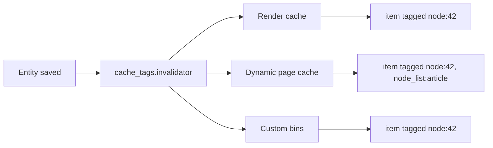
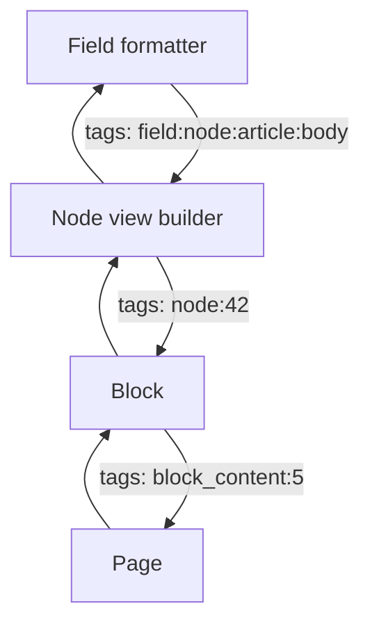

# Cache Tags

Cache tags are string labels attached to cache items that enable **targeted invalidation**. When content changes, Drupal invalidates all cache items tagged with matching labels—without flushing entire cache bins.

## How cache tags work



When node 42 is saved, all three items are invalidated.

## Standard entity tags

Drupal entities automatically provide cache tags:

```php
$node = \Drupal::entityTypeManager()->getStorage('node')->load(42);

// Individual entity tag
$node->getCacheTags();       // ['node:42']

// List tag (any query listing this type)
$node->getListCacheTags();   // ['node_list:article'] (bundle-specific)
                              // or ['node_list'] (type-wide)

// Combined
$node->getCacheTagsToInvalidate(); // tags to invalidate on save
```

| Entity | Individual tag | List tag |
|--------|-----------------|----------|
| Node | `node:{nid}` | `node_list` / `node_list:{bundle}` |
| User | `user:{uid}` | `user_list` |
| Taxonomy term | `taxonomy_term:{tid}` | `taxonomy_term_list` |
| Media | `media:{mid}` | `media_list` |
| Config | `config:{name}` | — |

## Using cache tags in code

### Render arrays

```php
$build = [
  '#markup' => $node->label(),
  '#cache' => [
    'tags' => $node->getCacheTags(),
  ],
];
```

### Cacheable objects

```php
use Drupal\Core\Cache\CacheableMetadata;

$metadata = new CacheableMetadata();
$metadata->addCacheTags(['node:42', 'node_list:article']);
$metadata->addCacheableDependency($node); // merges entity tags automatically
```

### Direct cache storage

```php
use Drupal\Core\Cache\Cache;

$data = ['articles' => $article_list];
$tags = ['node_list:article'];

\Drupal::cache('default')->set(
  'my_module:article_list',
  $data,
  Cache::PERMANENT,
  $tags,
);
```

## Invalidating tags

```php
// Invalidate specific tags
\Drupal::service('cache_tags.invalidator')->invalidateTags(['node:42']);

// Entity save does this automatically
$node->save(); // invalidates node:42, node_list:article, etc.
```

```bash
# Full cache rebuild (nuclear option)
drush cr
```

## Cache tag bubbling

Tags from child render elements bubble to parents:

```php
$build = [
  '#type' => 'container',
  'article_teaser' => \Drupal::entityTypeManager()
    ->getViewBuilder('node')
    ->view($node, 'teaser'),
  // Container inherits node:42 tag from child automatically
];
```



## Custom cache tags

Define tags for non-entity data:

```php
// Tag pattern: {module}:{identifier}
$tags = ['my_module:dashboard_stats', 'my_module:reports'];

$build['#cache']['tags'] = $tags;

// Invalidate when stats are recalculated
\Drupal::service('cache_tags.invalidator')
  ->invalidateTags(['my_module:dashboard_stats']);
```

### Tagged cache service

```php
<?php

declare(strict_types=1);

namespace Drupal\my_module\Service;

use Drupal\Core\Cache\CacheBackendInterface;
use Drupal\Core\Cache\CacheTagsInvalidatorInterface;

/**
 * Dashboard statistics with cache tag support.
 */
final class DashboardStatsService {

  public function __construct(
    private readonly CacheBackendInterface $cache,
    private readonly CacheTagsInvalidatorInterface $invalidator,
  ) {}

  public function getStats(): array {
    $cid = 'my_module:dashboard_stats';

    if ($cached = $this->cache->get($cid)) {
      return $cached->data;
    }

    $stats = $this->computeStats();

    $this->cache->set($cid, $stats, CacheBackendInterface::CACHE_PERMANENT, [
      'my_module:dashboard_stats',
      'node_list:article',
    ]);

    return $stats;
  }

  public function invalidate(): void {
    $this->invalidator->invalidateTags(['my_module:dashboard_stats']);
  }

  private function computeStats(): array {
    return [
      'article_count' => 42,
      'last_updated' => time(),
    ];
  }

}
```

## Config entity tags

Configuration changes invalidate `config:{name}` tags:

```php
// When system.site config changes, invalidates config:system.site
\Drupal::configFactory()->getEditable('system.site')
  ->set('name', 'New Site Name')
  ->save();
```

## Headless: propagating tags to frontend

Map Drupal tags to frontend cache keys:

| Drupal tag | Next.js `revalidateTag` |
|------------|------------------------|
| `node:42` | `node:42` |
| `node_list:article` | `node_list:article` |
| `config:system.menu.main` | `config:system.menu.main` |

```typescript
// In Next.js fetch
fetch(url, { next: { tags: ['node_list:article'] } });
```

See [Headless Cache Invalidation](../headless/cache-invalidation.md).

## Inspecting tags

```php
// In a controller or event subscriber
$response = $someCacheableResponse;
$metadata = CacheableMetadata::createFromRenderArray($build);
$tags = $metadata->getCacheTags();
\Drupal::logger('debug')->notice('Tags: @tags', ['@tags' => implode(', ', $tags)]);
```

## Best practices

| Practice | Reason |
|----------|--------|
| Use entity `getCacheTags()` | Consistent, complete tag sets |
| Include list tags for listings | Invalidate list when any member changes |
| Avoid overly broad tags like `node_list` | Invalidates all node listings |
| Tag config-dependent output | Use `config:` prefix |
| Invalidate, don't set `max-age: 0` | Preserve cache between changes |

## Related pages

- [Cache Contexts](cache-contexts.md) — variation dimensions
- [Invalidation](invalidation.md) — max-age + tag patterns
- [Render Cache](render-cache.md) — where tags attach
