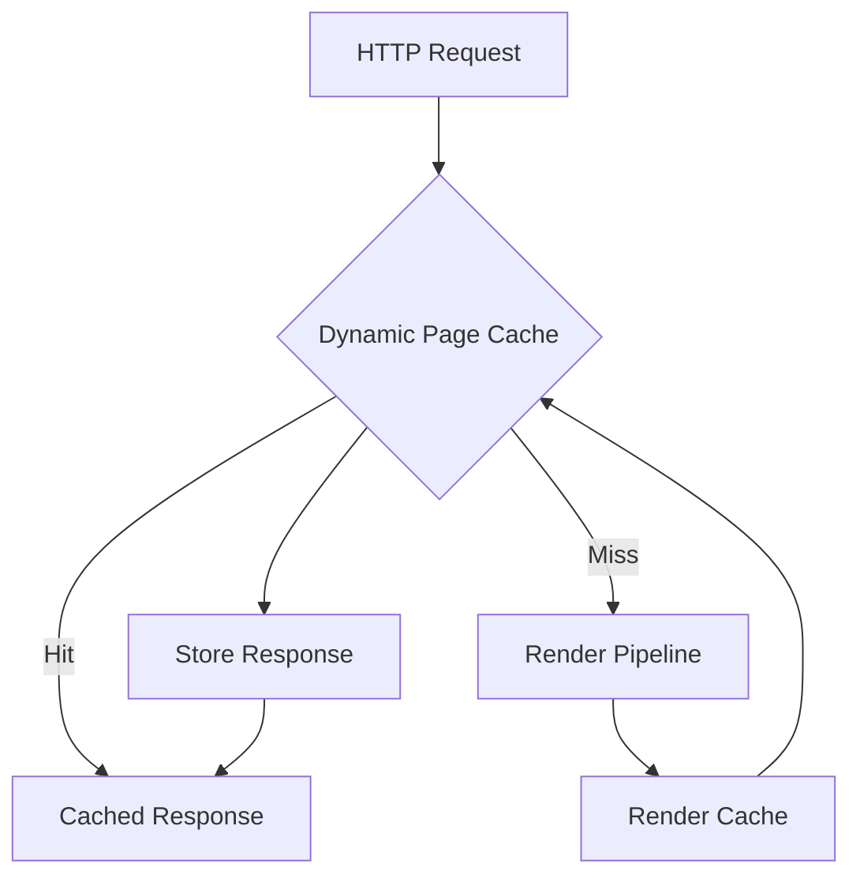
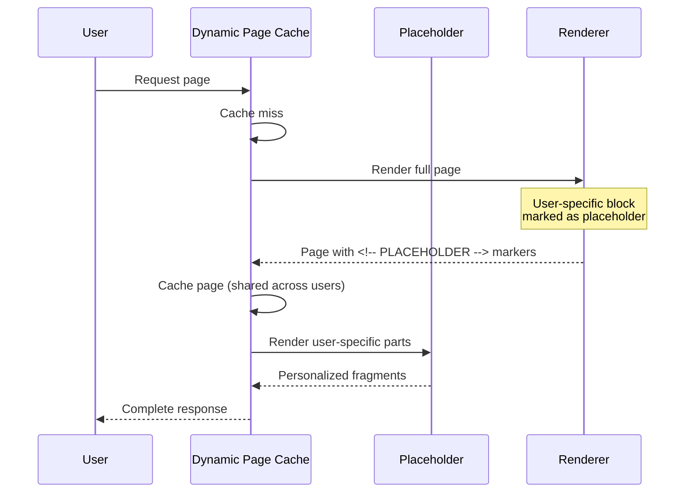
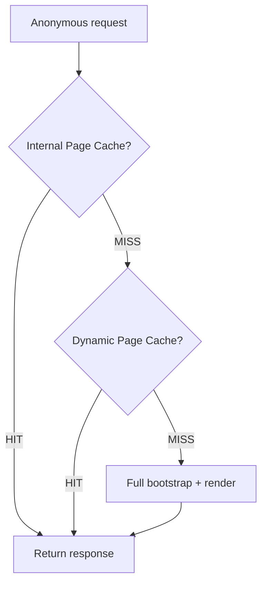

# Dynamic Page Cache

**Dynamic Page Cache** caches entire HTTP responses (rendered pages or API output) for authenticated and anonymous users. It sits above render cache and uses **auto-placeholdering** to handle per-user variations efficiently.

## Cache layer position



## Dynamic Page Cache vs Page Cache

| Feature | Page Cache | Dynamic Page Cache |
|---------|------------|-------------------|
| Module | `page_cache` | `dynamic_page_cache` |
| Anonymous users | Yes | Yes |
| Authenticated users | No | Yes |
| Per-user variations | N/A | Via placeholders |
| Implementation | HTTP middleware (runs first, before routing) | Event subscriber on `KernelEvents::REQUEST`/`RESPONSE` |
| Honors cache contexts / max-age | No (one entry per URL; expiry only via `Expires` header) | Yes |

Both are enabled by default in Drupal 11:

```bash
drush pm:list --filter=page_cache
drush pm:list --filter=dynamic_page_cache
```

## How auto-placeholdering works



Elements that have a `#lazy_builder` become placeholders automatically when their cacheability matches `renderer.config.auto_placeholder_conditions` (by default: `max-age` 0, or the `session` or `user` context). The outer page can then be cached while those parts vary per user. Elements without a `#lazy_builder` are never placeholdered; their contexts bubble up to the page instead.

## Cacheable responses

Controllers returning `CacheableResponse` or render arrays participate in dynamic page cache:

```php
<?php

declare(strict_types=1);

namespace Drupal\my_module\Controller;

use Drupal\Core\Cache\CacheableMetadata;
use Drupal\Core\Controller\ControllerBase;
use Symfony\Component\HttpFoundation\Response;

/**
 * Cacheable page controller.
 */
final class DashboardController extends ControllerBase {

  public function dashboard(): array {
    $build = [
      '#theme' => 'item_list',
      '#title' => $this->t('Dashboard'),
      '#items' => $this->getDashboardItems(),
    ];

    // Bubble cache metadata
    $build['#cache']['tags'] = ['node_list:article'];
    $build['#cache']['contexts'] = ['user.permissions'];
    $build['#cache']['max-age'] = 300;

    return $build;
  }

  private function getDashboardItems(): array {
    // ...
    return ['Item 1', 'Item 2'];
  }

}
```

## JSON:API and API responses

JSON:API responses are dynamically page-cached when cacheable:

```bash
# First request — MISS
curl -sI -H "Accept: application/vnd.api+json" \
  https://my-site.ddev.site/jsonapi/node/article | grep -i x-drupal

# Second request — HIT
curl -sI -H "Accept: application/vnd.api+json" \
  https://my-site.ddev.site/jsonapi/node/article | grep -i x-drupal
```

Response headers include cache debugging info:

```
X-Drupal-Cache: HIT
X-Drupal-Dynamic-Cache: HIT
Cache-Control: max-age=3600, public
```

## Opting out of page cache

```php
// In a controller — uncacheable response
$response = new Response('Personalized data');
$response->headers->set('Cache-Control', 'no-cache, must-revalidate');

// On a render array
$build['#cache']['max-age'] = 0;

// Kill switch for exceptional cases
\Drupal::service('page_cache_kill_switch')->trigger();
```

## Cache contexts drive variations

Dynamic page cache creates separate entries per unique context combination:

```php
// Two cache entries: users with the authenticated role, and users without it
$build['#cache']['contexts'] = ['user.roles:authenticated'];
```

Minimize contexts to maximize cache hits. See [Cache Contexts](cache-contexts.md).

## Internal Page Cache (anonymous)

For anonymous traffic, Internal Page Cache (`page_cache` module) provides an additional fast path:



## Configuring cache headers

Alter response cache headers with an event subscriber:

```php
<?php

declare(strict_types=1);

namespace Drupal\my_module\EventSubscriber;

use Drupal\Core\Cache\CacheableResponseInterface;
use Symfony\Component\EventDispatcher\EventSubscriberInterface;
use Symfony\Component\HttpKernel\Event\ResponseEvent;
use Symfony\Component\HttpKernel\KernelEvents;

/**
 * Sets Cache-Control headers for API responses.
 */
final class ApiCacheHeaderSubscriber implements EventSubscriberInterface {

  public static function getSubscribedEvents(): array {
    return [KernelEvents::RESPONSE => ['onResponse', -10]];
  }

  public function onResponse(ResponseEvent $event): void {
    $response = $event->getResponse();
    $request = $event->getRequest();

    if (!str_starts_with($request->getPathInfo(), '/api/')) {
      return;
    }

    if ($response instanceof CacheableResponseInterface) {
      $response->headers->set(
        'Cache-Control',
        'public, max-age=300, s-maxage=600, stale-while-revalidate=60',
      );
    }
  }

}
```

## Headless CDN caching

Place a CDN in front of JSON:API for anonymous reads:

```
Browser → CDN (cache by URL) → Drupal
```

Align CDN TTL with Drupal `max-age`:

| Drupal max-age | CDN behavior |
|----------------|--------------|
| 3600 | Cache 1 hour at edge |
| 0 | Pass-through only |
| `stale-while-revalidate` | Serve stale while refreshing |

Use [cache invalidation webhooks](../headless/cache-invalidation.md) for content updates.

## Debugging

```php
// settings.local.php — disable dynamic page cache (and internal page cache).
// cache.backend.null is defined in sites/development.services.yml.
$settings['container_yamls'][] = DRUPAL_ROOT . '/sites/development.services.yml';
$settings['cache']['bins']['dynamic_page_cache'] = 'cache.backend.null';
$settings['cache']['bins']['page'] = 'cache.backend.null';
```

`system.performance:cache.page.max_age` only sets the `Cache-Control` max-age sent to browsers and proxies. It does not disable either Drupal cache.

```bash
# Response headers
curl -sI https://my-site.ddev.site/jsonapi/node/article \
  -H "Accept: application/vnd.api+json"
```

## Related pages

- [Render Cache](render-cache.md) — element-level caching
- [Cache Tags](cache-tags.md) — invalidation
- [Invalidation](invalidation.md) — max-age patterns
