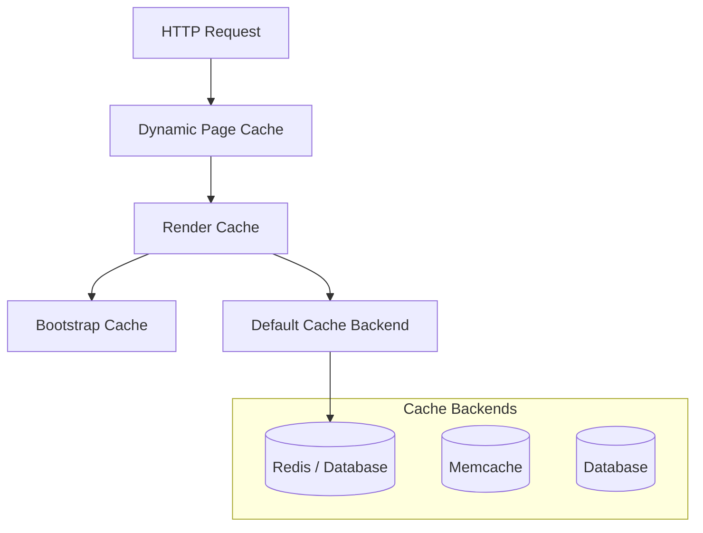

# Caching in Drupal

Drupal's cache system is a multi-layer architecture that makes headless and traditional sites performant. Understanding render cache, dynamic page cache, cache tags, and cache contexts is essential for both backend development and frontend cache coordination.

## Cache layers



| Layer | Purpose | Scope |
|-------|---------|-------|
| [Render cache](render-cache.md) | Cached render array output | Per render element |
| [Dynamic Page Cache](dynamic-page-cache.md) | Full page responses | Per route + contexts |
| [Page cache](dynamic-page-cache.md) | Anonymous full pages | Anonymous only |
| Bootstrap | Container, extensions | Long-lived |
| Discovery | Plugin/routing maps | Until cache rebuild |

## Cache item anatomy

Every cacheable item has three metadata dimensions:

```php
$build = [
  '#markup' => '<p>Hello</p>',
  '#cache' => [
    'keys' => ['my_module', 'dashboard', $user_id],  // Cache ID parts
    'tags' => ['node:42', 'node_list:article'],       // Invalidation labels
    'contexts' => ['user.roles', 'languages:language_interface'], // Variation axes
    'max-age' => 3600,                                 // TTL in seconds
  ],
];
```

| Dimension | Question it answers |
|-----------|---------------------|
| **Keys** | What is this cache entry? |
| **Tags** | When should it be invalidated? |
| **Contexts** | How many versions do we need? |
| **Max-age** | How long is it valid (time-based)? |

## Cache backends

Configure Redis for production:

```php
// settings.php
$settings['redis.connection']['interface'] = 'PhpRedis';
$settings['redis.connection']['host'] = 'redis';
$settings['cache']['default'] = 'cache.backend.redis';
```

```bash
composer require drupal/redis
drush en redis -y
```

## Checking cache status

```bash
# Rebuild all caches
drush cr

# Inspect cache bins (with devel)
drush php:eval "print_r(array_keys(\Drupal::cache('render')->getAll()));"
```

## Headless implications

| Concern | Traditional | Headless |
|---------|-------------|----------|
| Page cache | HTML pages | JSON:API responses |
| Render cache | Twig blocks | API normalizers |
| Cache tags | Auto on entities | Propagate to frontend |
| Cache contexts | User/session | OAuth token context |

JSON:API and REST responses participate in Drupal's cache system when built with cacheable metadata:

```php
$response = new CacheableJsonResponse($data);
$response->addCacheableDependency($node);
```

## Section guide

| Page | Topics |
|------|--------|
| [Render Cache](render-cache.md) | `#cache` on render arrays, placeholders |
| [Dynamic Page Cache](dynamic-page-cache.md) | Full response caching, auto-placeholdering |
| [Cache Tags](cache-tags.md) | Tag definition, bubbling, invalidation |
| [Cache Contexts](cache-contexts.md) | User, language, URL variations |
| [Invalidation](invalidation.md) | Max-age, patterns, queue-based purge |

## Quick reference

```php
// Invalidate specific tags
\Drupal::service('cache_tags.invalidator')->invalidateTags(['node:42']);

// Invalidate entire bin
\Drupal::cache('render')->deleteAll();

// Set max-age to forever (use with caution)
$build['#cache']['max-age'] = Cache::PERMANENT;

// Opt out of caching
$build['#cache']['max-age'] = 0;
```

## Related pages

- [Headless Cache Invalidation](../headless/cache-invalidation.md) — frontend webhooks
- [Symfony Cache](../symfony/cache.md) — underlying cache component
- [Custom JSON APIs](../headless/custom-json-apis.md) — CacheableJsonResponse
