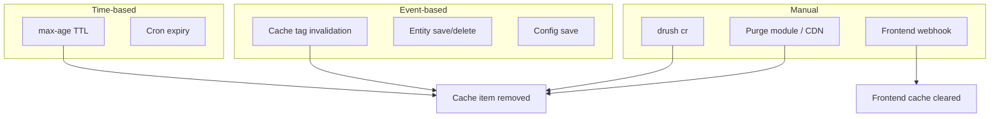
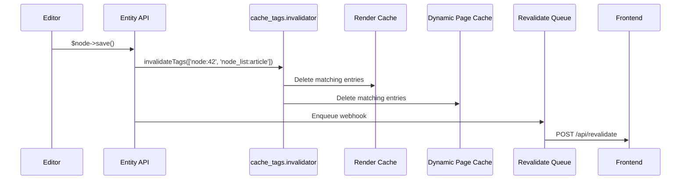
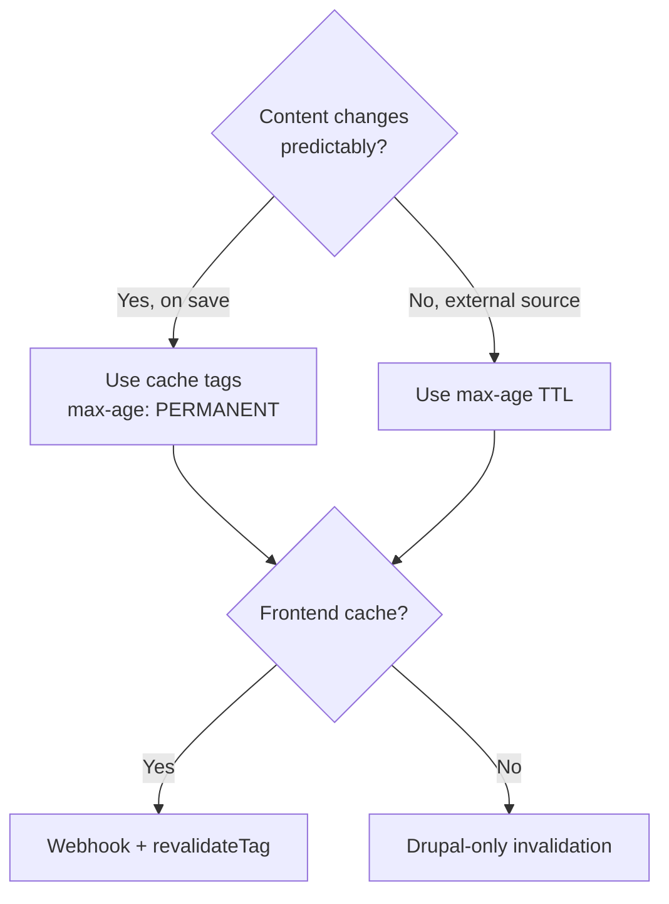

# Cache Invalidation

Cache invalidation combines **time-based expiry** (`max-age`), **event-based invalidation** (cache tags), and **manual purge** strategies. Getting this right keeps headless frontends fresh without sacrificing performance.

## Three invalidation mechanisms



## Max-age

`max-age` sets a time-to-live in seconds. After expiry, the item is stale and regenerated on next request.

```php
use Drupal\Core\Cache\Cache;

// Cache for 1 hour
$build['#cache']['max-age'] = 3600;

// Never expires by time (rely on tags)
$build['#cache']['max-age'] = Cache::PERMANENT;

// Never cache
$build['#cache']['max-age'] = 0;
```

### Max-age constants

| Value | Meaning |
|-------|---------|
| `Cache::PERMANENT` | No time expiry; invalidate via tags |
| `0` | Uncacheable |
| `300` | 5 minutes |
| `3600` | 1 hour |
| `86400` | 24 hours |

### Choosing max-age

| Content type | Recommended max-age | Invalidation |
|--------------|--------------------|--------------|
| Published articles | `PERMANENT` | Cache tags |
| Dashboard stats | `300`–`900` | Tags + short TTL |
| User profile | `0` or `user` context | Per-user |
| Search results | `0`–`60` | Query-dependent |
| Config-driven menus | `PERMANENT` | `config:` tags |
| External API data | `300`–`3600` | TTL only |

!!! tip "Prefer tags over short max-age"
    `max-age: 60` on content that changes rarely wastes CPU regenerating cache every minute. Use `Cache::PERMANENT` with proper cache tags instead.

## Tag-based invalidation patterns

### Entity CRUD (automatic)

```php
$node->save();
// Automatically invalidates:
// - node:{nid}
// - node_list:{bundle}
// - Any rendered output that bubbled these tags
```

### Custom service invalidation

```php
// After bulk import
$this->cacheTagsInvalidator->invalidateTags([
  'node_list:article',
  'my_module:search_index',
]);
```

### Config change invalidation

```php
// Saving config auto-invalidates config:{name}
$this->configFactory->getEditable('system.menu.main')
  ->set('label', 'Main navigation')
  ->save();
// Invalidates config:system.menu.main
```

## Invalidation flow



## Queue-based invalidation

Avoid blocking editor saves with synchronous HTTP calls:

```php
<?php

declare(strict_types=1);

namespace Drupal\my_module\Plugin\QueueWorker;

use Drupal\Core\Cache\CacheTagsInvalidatorInterface;
use Drupal\Core\Plugin\ContainerFactoryPluginInterface;
use Drupal\Core\Queue\Attribute\QueueWorker;
use Drupal\Core\Queue\QueueWorkerBase;
use Drupal\Core\StringTranslation\TranslatableMarkup;
use Symfony\Component\DependencyInjection\ContainerInterface;

/**
 * Processes deferred cache invalidation.
 */
#[QueueWorker(
  id: 'my_module_cache_invalidate',
  title: new TranslatableMarkup('Deferred cache invalidation'),
  cron: ['time' => 60],
)]
final class CacheInvalidateQueueWorker extends QueueWorkerBase implements ContainerFactoryPluginInterface {

  public function __construct(
    array $configuration,
    $plugin_id,
    $plugin_definition,
    private readonly CacheTagsInvalidatorInterface $invalidator,
  ) {
    parent::__construct($configuration, $plugin_id, $plugin_definition);
  }

  public static function create(ContainerInterface $container, array $configuration, $plugin_id, $plugin_definition): static {
    return new static(
      $configuration,
      $plugin_id,
      $plugin_definition,
      $container->get('cache_tags.invalidator'),
    );
  }

  public function processItem($data): void {
    $this->invalidator->invalidateTags($data['tags']);
  }

}
```

Enqueue on bulk operations:

```php
$queue = \Drupal::queue('my_module_cache_invalidate');
$queue->createItem(['tags' => ['node_list:article']]);
```

## CDN and edge invalidation

### Purge module

```bash
composer require drupal/purge
drush en purge purge_ui purge_queuer_coretags -y
```

Configure purgers for your CDN (Cloudflare, Varnish, Acquia).

### Manual CDN purge

```bash
# Cloudflare API example
curl -X POST "https://api.cloudflare.com/client/v4/zones/{zone_id}/purge_cache" \
  -H "Authorization: Bearer $CF_TOKEN" \
  -H "Content-Type: application/json" \
  -d '{"tags":["node-42"]}'
```

## Frontend invalidation (headless)

Drupal invalidates its own cache; frontends need separate coordination:

```typescript
// Next.js — called by Drupal webhook
import { revalidateTag, revalidatePath } from 'next/cache';

export async function POST(request: Request) {
  const { tags, paths } = await request.json();

  for (const tag of tags ?? []) {
    revalidateTag(tag);
  }
  for (const path of paths ?? []) {
    revalidatePath(path);
  }

  return Response.json({ revalidated: true });
}
```

See [Headless Cache Invalidation](../headless/cache-invalidation.md) for the full Drupal webhook module.

## Invalidation patterns by use case

### Content publishing

```php
// node_presave hook or event subscriber — no extra work needed
// Entity save handles tag invalidation automatically
```

### Bulk migration

```php
// After migration batch completes
\Drupal::service('cache_tags.invalidator')->invalidateTags([
  'node_list',
  'taxonomy_term_list',
  'media_list',
]);
```

### Search index rebuild

```php
function my_module_search_indexed(array $ids): void {
  \Drupal::service('cache_tags.invalidator')
    ->invalidateTags(['my_module:search_results']);
}
```

### Theme/settings change

```php
// After saving theme settings
\Drupal::service('cache_tags.invalidator')
  ->invalidateTags(['config:system.theme.global', 'rendered']);
```

### External data refresh

```php
// TTL-only — no tags available
\Drupal::cache('default')->set(
  'my_module:weather',
  $weatherData,
  time() + 1800, // 30-minute TTL
  ['my_module:weather'],
);
```

## Full cache rebuild

```bash
# Rebuild all caches — use sparingly in production
drush cr
```

Triggers:

- Module install/uninstall
- Plugin discovery changes
- Deploying code changes
- Troubleshooting cache corruption

!!! warning "Production impact"
    `drush cr` on high-traffic sites causes a thundering herd as all caches regenerate simultaneously. Prefer tag invalidation.

## Monitoring invalidation

```php
// Log invalidation events
\Drupal::logger('cache')->notice('Invalidated tags: @tags', [
  '@tags' => implode(', ', $tags),
]);
```

```bash
# Watch logs during content edit
drush watchdog:tail --filter=cache
```

## Decision matrix



## Related pages

- [Cache Tags](cache-tags.md) — tag fundamentals
- [Render Cache](render-cache.md) — element-level caching
- [Headless Cache Invalidation](../headless/cache-invalidation.md) — webhook implementation
