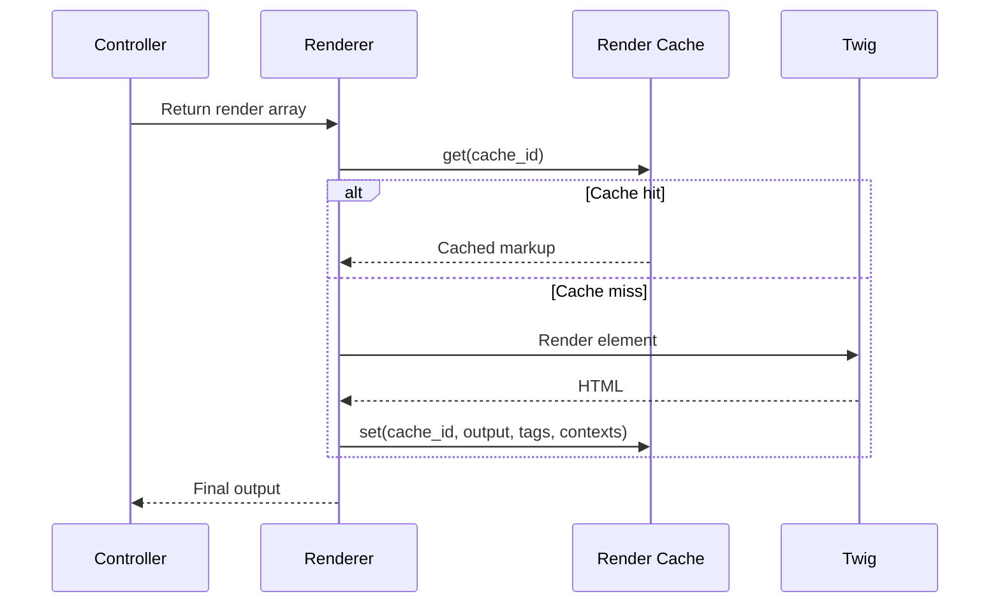
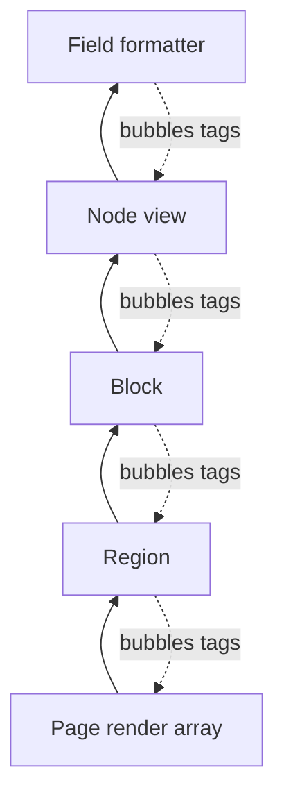

# Render Cache

The **render cache** stores the output of render arrays after processing (the "preprocessed" tree). It is Drupal's most granular cache layer and applies to blocks, entities, views, and any element with `#cache` metadata.

## How render cache works



## Cache keys

Cache IDs are built from `#cache['keys']`:

```php
$build = [
  '#theme' => 'item_list',
  '#items' => $article_titles,
  '#cache' => [
    'keys' => ['my_module', 'recent_articles'],
    'tags' => ['node_list:article'],
    'contexts' => ['languages:language_content'],
    'max-age' => 3600,
  ],
];
```

Without explicit keys, Drupal auto-generates keys from the render array structure.

## Attaching cache to render arrays

### Block plugin example

```php
<?php

declare(strict_types=1);

namespace Drupal\my_module\Plugin\Block;

use Drupal\Core\Block\BlockBase;
use Drupal\Core\Cache\Cache;
use Drupal\node\NodeInterface;

/**
 * Recent articles block with proper render cache.
 *
 * @Block(
 *   id = "recent_articles",
 *   admin_label = @Translation("Recent articles"),
 * )
 */
final class RecentArticlesBlock extends BlockBase {

  /**
   * {@inheritdoc}
   */
  public function build(): array {
    $storage = \Drupal::entityTypeManager()->getStorage('node');
    $nids = $storage->getQuery()
      ->accessCheck(TRUE)
      ->condition('type', 'article')
      ->condition('status', NodeInterface::PUBLISHED)
      ->sort('created', 'DESC')
      ->range(0, 5)
      ->execute();

    $nodes = $storage->loadMultiple($nids);
    $items = [];
    $tags = ['node_list:article'];

    foreach ($nodes as $node) {
      $tags = Cache::mergeTags($tags, $node->getCacheTags());
      $items[] = [
        '#type' => 'link',
        '#title' => $node->label(),
        '#url' => $node->toUrl(),
      ];
    }

    return [
      '#theme' => 'item_list',
      '#items' => $items,
      '#cache' => [
        'tags' => $tags,
        'contexts' => ['languages:language_content'],
      ],
    ];
  }

  /**
   * {@inheritdoc}
   */
  public function getCacheMaxAge(): int {
    return 300;
  }

}
```

## Cache bubbling

Child elements bubble cache metadata to parents automatically:



```php
// Parent automatically inherits child's cache tags
$build = [
  '#type' => 'container',
  'child' => [
    '#markup' => $node->label(),
    '#cache' => [
      'tags' => $node->getCacheTags(),
    ],
  ],
];
// Parent now invalidates when node:42 is invalidated
```

## `#create_placeholder` and lazy rendering

For expensive, uncacheable sub-elements, use placeholders:

```php
$build = [
  '#markup' => 'Static header',
  'user_greeting' => [
    '#lazy_builder' => ['my_module.lazy_builder:greeting', []],
    '#create_placeholder' => TRUE,
  ],
  '#cache' => [
    'keys' => ['my_page'],
    'contexts' => ['user'],
    'tags' => ['node_list'],
    'max-age' => Cache::PERMANENT,
  ],
];
```

```php
// my_module.lazy_builder service
public function greeting(): array {
  $name = $this->currentUser->getDisplayName();
  return [
    '#markup' => "Hello, {$name}!",
    '#cache' => [
      'contexts' => ['user'],
    ],
  ];
}
```

The outer page caches permanently; the greeting placeholder renders per-user at request time.

## Entity view builder cache

Entity view modes are render-cached by default:

```php
$build = \Drupal::entityTypeManager()
  ->getViewBuilder('node')
  ->view($node, 'teaser');
// Automatically includes node:{nid} cache tags
```

Disable per entity type in `entity_view_display` config or:

```php
$build['#cache']['max-age'] = 0;
```

## Render cache in headless APIs

Custom API controllers should use `CacheableJsonResponse`:

```php
use Drupal\Core\Cache\CacheableJsonResponse;
use Drupal\Core\Cache\CacheableMetadata;

$response = new CacheableJsonResponse(['items' => $data]);

$cacheability = (new CacheableMetadata())
  ->addCacheTags(['node_list:article'])
  ->addCacheContexts(['user.permissions'])
  ->setCacheMaxAge(300);

$response->addCacheableDependency($cacheability);
```

## Debugging render cache

```php
// Disable render cache during development (settings.local.php)
$settings['cache']['bins']['render'] = 'cache.backend.null';

// Or per-element
$build['#cache']['max-age'] = 0;
```

```bash
# Add cache debug headers (devel)
drush en devel -y
# Visit page with ?debug_cache=1 (with devel settings)
```

## Common mistakes

| Mistake | Fix |
|---------|-----|
| Missing cache tags | Add entity `getCacheTags()` |
| Over-broad contexts | Use minimum required contexts |
| `max-age: 0` everywhere | Defeats caching; fix tags instead |
| User-specific data in cached build | Use `#lazy_builder` placeholder |
| Forgetting query access check | Always `->accessCheck(TRUE)` |

## Related pages

- [Cache Tags](cache-tags.md) — invalidation labels
- [Cache Contexts](cache-contexts.md) — variation dimensions
- [Dynamic Page Cache](dynamic-page-cache.md) — full page layer
