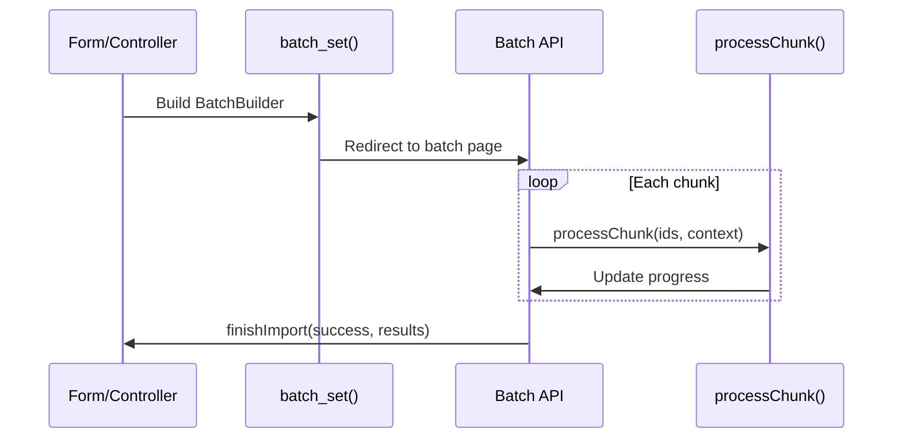

# Batch API

The Batch API splits long operations into chunks with a progress bar. Ideal for bulk updates, imports, and migrations triggered from a form or controller.

## Batch builder service — `src/Service/BatchImporter.php`

```php
<?php

declare(strict_types=1);

namespace Drupal\example_module\Service;

use Drupal\Core\Batch\BatchBuilder;
use Drupal\Core\StringTranslation\StringTranslationTrait;

/**
 * Sets up batch jobs for importing items.
 */
final class BatchImporter {

  use StringTranslationTrait;

  /**
   * Starts a batch import for the given item IDs.
   *
   * @param list<int|string> $item_ids
   */
  public function startImport(array $item_ids): void {
    $batch_builder = (new BatchBuilder())
      ->setTitle($this->t('Importing items'))
      ->setInitMessage($this->t('Starting import...'))
      ->setProgressMessage($this->t('Processed @current of @total.'))
      ->setErrorMessage($this->t('Import encountered an error.'))
      ->setFinishCallback([self::class, 'finishImport']);

    $chunks = array_chunk($item_ids, 10);
    foreach ($chunks as $chunk) {
      $batch_builder->addOperation(
        [self::class, 'processChunk'],
        [$chunk],
      );
    }

    batch_set($batch_builder->toArray());
  }

  /**
   * Batch operation callback: process one chunk of IDs.
   *
   * @param list<int|string> $ids
   */
  public static function processChunk(array $ids, array &$context): void {
    if (!isset($context['results']['imported'])) {
      $context['results']['imported'] = 0;
      $context['results']['errors'] = [];
    }

    $storage = \Drupal::entityTypeManager()->getStorage('node');

    foreach ($ids as $nid) {
      try {
        $node = $storage->load($nid);
        if ($node === NULL) {
          throw new \RuntimeException("Node $nid not found.");
        }

        // Simulate import work.
        $node->set('field_imported', TRUE);
        $node->save();
        $context['results']['imported']++;
      }
      catch (\Throwable $e) {
        $context['results']['errors'][] = $e->getMessage();
      }

      $context['message'] = t('Processing node @nid...', ['@nid' => $nid]);
    }
  }

  /**
   * Batch finished callback.
   */
  public static function finishImport(bool $success, array $results, array $operations): void {
    $messenger = \Drupal::messenger();

    if ($success) {
      $messenger->addStatus(t('Imported @count items.', [
        '@count' => $results['imported'] ?? 0,
      ]));

      if (!empty($results['errors'])) {
        $messenger->addWarning(t('@count errors occurred.', [
          '@count' => count($results['errors']),
        ]));
      }
    }
    else {
      $messenger->addError(t('Import finished with an error.'));
    }
  }

}
```

```yaml
# example_module.services.yml
  example_module.batch_importer:
    class: Drupal\example_module\Service\BatchImporter
```

---

## Form that starts the batch — `src/Form/ImportBatchForm.php`

```php
<?php

declare(strict_types=1);

namespace Drupal\example_module\Form;

use Drupal\Core\Entity\EntityTypeManagerInterface;
use Drupal\Core\Form\FormBase;
use Drupal\Core\Form\FormStateInterface;
use Drupal\example_module\Service\BatchImporter;
use Symfony\Component\DependencyInjection\ContainerInterface;

/**
 * Form to trigger a batch import.
 */
final class ImportBatchForm extends FormBase {

  public function __construct(
    private readonly BatchImporter $batchImporter,
    private readonly EntityTypeManagerInterface $entityTypeManager,
  ) {}

  /**
   * {@inheritdoc}
   */
  public static function create(ContainerInterface $container): static {
    return new static(
      $container->get('example_module.batch_importer'),
      $container->get('entity_type.manager'),
    );
  }

  /**
   * {@inheritdoc}
   */
  public function getFormId(): string {
    return 'example_module_import_batch';
  }

  /**
   * {@inheritdoc}
   */
  public function buildForm(array $form, FormStateInterface $form_state): array {
    $count = $this->entityTypeManager->getStorage('node')->getQuery()
      ->accessCheck(FALSE)
      ->condition('type', 'article')
      ->count()
      ->execute();

    $form['description'] = [
      '#markup' => '<p>' . $this->t('Import @count articles in batches of 10.', ['@count' => $count]) . '</p>',
    ];

    $form['actions']['submit'] = [
      '#type' => 'submit',
      '#value' => $this->t('Start import'),
    ];

    return $form;
  }

  /**
   * {@inheritdoc}
   */
  public function submitForm(array &$form, FormStateInterface $form_state): void {
    $nids = $this->entityTypeManager->getStorage('node')->getQuery()
      ->accessCheck(FALSE)
      ->condition('type', 'article')
      ->execute();

    // Form API runs batches set during submission automatically. Any redirect
    // set on $form_state is where the user lands after the batch finishes.
    $this->batchImporter->startImport(array_values($nids));
  }

}
```

```yaml
# example_module.routing.yml
example_module.import_batch:
  path: '/admin/config/system/example-module/import'
  defaults:
    _form: '\Drupal\example_module\Form\ImportBatchForm'
    _title: 'Batch import'
  requirements:
    _permission: 'administer example module'
```

---

## Batch from a controller

```php
<?php

declare(strict_types=1);

namespace Drupal\example_module\Controller;

use Drupal\Core\Controller\ControllerBase;
use Drupal\Core\Url;
use Drupal\example_module\Service\BatchImporter;
use Symfony\Component\DependencyInjection\ContainerInterface;
use Symfony\Component\HttpFoundation\RedirectResponse;

final class ImportController extends ControllerBase {

  public function __construct(
    private readonly BatchImporter $batchImporter,
  ) {}

  /**
   * {@inheritdoc}
   */
  public static function create(ContainerInterface $container): static {
    return new static($container->get('example_module.batch_importer'));
  }

  public function start(): RedirectResponse {
    $nids = $this->entityTypeManager()->getStorage('node')->getQuery()
      ->accessCheck(FALSE)
      ->condition('type', 'article')
      ->execute();

    $this->batchImporter->startImport(array_values($nids));

    // Outside Form API, batch_process() must be called to start the batch.
    // It returns a redirect to the progress page; the argument is where the
    // user goes when the batch finishes.
    return batch_process(Url::fromRoute('example_module.import_batch'));
  }

}
```

---

## Batch flow



!!! warning "Batch runs in HTTP requests"
    Each chunk runs in a separate request. Keep chunks small enough to finish within PHP `max_execution_time`.

!!! tip "Drush alternative"
    For CLI imports without a progress UI, use [Queue API](queue-api.md) or Drush commands instead.

!!! note "Context array"
    Pass data between operations via `$context['sandbox']` (persists across ops) and `$context['results']` (passed to finished callback).
