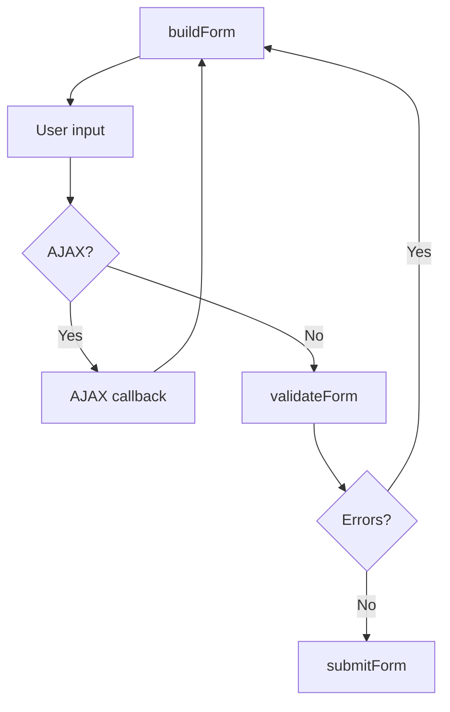

# Forms API

Drupal's Form API builds, validates, and submits HTML forms with CSRF protection, multistep state, and AJAX support. Forms are classes extending `FormBase` or `ConfigFormBase`, wired through routes or `hook_form()`.

## Form types in this section

| Guide | Base class | Use case |
|-------|-----------|----------|
| [Config Form](config-form.md) | `ConfigFormBase` | Admin settings stored in config |
| [Multi-step Form](multi-step-form.md) | `FormBase` | Wizards with persisted `$form_state` |
| [AJAX Form](ajax-form.md) | `FormBase` | Dynamic UI without full page reload |

## Minimal form example

### Route — `example_module.routing.yml`

```yaml
example_module.contact:
  path: '/example/contact'
  defaults:
    _form: '\Drupal\example_module\Form\ContactForm'
    _title: 'Contact us'
  requirements:
    _permission: 'access content'
```

### Form — `src/Form/ContactForm.php`

```php
<?php

declare(strict_types=1);

namespace Drupal\example_module\Form;

use Drupal\Core\Form\FormBase;
use Drupal\Core\Form\FormStateInterface;

/**
 * Simple contact form.
 */
final class ContactForm extends FormBase {

  /**
   * {@inheritdoc}
   */
  public function getFormId(): string {
    return 'example_module_contact';
  }

  /**
   * {@inheritdoc}
   */
  public function buildForm(array $form, FormStateInterface $form_state): array {
    $form['email'] = [
      '#type' => 'email',
      '#title' => $this->t('Email'),
      '#required' => TRUE,
    ];

    $form['message'] = [
      '#type' => 'textarea',
      '#title' => $this->t('Message'),
      '#required' => TRUE,
    ];

    $form['actions'] = ['#type' => 'actions'];
    $form['actions']['submit'] = [
      '#type' => 'submit',
      '#value' => $this->t('Send'),
    ];

    return $form;
  }

  /**
   * {@inheritdoc}
   */
  public function validateForm(array &$form, FormStateInterface $form_state): void {
    $email = (string) $form_state->getValue('email');
    if (!filter_var($email, FILTER_VALIDATE_EMAIL)) {
      $form_state->setErrorByName('email', $this->t('Enter a valid email address.'));
    }
  }

  /**
   * {@inheritdoc}
   */
  public function submitForm(array &$form, FormStateInterface $form_state): void {
    $this->messenger()->addStatus($this->t('Thank you for your message.'));
    $form_state->setRedirect('<front>');
  }

}
```

## Form lifecycle



## Common `#type` elements

| `#type` | Purpose |
|---------|---------|
| `textfield` | Single-line text |
| `textarea` | Multi-line text |
| `email` | Email with browser validation |
| `select` | Dropdown |
| `checkbox` / `checkboxes` | Boolean / multiple choice |
| `radios` | Single choice from set |
| `fieldset` | Group fields visually |
| `details` | Collapsible group |
| `vertical_tabs` | Tabbed field groups |
| `container` | Wrapper for AJAX replacement |
| `markup` | Static HTML |
| `item` | Read-only display value |

## Dependency injection in forms

```php
<?php

declare(strict_types=1);

namespace Drupal\example_module\Form;

use Drupal\Core\Entity\EntityTypeManagerInterface;
use Drupal\Core\Form\FormBase;
use Drupal\Core\Form\FormStateInterface;
use Symfony\Component\DependencyInjection\ContainerInterface;

final class NodePickerForm extends FormBase {

  public function __construct(
    private readonly EntityTypeManagerInterface $entityTypeManager,
  ) {}

  /**
   * {@inheritdoc}
   */
  public static function create(ContainerInterface $container): static {
    return new static(
      $container->get('entity_type.manager'),
    );
  }

  /**
   * {@inheritdoc}
   */
  public function getFormId(): string {
    return 'example_module_node_picker';
  }

  /**
   * {@inheritdoc}
   */
  public function buildForm(array $form, FormStateInterface $form_state): array {
    $options = [];
    $nodes = $this->entityTypeManager->getStorage('node')->loadMultiple();
    foreach ($nodes as $node) {
      $options[$node->id()] = $node->label();
    }

    $form['nid'] = [
      '#type' => 'select',
      '#title' => $this->t('Select article'),
      '#options' => $options,
      '#empty_option' => $this->t('- Select -'),
    ];

    $form['actions']['submit'] = ['#type' => 'submit', '#value' => $this->t('Save')];
    return $form;
  }

  /**
   * {@inheritdoc}
   */
  public function submitForm(array &$form, FormStateInterface $form_state): void {
    $this->messenger()->addStatus($this->t('Selected node @nid', [
      '@nid' => $form_state->getValue('nid'),
    ]));
  }

}
```

!!! tip "Form alter for contrib forms"
    Use `#[Hook('form_alter')]` to modify forms you do not own. Prefer plugins or events when altering your own forms.

!!! warning "Never trust user input"
    Validate in `validateForm()`. Sanitize on output with `#plain_text` or Twig auto-escaping — not on input.
