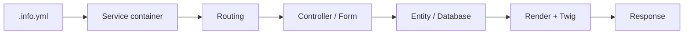

# Custom Modules

This section is a hands-on reference for building **production-grade Drupal 11 custom modules**. Every example uses `declare(strict_types=1);`, real YAML configuration, and patterns you can copy directly into `web/modules/custom/`.

## What you'll build

Throughout these chapters we use a single reference module named **`example_module`**. Each page extends that module with focused functionality:

| Chapter | What it covers |
|---------|----------------|
| [Module Structure](module-structure.md) | Full file tree, `.info.yml`, services, routing |
| [OOP & Legacy Hooks](hooks.md) | `#[Hook]` attribute classes and `.module` hooks |
| [Forms API](forms/index.md) | Config forms, multi-step wizards, AJAX |
| [Plugin System](plugins/index.md) | Blocks, queue workers, formatters, custom types |
| [Entity API](entities/index.md) | Content entities, config entities, custom storage |
| [Custom Field Types](custom-field-types.md) | Field type + widget + formatter end-to-end |
| [Batch API](batch-api.md) | Long-running operations with progress UI |
| [Queue API](queue-api.md) | Deferred background work |
| [Cron API](cron-api.md) | Scheduled tasks via `hook_cron` and services |
| [Database API](database-api.md) | `\Drupal::database()`, entity queries |
| [Twig & Theming](twig-theming.md) | Templates, preprocess, theme hooks |
| [Access & Permissions](access-permissions.md) | `permissions.yml`, custom access checks |
| [Drush Commands](drush-commands.md) | CLI commands with PHP 8 attributes |
| [Testing](testing.md) | Unit, Kernel, and Functional tests |

## Create the module skeleton

```bash
# From your project root (docroot = web/)
mkdir -p web/modules/custom/example_module/src
ddev drush en example_module -y
```

!!! tip "Enable debugging during development"
    Add `$settings['container_yamls'][] = DRUPAL_ROOT . '/sites/development.services.yml';` and set `twig.config: { debug: true }` in `development.services.yml` so template suggestions and cache behavior are visible while you theme.

## Conventions used in this section

- **Namespace:** `Drupal\example_module\...`
- **Machine name:** `example_module`
- **PHP:** 8.3+, `declare(strict_types=1);`, constructor property promotion, `final` classes where extension is not intended
- **Hooks:** Prefer OOP `#[Hook]` classes in `src/Hook/` (Drupal 11.1+); legacy procedural hooks are shown where still common
- **Services:** Defined in `example_module.services.yml` with explicit arguments — no static `\Drupal::` calls inside services
- **Permissions:** Declared in `example_module.permissions.yml` and enforced in controllers, forms, and access check services

## Module lifecycle at a glance



## Related reading

- [Modern PHP Standards](../intro/modern-php.md) — strict types, attributes, enums
- [Service Container](../dependency-injection/service-container.md) — how Drupal wires services
- [Plugin System](../internals/plugin-system.md) — discovery and plugin managers
- [Entity System](../internals/entity-system.md) — entity types, fields, storage
