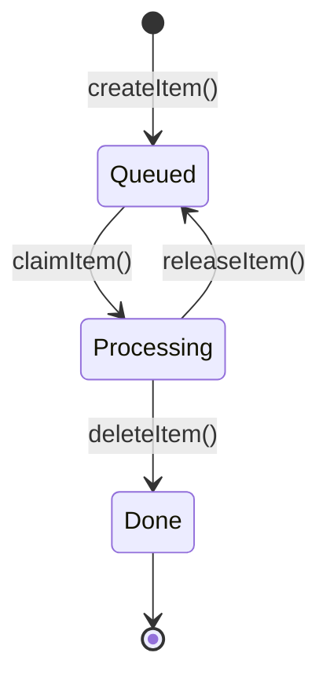

# Queue API

The Queue API defers work to background processors. Unlike Batch API (user-facing progress), queues are processed by cron or Drush without blocking the current request.

## Enqueue from a controller

```php
<?php

declare(strict_types=1);

namespace Drupal\example_module\Controller;

use Drupal\Core\Controller\ControllerBase;
use Drupal\Core\Queue\QueueFactory;
use Symfony\Component\DependencyInjection\ContainerInterface;

final class QueueDemoController extends ControllerBase {

  public function __construct(
    private readonly QueueFactory $queueFactory,
  ) {}

  /**
   * {@inheritdoc}
   */
  public static function create(ContainerInterface $container): static {
    return new static($container->get('queue'));
  }

  public function enqueue(): array {
    $queue = $this->queueFactory->get('example_module_email');

    for ($i = 0; $i < 5; $i++) {
      $queue->createItem([
        'to' => 'user@example.com',
        'subject' => "Notification $i",
        'body' => 'Queued message body.',
      ]);
    }

    $this->messenger()->addStatus($this->t('Queued 5 items. Run drush queue:run example_module_email'));

    return ['#markup' => ''];
  }

}
```

---

## Queue service wrapper — `src/Service/QueueManager.php`

```php
<?php

declare(strict_types=1);

namespace Drupal\example_module\Service;

use Drupal\Core\Queue\QueueFactory;
use Drupal\Core\Queue\QueueInterface;

/**
 * High-level queue operations for example_module.
 */
final class QueueManager {

  public function __construct(
    private readonly QueueFactory $queueFactory,
  ) {}

  public function getEmailQueue(): QueueInterface {
    return $this->queueFactory->get('example_module_email');
  }

  /**
   * @param array{to: string, subject: string, body: string} $payload
   */
  public function enqueueEmail(array $payload): void {
    $this->getEmailQueue()->createItem($payload);
  }

  public function getItemCount(): int {
    return $this->getEmailQueue()->numberOfItems();
  }

  /**
   * Claims and processes a single item (useful in tests).
   */
  public function processOne(): bool {
    $queue = $this->getEmailQueue();
    if ($item = $queue->claimItem()) {
      try {
        $worker = \Drupal::service('plugin.manager.queue_worker')
          ->createInstance('example_module_email');
        $worker->processItem($item->data);
        $queue->deleteItem($item);
        return TRUE;
      }
      catch (\Throwable $e) {
        $queue->releaseItem($item);
        throw $e;
      }
    }
    return FALSE;
  }

}
```

---

## Manual processing loop

```php
<?php

declare(strict_types=1);

$queue = \Drupal::queue('example_module_email');
$worker = \Drupal::service('plugin.manager.queue_worker')->createInstance('example_module_email');
$end = time() + 60;

while (time() < $end && ($item = $queue->claimItem())) {
  try {
    $worker->processItem($item->data);
    $queue->deleteItem($item);
  }
  catch (\Throwable $e) {
    $queue->releaseItem($item);
    \Drupal::logger('example_module')->error($e->getMessage());
    break;
  }
}
```

---

## Queue worker

See [Queue Workers](plugins/queue-workers.md) for the `#[QueueWorker]` plugin implementation.

---

## Drush commands

```bash
# List all queues
ddev drush queue:list

# Process one queue until empty or time limit
ddev drush queue:run example_module_email

# Delete all items (dangerous)
ddev drush queue:delete example_module_email
```

---

## Reliable vs unreliable queues

```php
<?php

declare(strict_types=1);

use Drupal\Core\Queue\QueueFactory;

/** @var QueueFactory $factory */
$factory = \Drupal::service('queue');

// Reliable: uses $settings['queue_reliable_service_example_module_email']
// if set, otherwise falls through to the defaults below.
$reliable = $factory->get('example_module_email', TRUE);

// Unreliable (the default for get() and \Drupal::queue()): uses
// $settings['queue_service_example_module_email'], then
// $settings['queue_default'], then 'queue.database'.
$unreliable = $factory->get('example_module_email', FALSE);
```

| Flag | Default backend | Guarantee |
|------|-----------------|-----------|
| `TRUE` | `queue.database` (persistent) | Backend must preserve order and deliver each item at least once |
| `FALSE` | `queue.database` (persistent) | No ordering or delivery guarantee required — lets you swap in a faster backend (e.g. Redis) |

With core alone both calls return the same persistent `DatabaseQueue`; the flag only matters once alternative queue backends are configured.

---

## Queue item lifecycle



!!! warning "Claim lease"
    If `processItem()` throws or times out, call `releaseItem()` so another worker can retry. A claim lasts for the lease passed to `claimItem($lease_time)` — `DatabaseQueue` defaults to 30 seconds, and cron claims with the worker's `cron: ['time' => N]`. Expired leases are reset by `DatabaseQueue::garbageCollection()` during system cron.

!!! tip "Batch vs queue"
    Use **Batch API** when a user waits for progress. Use **Queue API** when work can happen asynchronously via cron.
