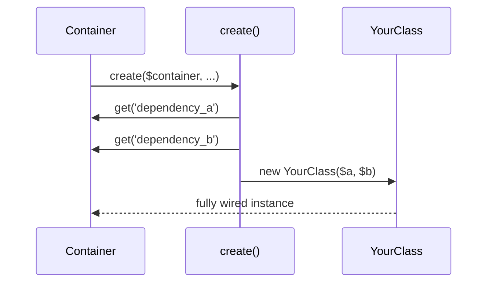

# Constructor Injection

Drupal wires most injectable objects — controllers, forms, event subscribers, plugins — through constructor injection. The container calls `create()` (a static factory) or the constructor directly, passing resolved dependencies. This page covers the patterns you use daily in Drupal 11 custom code.

## The pattern



## Controllers

Controllers must implement `create()` because Drupal instantiates them per route:

```php
<?php

declare(strict_types=1);

namespace Drupal\my_module\Controller;

use Drupal\Core\Controller\ControllerBase;
use Drupal\my_module\Service\ProductManager;
use Symfony\Component\DependencyInjection\ContainerInterface;
use Symfony\Component\HttpFoundation\JsonResponse;

final class ProductApiController extends ControllerBase {

  public function __construct(
    private readonly ProductManager $productManager,
  ) {}

  public static function create(ContainerInterface $container): static {
    return new static(
      $container->get('my_module.product_manager'),
    );
  }

  public function count(): JsonResponse {
    return new JsonResponse([
      'published' => $this->productManager->countPublished(),
    ]);
  }

}
```

```yaml
# No controller entry in services.yml — routing references the class directly.
# my_module.routing.yml
# defaults._controller: '\Drupal\my_module\Controller\ProductApiController::count'
```

!!! note "ControllerBase shortcuts"
    `ControllerBase` already provides `$this->entityTypeManager()`, `$this->config()`, etc. Inject custom services; use parent shortcuts for common core services only when it keeps code clean.

## Forms

Form classes use the same `create()` pattern:

```php
<?php

declare(strict_types=1);

namespace Drupal\my_module\Form;

use Drupal\Core\Form\FormBase;
use Drupal\Core\Form\FormStateInterface;
use Drupal\my_module\Service\ProductManager;
use Symfony\Component\DependencyInjection\ContainerInterface;

final class ProductSettingsForm extends FormBase {

  public function __construct(
    private readonly ProductManager $productManager,
  ) {}

  public static function create(ContainerInterface $container): static {
    return new static(
      $container->get('my_module.product_manager'),
    );
  }

  public function getFormId(): string {
    return 'my_module_product_settings';
  }

  public function buildForm(array $form, FormStateInterface $form_state): array {
    $form['sync_enabled'] = [
      '#type' => 'checkbox',
      '#title' => $this->t('Enable automatic sync'),
      '#default_value' => $this->config('my_module.settings')->get('sync_enabled'),
    ];
    $form['product_count'] = [
      '#type' => 'item',
      '#title' => $this->t('Published products'),
      '#markup' => (string) $this->productManager->countPublished(),
    ];
    $form['actions']['submit'] = ['#type' => 'submit', '#value' => $this->t('Save')];
    return $form;
  }

  public function submitForm(array &$form, FormStateInterface $form_state): void {
    $this->configFactory()->getEditable('my_module.settings')
      ->set('sync_enabled', (bool) $form_state->getValue('sync_enabled'))
      ->save();
    $this->messenger()->addStatus($this->t('Settings saved.'));
  }

}
```

## Plugins: ContainerFactoryPluginInterface

```php
<?php

declare(strict_types=1);

namespace Drupal\my_module\Plugin\QueueWorker;

use Drupal\Core\Plugin\ContainerFactoryPluginInterface;
use Drupal\Core\Queue\QueueWorkerBase;
use Drupal\my_module\Service\ProductSyncService;
use Drupal\Core\Queue\Attribute\QueueWorker;
use Drupal\Core\StringTranslation\TranslatableMarkup;
use Symfony\Component\DependencyInjection\ContainerInterface;

#[QueueWorker(
  id: 'my_module_product_sync',
  title: new TranslatableMarkup('Product sync worker'),
  cron: ['time' => 60],
)]
final class ProductSyncQueueWorker extends QueueWorkerBase implements ContainerFactoryPluginInterface {

  public function __construct(
    array $configuration,
    $plugin_id,
    $plugin_definition,
    private readonly ProductSyncService $syncService,
  ) {
    parent::__construct($configuration, $plugin_id, $plugin_definition);
  }

  public static function create(ContainerInterface $container, array $configuration, $plugin_id, $plugin_definition): static {
    return new static(
      $configuration,
      $plugin_id,
      $plugin_definition,
      $container->get('my_module.sync_service'),
    );
  }

  public function processItem($data): void {
    $this->syncService->syncProduct($data['sku']);
  }

}
```

## Plain services

Services defined in YAML receive constructor arguments automatically — no `create()` needed:

```yaml
services:
  my_module.order_processor:
    class: Drupal\my_module\Service\OrderProcessor
    arguments:
      - '@my_module.product_manager'
      - '@my_module.price_calculator'
      - '@logger.channel.my_module'
```

```php
<?php

declare(strict_types=1);

namespace Drupal\my_module\Service;

use Psr\Log\LoggerInterface;

final class OrderProcessor {

  public function __construct(
    private readonly ProductManager $productManager,
    private readonly PriceCalculatorInterface $priceCalculator,
    private readonly LoggerInterface $logger,
  ) {}

  public function processOrder(array $lineItems): float {
    $total = 0.0;
    foreach ($lineItems as $item) {
      $product = $this->productManager->loadBySku($item['sku']);
      if ($product) {
        $total += $this->priceCalculator->calculate(
          (float) $product->get('price')->value * $item['qty'],
          0.08,
        );
      }
    }
    $this->logger->info('Processed order total: @total', ['@total' => $total]);
    return $total;
  }

}
```

## Constructor property promotion

Use PHP 8 constructor promotion with `readonly` for immutable dependencies:

```php
<?php

declare(strict_types=1);

final class ProductExporter {

  public function __construct(
    private readonly EntityTypeManagerInterface $entityTypeManager,
    private readonly ClientInterface $httpClient,
    private readonly LoggerInterface $logger,
    private readonly string $exportEndpoint,
  ) {}

}
```

Pass the string parameter from YAML:

```yaml
services:
  my_module.product_exporter:
    class: Drupal\my_module\Service\ProductExporter
    arguments:
      - '@entity_type.manager'
      - '@http_client'
      - '@logger.channel.my_module'
      - 'https://warehouse.example.com/import'
```

## #[Autowire] attribute (Drupal 11)

Symfony's `#[Autowire]` attribute reduces boilerplate in service classes:

```php
<?php

declare(strict_types=1);

namespace Drupal\my_module\Service;

use Drupal\Core\Entity\EntityTypeManagerInterface;
use Psr\Log\LoggerInterface;
use Symfony\Component\DependencyInjection\Attribute\Autowire;

final class AutowiredProductManager {

  public function __construct(
    #[Autowire(service: 'entity_type.manager')]
    private readonly EntityTypeManagerInterface $entityTypeManager,

    #[Autowire(service: 'logger.channel.my_module')]
    private readonly LoggerInterface $logger,

    #[Autowire(param: 'my_module.export_endpoint')]
    private readonly string $exportEndpoint,
  ) {}

  public function getExportEndpoint(): string {
    return $this->exportEndpoint;
  }

}
```

```yaml
parameters:
  my_module.export_endpoint: 'https://api.example.com/export'

services:
  my_module.autowired_product_manager:
    class: Drupal\my_module\Service\AutowiredProductManager
    autowire: true
```

!!! tip "Explicit YAML vs autowire"
    Drupal core predominantly uses explicit `arguments:` in YAML. Autowire works but explicit definitions are easier to grep and debug in multi-module projects.

## Optional dependencies

```php
<?php

declare(strict_types=1);

namespace Drupal\my_module\Service;

use Drupal\search_api\Entity\Index;
use Psr\Log\LoggerInterface;

final class ProductIndexer {

  public function __construct(
    private readonly LoggerInterface $logger,
    private readonly ?Index $searchIndex = NULL,
  ) {}

  public function index(int $productId): void {
    if ($this->searchIndex === NULL) {
      $this->logger->warning('Search API not configured — skipping index.');
      return;
    }
  }

}
```

```yaml
services:
  my_module.product_indexer:
    class: Drupal\my_module\Service\ProductIndexer
    arguments:
      - '@logger.channel.my_module'
      - '@?search_api.index.products'
```

The `@?` prefix means "inject NULL if service does not exist."

## Testing with injected mocks

```php
<?php

declare(strict_types=1);

namespace Drupal\Tests\my_module\Unit\Service;

use Drupal\Core\Entity\EntityStorageInterface;
use Drupal\Core\Entity\EntityTypeManagerInterface;
use Drupal\Core\Entity\Query\QueryInterface;
use Drupal\my_module\Service\ProductManager;
use Drupal\Tests\UnitTestCase;
use PHPUnit\Framework\MockObject\MockObject;

/**
 * @coversDefaultClass \Drupal\my_module\Service\ProductManager
 * @group my_module
 */
final class ProductManagerTest extends UnitTestCase {

  private EntityTypeManagerInterface&MockObject $entityTypeManager;
  private EntityStorageInterface&MockObject $storage;

  protected function setUp(): void {
    parent::setUp();
    $this->entityTypeManager = $this->createMock(EntityTypeManagerInterface::class);
    $this->storage = $this->createMock(EntityStorageInterface::class);
    $this->entityTypeManager->method('getStorage')->with('product')->willReturn($this->storage);
  }

  public function testLoadBySkuReturnsNullWhenNotFound(): void {
    $query = $this->createMock(QueryInterface::class);
    $query->method('accessCheck')->willReturnSelf();
    $query->method('condition')->willReturnSelf();
    $query->method('range')->willReturnSelf();
    $query->method('execute')->willReturn([]);
    $this->storage->method('getQuery')->willReturn($query);

    $manager = new ProductManager($this->entityTypeManager);
    $this->assertNull($manager->loadBySku('MISSING-SKU'));
  }

}
```

## Checklist for new classes

1. List every external dependency the class needs
2. Add typed constructor parameters (`private readonly` where possible)
3. For controllers/forms/plugins: add `public static function create(ContainerInterface $container)`
4. Register services in `*.services.yml` with `@` references
5. Run `drush cr`
6. Verify: `drush php:eval "echo get_class(\Drupal::service('your.service'));"`

## Related reading

- [Service Definitions](service-definitions.md) — YAML reference
- [What DI Solves](what-di-solves.md) — why avoid `\Drupal::`
- [Service Decoration](service-decoration.md) — wrapping services
