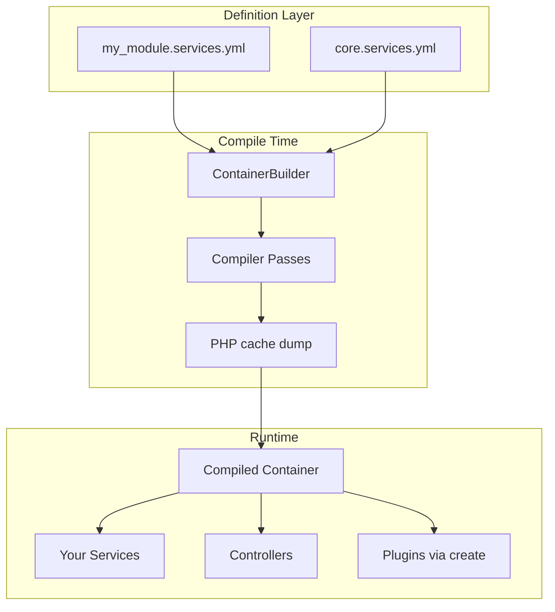

# Dependency Injection

Dependency Injection (DI) is how Drupal wires objects together. Instead of classes creating their own dependencies, the **service container** constructs objects and injects what they need. Every custom module you write should define services in `*.services.yml` and receive dependencies through constructors.

## Chapters

- **[What DI Solves](what-di-solves.md)** — problems with static `\Drupal::` calls vs proper injection
- **[Service Container](service-container.md)** — `ContainerBuilder`, compiled container, cache
- **[Service Definitions](service-definitions.md)** — `*.services.yml` reference with full examples
- **[Constructor Injection](constructor-injection.md)** — `create()` factory, `#[Autowire]` attribute
- **[Service Decoration](service-decoration.md)** — the `decorates` key, real-world patterns
- **[Tagged Services](tagged-services.md)** — tags, compiler passes, collector services

## DI in the Drupal stack



## Minimal example

**Service class:**

```php
<?php

declare(strict_types=1);

namespace Drupal\my_module\Service;

use Drupal\Core\Entity\EntityTypeManagerInterface;

final class ProductManager {

  public function __construct(
    private readonly EntityTypeManagerInterface $entityTypeManager,
  ) {}

  public function countPublished(): int {
    return (int) $this->entityTypeManager
      ->getStorage('product')
      ->getQuery()
      ->accessCheck(FALSE)
      ->condition('status', 1)
      ->count()
      ->execute();
  }

}
```

**Service definition:**

```yaml
# my_module.services.yml
services:
  my_module.product_manager:
    class: Drupal\my_module\Service\ProductManager
    arguments: ['@entity_type.manager']
```

**Usage in a controller:**

```php
<?php

declare(strict_types=1);

namespace Drupal\my_module\Controller;

use Drupal\Core\Controller\ControllerBase;
use Drupal\my_module\Service\ProductManager;
use Symfony\Component\DependencyInjection\ContainerInterface;
use Symfony\Component\HttpFoundation\JsonResponse;

final class StatsController extends ControllerBase {

  public function __construct(
    private readonly ProductManager $productManager,
  ) {}

  public static function create(ContainerInterface $container): static {
    return new static(
      $container->get('my_module.product_manager'),
    );
  }

  public function stats(): JsonResponse {
    return new JsonResponse([
      'published_products' => $this->productManager->countPublished(),
    ]);
  }

}
```

## Service naming conventions

| Pattern | Example | Notes |
|---------|---------|-------|
| `{module}.{name}` | `my_module.product_manager` | Standard service ID |
| `logger.channel.{module}` | `logger.channel.my_module` | Module-specific logger |
| `plugin.manager.{type}` | `plugin.manager.block` | Plugin managers |
| `@` prefix in YAML | `@entity_type.manager` | Reference another service |

## When to define a service

Define a service when logic is:

- Reused across controllers, forms, and plugins
- Needs testable dependencies
- Performs I/O (HTTP, queue, external APIs)
- Has state independent of a single request artifact

Keep as plain methods or value objects when logic is trivial and used in one place only.

!!! tip "Start with the constructor"
    If a class needs `\Drupal::service()` more than once, convert it to a service with constructor injection. See [What DI Solves](what-di-solves.md) for the full rationale.

## Related sections

- [Drupal Internals: Service Container](../internals/service-container.md) — kernel-level container build
- [Symfony Foundation](../intro/symfony-foundation.md) — Symfony DI component overview
- [Custom Modules](../custom-coding/index.md) — applying DI in real modules
