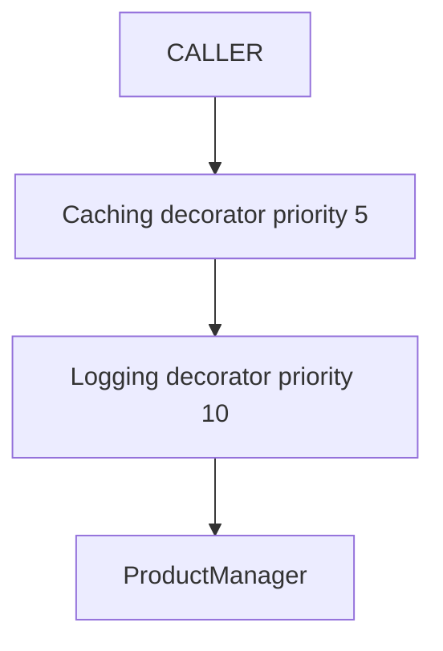

# Service Decoration

Service decoration lets you wrap an existing service with new behavior without modifying the original class or every caller. The decorator receives the inner service as `@.inner` and delegates to it by default, overriding only the methods you need.

## How decoration works


At compile time, Drupal replaces the original service ID with the decorator. The original is available only as `@.inner` inside the decorator.

## Basic example: caching wrapper

Wrap a product manager to add request-level caching:

```yaml
# my_module.services.yml
services:
  my_module.product_manager:
    class: Drupal\my_module\Service\ProductManager
    arguments: ['@entity_type.manager']

  my_module.product_manager.cached:
    class: Drupal\my_module\Service\CachedProductManager
    decorates: my_module.product_manager
    arguments: ['@.inner', '@cache.default']
```

```php
<?php

declare(strict_types=1);

namespace Drupal\my_module\Service;

use Drupal\Core\Cache\CacheBackendInterface;

/**
 * Decorates ProductManager with static request cache.
 */
final class CachedProductManager implements ProductManagerInterface {

  private array $skuCache = [];

  public function __construct(
    private readonly ProductManagerInterface $inner,
    private readonly CacheBackendInterface $cache,
  ) {}

  public function loadBySku(string $sku): ?Product {
    if (isset($this->skuCache[$sku])) {
      return $this->skuCache[$sku];
    }

    $cid = "my_module:sku:{$sku}";
    if ($cached = $this->cache->get($cid)) {
      $this->skuCache[$sku] = $cached->data;
      return $cached->data;
    }

    $product = $this->inner->loadBySku($sku);
    $this->cache->set($cid, $product, time() + 3600, ['product_list']);
    $this->skuCache[$sku] = $product;

    return $product;
  }

  public function countPublished(): int {
    return $this->inner->countPublished();
  }

}
```

Callers still use `my_module.product_manager` — they receive the cached decorator transparently:

```php
<?php

declare(strict_types=1);

// This resolves to CachedProductManager, which delegates to ProductManager.
$manager = \Drupal::service('my_module.product_manager');
$product = $manager->loadBySku('WIDGET-001');
```

## Interface requirement

Decorators should implement the same interface as the inner service:

```php
<?php

declare(strict_types=1);

namespace Drupal\my_module\Service;

use Drupal\my_module\Entity\Product;

interface ProductManagerInterface {
  public function loadBySku(string $sku): ?Product;
  public function countPublished(): int;
}
```

```yaml
services:
  Drupal\my_module\Service\ProductManagerInterface: '@my_module.product_manager'
```

## Logging decorator

A common pattern — log all calls without changing business logic:

```yaml
services:
  my_module.sync_service:
    class: Drupal\my_module\Service\ProductSyncService
    arguments:
      - '@entity_type.manager'
      - '@http_client'
      - '@logger.channel.my_module'

  my_module.sync_service.logging:
    class: Drupal\my_module\Service\LoggingProductSyncService
    decorates: my_module.sync_service
    decoration_priority: 10
    arguments:
      - '@.inner'
      - '@logger.channel.my_module'
```

```php
<?php

declare(strict_types=1);

namespace Drupal\my_module\Service;

use Psr\Log\LoggerInterface;

final class LoggingProductSyncService implements ProductSyncServiceInterface {

  public function __construct(
    private readonly ProductSyncServiceInterface $inner,
    private readonly LoggerInterface $logger,
  ) {}

  public function sync(): int {
    $start = microtime(TRUE);
    $this->logger->info('Product sync started');

    try {
      $count = $this->inner->sync();
      $duration = round(microtime(TRUE) - $start, 2);
      $this->logger->info('Product sync completed: @count items in @duration s', [
        '@count' => $count,
        '@duration' => $duration,
      ]);
      return $count;
    }
    catch (\Throwable $e) {
      $this->logger->error('Product sync failed: @message', ['@message' => $e->getMessage()]);
      throw $e;
    }
  }

  public function syncProduct(string $sku): void {
    $this->logger->debug('Syncing SKU @sku', ['@sku' => $sku]);
    $this->inner->syncProduct($sku);
  }

}
```

## Decoration priority

Multiple decorators can wrap the same service. `decoration_priority` controls ordering: higher priorities are applied earlier, so they sit closer to the original service (innermost). The lowest priority ends up outermost:



```yaml
services:
  my_module.product_manager.cache:
    class: Drupal\my_module\Service\CachedProductManager
    decorates: my_module.product_manager
    decoration_priority: 5
    arguments: ['@.inner', '@cache.default']

  my_module.product_manager.logging:
    class: Drupal\my_module\Service\LoggingProductManager
    decorates: my_module.product_manager
    decoration_priority: 10
    arguments: ['@.inner', '@logger.channel.my_module']
```

Call flow: `CachedProductManager` → `LoggingProductManager` → `ProductManager` (cache hits are not logged). To log every call, give the logging decorator the lower priority.

## Decoration inner name

Override the inner reference name when needed:

```yaml
services:
  my_module.api_client.metrics:
    class: Drupal\my_module\Http\MetricsApiClient
    decorates: my_module.api_client
    decoration_inner_name: my_module.api_client.original
    arguments: ['@my_module.api_client.original', '@stats_collector']
```

## Disabling a decorator

Conditionally disable decoration via service provider:

```php
<?php

declare(strict_types=1);

namespace Drupal\my_module;

use Drupal\Core\DependencyInjection\ContainerBuilder;
use Drupal\Core\DependencyInjection\ServiceProviderInterface;

final class MyModuleServiceProvider implements ServiceProviderInterface {

  public function register(ContainerBuilder $container): void {
    if (!$container->getParameter('my_module.enable_caching_decorator')) {
      $container->removeDefinition('my_module.product_manager.cached');
    }
  }

}
```

```yaml
parameters:
  my_module.enable_caching_decorator: true
```

## Decoration vs inheritance

| Approach | When to use |
|----------|-------------|
| Decoration | Add cross-cutting behavior (cache, log, metrics) |
| Subclass | Replace core behavior entirely (rare, prefer events) |
| Event subscriber | React to actions without wrapping services |
| Custom service | New business logic unrelated to existing service |

!!! warning "Do not decorate core services lightly"
    Decorating `entity_type.manager` or `cache.default` affects the entire site. Prefer decorating your own module's services unless you fully understand the blast radius.

## Core decoration examples

Drupal core decorates several services. Study these patterns:

```bash
# Find decorators in core
grep -r "decorates:" web/core/modules --include="*.services.yml" | head -10
```

Common core patterns:

- Cache backend chaining
- Logger channel decoration
- Middleware wrapping HttpKernel (same idea, but wired by the `http_middleware` tag rather than `decorates:`)

## Verify decoration

```bash
drush php:eval "
\$service = \Drupal::service('my_module.product_manager');
echo get_class(\$service) . PHP_EOL;
"

# Expected: Drupal\my_module\Service\CachedProductManager
# (not ProductManager — the decorator is the public face)
```

```bash
drush cr  # Required after adding/changing decorators
```

## Related reading

- [Tagged Services](tagged-services.md) — alternative extension via compiler passes
- [Service Definitions](service-definitions.md) — full YAML reference
- [What DI Solves](what-di-solves.md) — when to extract vs decorate
