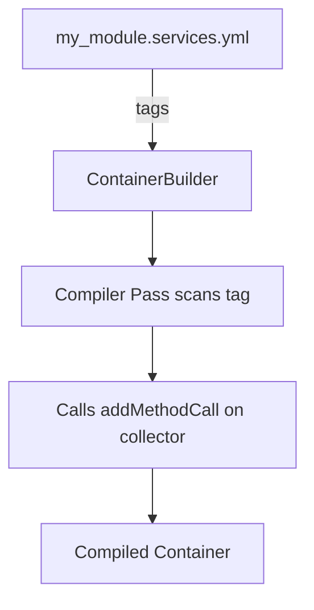
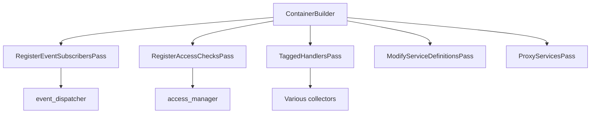

# Tagged Services

Tags attach metadata to service definitions. **Compiler passes** scan tagged services at container compile time and wire them into collector services — event dispatchers, access managers, middleware stacks, and paramconverter registries all use this pattern.

## How tags work



```yaml
services:
  my_module.event_subscriber:
    class: Drupal\my_module\EventSubscriber\ProductSubscriber
    tags:
      - { name: event_subscriber }
```

At compile time, `RegisterEventSubscribersPass` finds all `event_subscriber` tags and registers them with `event_dispatcher`.

## Common Drupal tags

| Tag | Collector | Purpose |
|-----|-----------|---------|
| `event_subscriber` | `event_dispatcher` | Symfony event listeners |
| `access_check` | `access_manager` | Route access checkers |
| `http_middleware` | `http_middleware` | Request/response middleware |
| `paramconverter` | `paramconverter_manager` | Route parameter upcasting |
| `cache_context` | `cache_contexts_manager` | Cache context plugins |
| `logger` | `logger.factory` | PSR-3 loggers |
| `drush.command` | Drush command discovery | CLI commands |
| `service_collector` | Custom collectors | Generic tag aggregation |

## Event subscribers

The most common tag in custom modules:

```yaml
services:
  my_module.product_subscriber:
    class: Drupal\my_module\EventSubscriber\ProductSubscriber
    arguments:
      - '@queue'
      - '@logger.channel.my_module'
    tags:
      - { name: event_subscriber }
```

```php
<?php

declare(strict_types=1);

namespace Drupal\my_module\EventSubscriber;

use Drupal\Core\Queue\QueueFactory;
use Drupal\node\NodeInterface;
use Psr\Log\LoggerInterface;
use Symfony\Component\EventDispatcher\EventSubscriberInterface;
use Symfony\Component\HttpKernel\Event\ResponseEvent;
use Symfony\Component\HttpKernel\KernelEvents;

final class ProductSubscriber implements EventSubscriberInterface {

  public function __construct(
    private readonly QueueFactory $queueFactory,
    private readonly LoggerInterface $logger,
  ) {}

  public function onResponse(ResponseEvent $event): void {
    if (!$event->isMainRequest()) {
      return;
    }
    $request = $event->getRequest();
    $node = $request->attributes->get('node');
    if ($node instanceof NodeInterface && $node->bundle() === 'product') {
      $this->queueFactory->get('my_module_product_sync')->createItem(['nid' => $node->id()]);
      $this->logger->debug('Queued sync for node @nid', ['@nid' => $node->id()]);
    }
  }

  public static function getSubscribedEvents(): array {
    return [
      KernelEvents::RESPONSE => ['onResponse', -50],
    ];
  }

}
```

## Access check tags

```yaml
services:
  my_module.role_access_check:
    class: Drupal\my_module\Access\RoleAccessCheck
    tags:
      - { name: access_check, applies_to: _my_module_role }
```

```php
<?php

declare(strict_types=1);

namespace Drupal\my_module\Access;

use Drupal\Core\Access\AccessResult;
use Drupal\Core\Routing\Access\AccessInterface;
use Drupal\Core\Session\AccountInterface;
use Symfony\Component\Routing\Route;

final class RoleAccessCheck implements AccessInterface {

  public function access(Route $route, AccountInterface $account): AccessResult {
    $required_role = $route->getRequirement('_my_module_role');
    return AccessResult::allowedIf(
      in_array($required_role, $account->getRoles(), TRUE),
    )->addCacheContexts(['user.roles']);
  }

}
```

```yaml
# my_module.routing.yml
my_module.manager_dashboard:
  path: '/admin/products/dashboard'
  defaults:
    _controller: '\Drupal\my_module\Controller\DashboardController::view'
  requirements:
    _my_module_role: 'product_manager'
```

The `applies_to` key links the checker to routes using `_my_module_role` in requirements.

## HTTP middleware tags

```yaml
services:
  my_module.cors_middleware:
    class: Drupal\my_module\StackMiddleware\CorsMiddleware
    tags:
      - { name: http_middleware, priority: 250 }
    arguments: ['@config.factory']
```

```php
<?php

declare(strict_types=1);

namespace Drupal\my_module\StackMiddleware;

use Drupal\Core\Config\ConfigFactoryInterface;
use Symfony\Component\HttpFoundation\Request;
use Symfony\Component\HttpFoundation\Response;
use Symfony\Component\HttpKernel\HttpKernelInterface;

final class CorsMiddleware implements HttpKernelInterface {

  public function __construct(
    private readonly HttpKernelInterface $httpKernel,
    private readonly ConfigFactoryInterface $configFactory,
  ) {}

  public function handle(Request $request, int $type = self::MAIN_REQUEST, bool $catch = TRUE): Response {
    $response = $this->httpKernel->handle($request, $type, $catch);

    $origins = $this->configFactory->get('my_module.settings')->get('allowed_origins') ?? [];
    $origin = $request->headers->get('Origin');
    if ($origin && in_array($origin, $origins, TRUE)) {
      $response->headers->set('Access-Control-Allow-Origin', $origin);
      $response->headers->set('Access-Control-Allow-Methods', 'GET, POST, PATCH, DELETE');
    }

    return $response;
  }

}
```

Higher `priority` = runs earlier on the request path (outer layer of the onion).

## Custom tagged services with collector

Define your own tag and collector for a plugin-like registry:

```yaml
services:
  my_module.processor_collector:
    class: Drupal\my_module\ProcessorCollector
    tags:
      - { name: service_collector, tag: my_module.processor, call: addProcessor }

  my_module.csv_processor:
    class: Drupal\my_module\Processor\CsvProcessor
    tags:
      - { name: my_module.processor, priority: 10 }

  my_module.json_processor:
    class: Drupal\my_module\Processor\JsonProcessor
    tags:
      - { name: my_module.processor, priority: 20 }
```

```php
<?php

declare(strict_types=1);

namespace Drupal\my_module;

use Drupal\my_module\Processor\ProcessorInterface;

final class ProcessorCollector {

  /** @var \Drupal\my_module\Processor\ProcessorInterface[] */
  private array $processors = [];

  public function addProcessor(ProcessorInterface $processor): void {
    $this->processors[] = $processor;
  }

  public function process(string $format, string $data): array {
    foreach ($this->processors as $processor) {
      if ($processor->supports($format)) {
        return $processor->process($data);
      }
    }
    throw new \InvalidArgumentException("No processor for format: {$format}");
  }

}
```

```php
<?php

declare(strict_types=1);

namespace Drupal\my_module\Processor;

final class JsonProcessor implements ProcessorInterface {

  public function supports(string $format): bool {
    return $format === 'json';
  }

  public function process(string $data): array {
    return json_decode($data, TRUE, 512, JSON_THROW_ON_ERROR);
  }

}
```

The `service_collector` tag tells Drupal's `TaggedHandlersPass` to call `addProcessor` on the collector for every `my_module.processor` tagged service.

## Tag attributes

Tags accept arbitrary key-value attributes passed to the compiler pass:

```yaml
services:
  my_module.cache_context.user_tier:
    class: Drupal\my_module\Cache\Context\UserTierCacheContext
    tags:
      - { name: cache_context, context_id: 'user.my_module_tier' }
```

```yaml
services:
  my_module.param_converter:
    class: Drupal\my_module\ParamConverter\SkuParamConverter
    tags:
      - { name: paramconverter, priority: 5 }
```

| Attribute | Used by | Meaning |
|-----------|---------|---------|
| `priority` | Most collectors | Higher runs first |
| `applies_to` | `access_check` | Requirement key name |
| `context_id` | `cache_context` | Cache context ID string |
| `responder` | `http_middleware` | Also run on response path |
| `provider` | Various | Provider grouping |

## Compiler passes in core

Drupal registers these passes in `DrupalKernel`:



Custom modules rarely register compiler passes. Use existing tags or `hook_module_implements_alter`-style service providers instead.

## Custom compiler pass (advanced)

When tags are insufficient, register a compiler pass:

```php
<?php

declare(strict_types=1);

namespace Drupal\my_module\DependencyInjection;

use Drupal\my_module\MyModuleCompilerPass;
use Drupal\Core\DependencyInjection\ContainerBuilder;
use Drupal\Core\DependencyInjection\ServiceProviderInterface;

final class MyModuleServiceProvider implements ServiceProviderInterface {

  public function register(ContainerBuilder $container): void {
    $container->addCompilerPass(new MyModuleCompilerPass());
  }

}
```

```php
<?php

declare(strict_types=1);

namespace Drupal\my_module;

use Symfony\Component\DependencyInjection\Compiler\CompilerPassInterface;
use Symfony\Component\DependencyInjection\ContainerBuilder;

final class MyModuleCompilerPass implements CompilerPassInterface {

  public function process(ContainerBuilder $container): void {
    if (!$container->hasDefinition('my_module.processor_collector')) {
      return;
    }
    $definition = $container->getDefinition('my_module.processor_collector');
    $tagged = $container->findTaggedServiceIds('my_module.processor');

  }

}
```

!!! warning "Compiler passes run at cache rebuild"
    Errors in compiler passes break `drush cr`. Test changes locally before deploying.

## Inspecting tagged services

```bash
# List event subscribers (via devel)
drush php:eval "
\$container = \Drupal::getContainer();
\$ids = \$container->getServiceIds();
foreach (\$ids as \$id) {
  if (str_contains(\$id, 'my_module')) {
    echo \$id . PHP_EOL;
  }
}
"

# Verify subscriber is registered
drush php:eval "
\$dispatcher = \Drupal::service('event_dispatcher');
\$listeners = \$dispatcher->getListeners('kernel.response');
echo count(\$listeners) . ' kernel.response listeners' . PHP_EOL;
"
```

## Drush command tags

```yaml
# drush.services.yml (module root)
services:
  my_module.commands:
    class: Drupal\my_module\Commands\ProductCommands
    arguments: ['@my_module.product_manager']
    tags:
      - { name: drush.command }
```

```php
<?php

declare(strict_types=1);

namespace Drupal\my_module\Commands;

use Drupal\my_module\Service\ProductManager;
use Drush\Attributes as CLI;
use Drush\Commands\DrushCommands;

final class ProductCommands extends DrushCommands {

  public function __construct(
    private readonly ProductManager $productManager,
  ) {
    parent::__construct();
  }

  #[CLI\Command(name: 'my-module:product-count')]
  public function count(): void {
    $count = $this->productManager->countPublished();
    $this->io()->success("Published products: {$count}");
  }

}
```

```bash
drush my-module:product-count
```

## Related reading

- [Service Definitions](service-definitions.md) — YAML with tag examples
- [Service Decoration](service-decoration.md) — wrapping services instead of tagging
- [Request Lifecycle](../internals/request-lifecycle.md) — where tagged middleware and subscribers run
