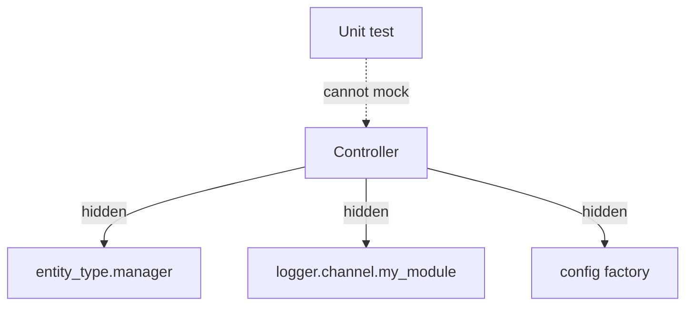

# What DI Solves

Drupal codebases accumulate `\Drupal::service()` and `\Drupal::entityTypeManager()` calls because the static facade is convenient. Dependency Injection replaces that pattern with explicit constructor parameters — making code testable, predictable, and aligned with how Drupal's own core services are built.

## The static facade problem

`\Drupal` is a static entry point to the container:

```php
<?php

declare(strict_types=1);

namespace Drupal\my_module\Controller;

use Drupal\Core\Controller\ControllerBase;

// ANTI-PATTERN — hard to test, hidden dependencies
final class ProductListController extends ControllerBase {

  public function list(): array {
    $storage = \Drupal::entityTypeManager()->getStorage('product');
    $logger = \Drupal::logger('my_module');
    $config = \Drupal::config('my_module.settings');

    $products = $storage->loadByProperties(['status' => 1]);
    $logger->info('Listed @count products', ['@count' => count($products)]);

    return [
      '#theme' => 'item_list',
      '#items' => array_map(fn($p) => $p->label(), $products),
      '#cache' => ['tags' => ['product_list'], 'max-age' => $config->get('cache_ttl')],
    ];
  }

}
```

### Problems with this approach



| Problem | Impact |
|---------|--------|
| Hidden dependencies | Reader cannot see what the class needs without reading the method body |
| Untestable | PHPUnit cannot inject mocks without bootstrapping Drupal |
| Tight coupling | Class is bound to global state |
| Circular risk | Services calling `\Drupal::` during construction cause subtle loops |
| Static analysis | PHPStan/Psalm cannot trace types through facades |

## The DI solution

Dependencies are declared in the constructor and wired via YAML:

```php
<?php

declare(strict_types=1);

namespace Drupal\my_module\Controller;

use Drupal\Core\Config\ConfigFactoryInterface;
use Drupal\Core\Controller\ControllerBase;
use Drupal\Core\Entity\EntityTypeManagerInterface;
use Psr\Log\LoggerInterface;
use Symfony\Component\DependencyInjection\ContainerInterface;

final class ProductListController extends ControllerBase {

  public function __construct(
    EntityTypeManagerInterface $entityTypeManager,
    private readonly LoggerInterface $logger,
    ConfigFactoryInterface $configFactory,
  ) {
    // ControllerBase already declares protected $entityTypeManager and
    // $configFactory; redeclaring them as private readonly is a fatal error.
    $this->entityTypeManager = $entityTypeManager;
    $this->configFactory = $configFactory;
  }

  public static function create(ContainerInterface $container): static {
    return new static(
      $container->get('entity_type.manager'),
      $container->get('logger.channel.my_module'),
      $container->get('config.factory'),
    );
  }

  public function list(): array {
    $products = $this->entityTypeManager
      ->getStorage('product')
      ->loadByProperties(['status' => 1]);

    $this->logger->info('Listed @count products', ['@count' => count($products)]);

    $ttl = $this->configFactory->get('my_module.settings')->get('cache_ttl');

    return [
      '#theme' => 'item_list',
      '#items' => array_map(fn($p) => $p->label(), $products),
      '#cache' => ['tags' => ['product_list'], 'max-age' => $ttl],
    ];
  }

}
```

Now dependencies are visible, typed, and mockable:

```php
<?php

declare(strict_types=1);

namespace Drupal\Tests\my_module\Unit\Controller;

use Drupal\my_module\Controller\ProductListController;
use Drupal\Tests\UnitTestCase;

final class ProductListControllerTest extends UnitTestCase {

  public function testListBuildsRenderArray(): void {
  }

}
```

## When `\Drupal::` is still acceptable

| Context | Static OK? | Better alternative |
|---------|------------|-------------------|
| `.module` procedural hooks | Often yes | OOP `#[Hook]` classes with DI |
| One-liner in `drush php:eval` | Yes | N/A |
| `create()` factory methods | Use `$container->get()` | Not `\Drupal::` |
| Service classes | No | Constructor injection |
| Controllers, forms, plugins | No | `create()` + injection |
| Entity methods | No | Inject services into callers |

```php
<?php

declare(strict_types=1);

/**
 * Implements hook_cron().
 *
 * Procedural hooks may use \Drupal:: — but prefer a cron service.
 */
function my_module_cron(): void {
  \Drupal::service('my_module.cron_runner')->run();
}
```

## Extracting logic into services

The biggest win from DI is moving business logic out of controllers:

```php
<?php

declare(strict_types=1);

namespace Drupal\my_module\Service;

use Drupal\Core\Config\ConfigFactoryInterface;
use Drupal\Core\Entity\EntityTypeManagerInterface;
use Psr\Log\LoggerInterface;

final class ProductLister {

  public function __construct(
    private readonly EntityTypeManagerInterface $entityTypeManager,
    private readonly LoggerInterface $logger,
    private readonly ConfigFactoryInterface $configFactory,
  ) {}

  public function getPublishedLabels(): array {
    $products = $this->entityTypeManager
      ->getStorage('product')
      ->loadByProperties(['status' => 1]);

    $this->logger->info('Listed @count products', ['@count' => count($products)]);

    return array_map(fn($product) => $product->label(), $products);
  }

  public function getCacheMaxAge(): int {
    return (int) $this->configFactory->get('my_module.settings')->get('cache_ttl');
  }

}
```

```yaml
# my_module.services.yml
services:
  my_module.product_lister:
    class: Drupal\my_module\Service\ProductLister
    arguments:
      - '@entity_type.manager'
      - '@logger.channel.my_module'
      - '@config.factory'
```

The controller becomes thin:

```php
<?php

declare(strict_types=1);

public function list(): array {
  return [
    '#theme' => 'item_list',
    '#items' => $this->productLister->getPublishedLabels(),
    '#cache' => [
      'tags' => ['product_list'],
      'max-age' => $this->productLister->getCacheMaxAge(),
    ],
  ];
}
```

## Interface-based injection

Depend on interfaces, not concrete classes:

```php
<?php

declare(strict_types=1);

namespace Drupal\my_module\Service;

interface PriceCalculatorInterface {
  public function calculate(float $base, float $taxRate): float;
}

final class PriceCalculator implements PriceCalculatorInterface {
  public function calculate(float $base, float $taxRate): float {
    return round($base * (1 + $taxRate), 2);
  }
}
```

```yaml
services:
  my_module.price_calculator:
    class: Drupal\my_module\Service\PriceCalculator

  my_module.order_processor:
    class: Drupal\my_module\Service\OrderProcessor
    arguments: ['@my_module.price_calculator']
```

```php
<?php

declare(strict_types=1);

final class OrderProcessor {

  public function __construct(
    private readonly PriceCalculatorInterface $priceCalculator,
  ) {}

}
```

Use an alias if you want to swap implementations:

```yaml
services:
  Drupal\my_module\Service\PriceCalculatorInterface: '@my_module.price_calculator'
```

## DI vs service location

**Service location** (anti-pattern): object asks the container for dependencies.

```php
<?php

declare(strict_types=1);

// Service locator — avoids DI but hides dependencies
final class BadService {
  public function process(): void {
    $entityTypeManager = \Drupal::entityTypeManager();
  }
}
```

**Dependency injection** (correct): container provides dependencies at construction.

```php
<?php

declare(strict_types=1);

final class GoodService {
  public function __construct(
    private readonly EntityTypeManagerInterface $entityTypeManager,
  ) {}
}
```

!!! warning "Don't inject the container"
    Injecting `ContainerInterface` into your services is service location. Inject specific services instead.

## Migration checklist

Converting legacy code to DI:

1. Identify all `\Drupal::` calls in the class
2. Add constructor parameters for each service
3. Add `create()` method (controllers, forms, plugins)
4. Register or update `*.services.yml`
5. Run `drush cr`
6. Write a unit test with mocked dependencies

```bash
# Find static calls in your module
grep -r '\\Drupal::' web/modules/custom/my_module/src/ | grep -v 'create('
```

## Related reading

- [Service Definitions](service-definitions.md) — YAML wiring
- [Constructor Injection](constructor-injection.md) — `create()` and `#[Autowire]`
- [Service Decoration](service-decoration.md) — extending behavior without subclassing callers
