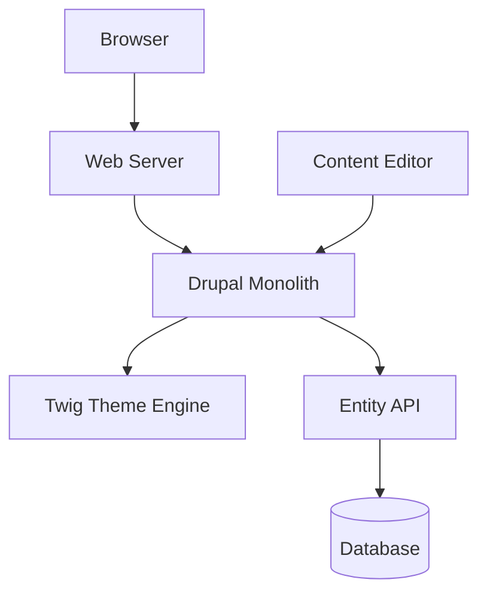
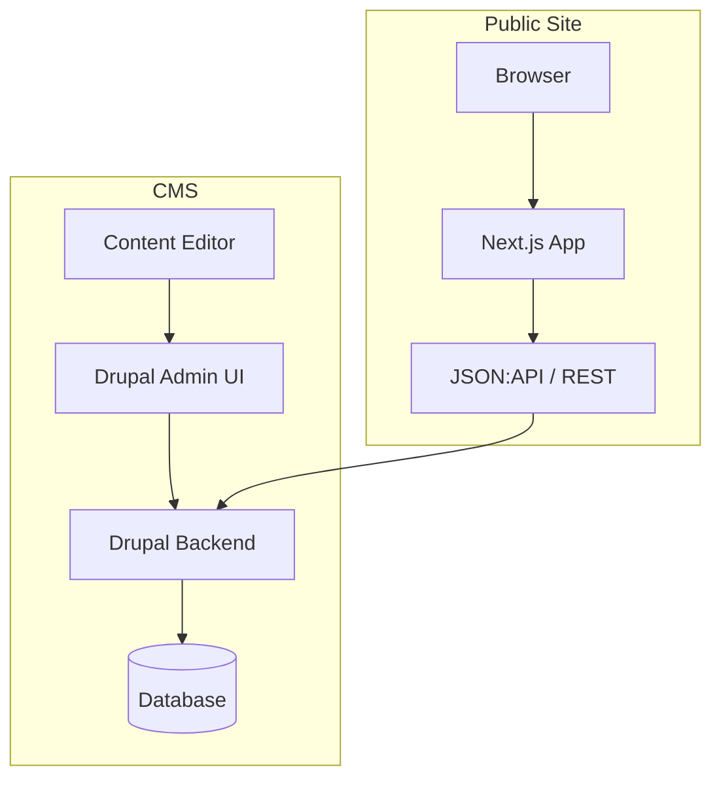
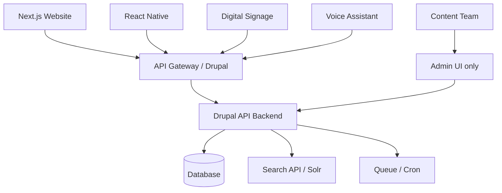
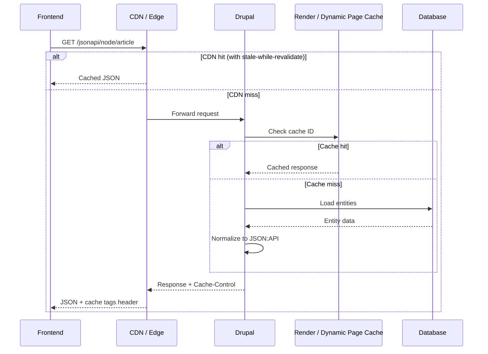
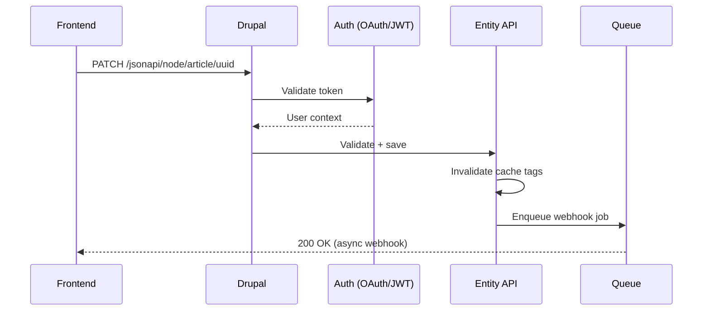
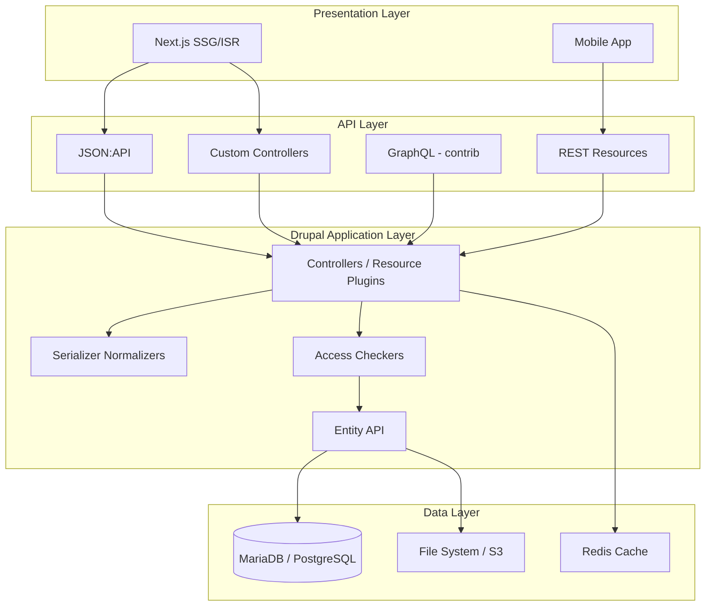
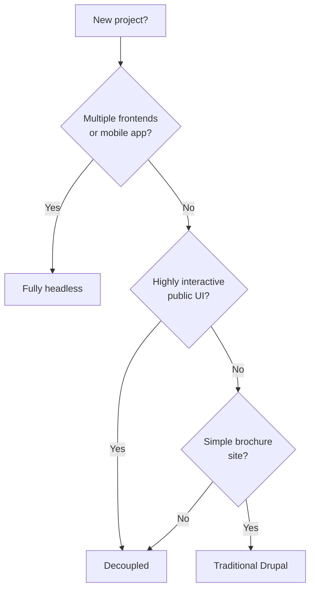

# Headless Architecture

Choosing the right decoupling strategy affects team structure, hosting, caching, and how much Drupal code you maintain. This page compares the three common patterns with diagrams and implementation notes.

## Three architecture patterns

### Traditional (coupled)

Drupal owns routing, business logic, and HTML rendering via Twig themes.



**Characteristics:**

- Single deployment unit
- Full page cache and render cache work out of the box
- Contrib themes and Layout Builder available
- No CORS or API auth complexity

### Decoupled (progressive)

Drupal serves the admin UI and APIs; a JavaScript framework renders the public site.



**Characteristics:**

- Editors use familiar Drupal admin
- Public frontend is independently deployable
- Two codebases, coordinated releases
- Preview and draft workflows need extra wiring

### Fully headless

Drupal has no public theme. All consumers—web, mobile, IoT—use APIs exclusively.



**Characteristics:**

- Maximum flexibility for multi-channel delivery
- No Twig maintenance for public pages
- Requires API-first content modeling from day one
- Preview, SEO, and caching are frontend responsibilities

## Comparison matrix

| Factor | Traditional | Decoupled | Fully Headless |
|--------|-------------|-----------|----------------|
| Public HTML | Drupal Twig | Frontend framework | Frontend only |
| Admin UI | Drupal | Drupal | Drupal (or custom) |
| API exposure | Optional | Required for FE | Required for all |
| Caching | Core page cache | Split (Drupal + CDN) | Frontend + API cache |
| Team skills | PHP + Twig | PHP + JavaScript | PHP + JS + DevOps |
| Time to MVP | Fastest | Medium | Slowest |
| Multi-channel | Limited | Good | Excellent |

## Request flow: headless read path



## Request flow: headless write path



## Layered architecture



## Hosting topology

A typical production headless stack:

```
┌─────────────────────────────────────────────────────────┐
│  CDN (Cloudflare / Fastly)                              │
│  ├── Static assets (Next.js on Vercel)                  │
│  └── API cache (optional, tag-aware)                    │
└─────────────────────────────────────────────────────────┘
         │                              │
         ▼                              ▼
┌─────────────────┐          ┌─────────────────────────┐
│  Vercel         │          │  Platform.sh / Acquia   │
│  Next.js 15     │  HTTPS   │  Drupal 11              │
│  ISR + webhooks │ ◄──────► │  JSON:API + OAuth       │
└─────────────────┘          └─────────────────────────┘
```

## Drupal modules by pattern

| Pattern | Core modules | Common contrib |
|---------|--------------|----------------|
| All headless | `jsonapi`, `serialization` | `jsonapi_extras`, `subrequests` |
| REST endpoints | `rest` | — |
| Auth | `basic_auth` (dev only) | `simple_oauth`, custom JWT |
| CORS | — (services.yml) | `cors` (if not using services.yml) |
| Preview | — | `next`, `decoupled_router` |
| GraphQL | — | `graphql`, `graphql_compose` |

## Configuration export for headless sites

Export API-related configuration with the rest of your site:

```bash
# Export all config
drush config:export -y

# Key config files for headless setups
ls config/sync/ | grep -E 'jsonapi|rest|cors|oauth'
```

Typical headless config entities:

- `jsonapi.settings.yml` — read-only mode, base path
- `rest.resource.*.yml` — REST resource configuration
- `user.role.api_consumer.yml` — API consumer role
- `simple_oauth.settings.yml` — OAuth settings

## Decision guide



## Related pages

- [JSON:API Deep Dive](jsonapi.md) — primary API layer
- [Authentication](auth/index.md) — securing API access
- [Cache Invalidation](cache-invalidation.md) — keeping frontends fresh
- [Next.js integration](nextjs.md) — reference frontend architecture
