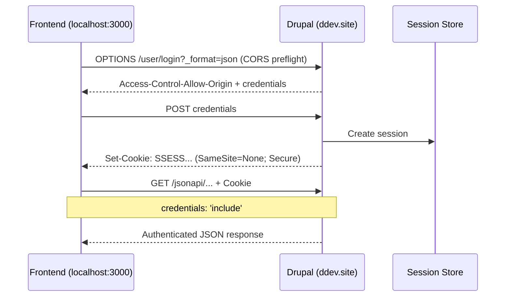

# Cookie Authentication

Cookie authentication sends Drupal's session cookie (`SSESS...`) with cross-origin requests. It enables browser clients to maintain login state when CORS and `credentials: 'include'` are configured correctly.

## Architecture



## CORS configuration

Both `services.yml` and your frontend must cooperate.

### Drupal services.yml

```yaml
# web/sites/default/services.yml
parameters:
  cors.config:
    enabled: true
    allowedHeaders:
      - x-csrf-token
      - authorization
      - content-type
      - accept
      - origin
      - x-requested-with
    allowedMethods: ['GET', 'POST', 'PUT', 'PATCH', 'DELETE', 'OPTIONS']
    allowedOrigins:
      - 'http://localhost:3000'
      - 'https://my-frontend.vercel.app'
    exposedHeaders: false
    maxAge: 1000
    supportsCredentials: true
```

```bash
drush cr
```

### settings.php session settings

For cross-site cookies (frontend and Drupal on different domains):

```php
// web/sites/default/settings.php

// Required for cross-origin cookies in modern browsers.
ini_set('session.cookie_samesite', 'None');
ini_set('session.cookie_secure', '1');

// If using subdomains (app.example.com + cms.example.com):
$settings['cookie_domain'] = '.example.com';
```

!!! warning "SameSite=None requires Secure"
    Browsers reject `SameSite=None` cookies without the `Secure` flag. Use HTTPS everywhere—even in staging.

## Frontend fetch configuration

```typescript
// lib/drupal-client.ts
const DRUPAL_BASE = process.env.NEXT_PUBLIC_DRUPAL_BASE_URL!;

export async function drupalFetch(
  path: string,
  options: RequestInit = {},
): Promise<Response> {
  return fetch(`${DRUPAL_BASE}${path}`, {
    ...options,
    credentials: 'include',
    headers: {
      Accept: 'application/vnd.api+json',
      ...options.headers,
    },
  });
}

// Login via core's JSON login route (see Session Auth).
// Returns { current_user, csrf_token, logout_token }.
export async function login(username: string, password: string) {
  const response = await drupalFetch('/user/login?_format=json', {
    method: 'POST',
    headers: { 'Content-Type': 'application/json' },
    body: JSON.stringify({ name: username, pass: password }),
  });

  if (!response.ok) {
    throw new Error('Login failed');
  }

  return response.json();
}

// Authenticated JSON:API request for the current user. JSON:API has no "me"
// filter; the /jsonapi entry point exposes meta.links.me for logged-in users.
export async function getMyProfile() {
  const index = await (await drupalFetch('/jsonapi')).json();
  const meHref: string | undefined = index.meta?.links?.me?.href;
  if (!meHref) {
    throw new Error('Not logged in');
  }
  return fetch(meHref, {
    credentials: 'include',
    headers: { Accept: 'application/vnd.api+json' },
  });
}
```

## CSRF token flow

State-changing requests with session cookies require CSRF protection:

```typescript
let csrfToken: string | null = null;

export async function getCsrfToken(): Promise<string> {
  if (csrfToken) return csrfToken;

  const response = await drupalFetch('/session/token');
  csrfToken = await response.text();
  return csrfToken;
}

export async function patchArticle(uuid: string, title: string) {
  const token = await getCsrfToken();

  return drupalFetch(`/jsonapi/node/article/${uuid}`, {
    method: 'PATCH',
    headers: {
      'Content-Type': 'application/vnd.api+json',
      'X-CSRF-Token': token,
    },
    body: JSON.stringify({
      data: {
        type: 'node--article',
        id: uuid,
        attributes: { title },
      },
    }),
  });
}
```

## React login component

```tsx
'use client';

import { useState } from 'react';
import { login } from '@/lib/drupal-client';

export function LoginForm() {
  const [username, setUsername] = useState('');
  const [password, setPassword] = useState('');
  const [error, setError] = useState<string | null>(null);

  async function handleSubmit(e: React.FormEvent) {
    e.preventDefault();
    setError(null);

    try {
      await login(username, password);
      window.location.href = '/dashboard';
    } catch {
      setError('Invalid credentials');
    }
  }

  return (
    <form onSubmit={handleSubmit}>
      <input
        type="text"
        value={username}
        onChange={(e) => setUsername(e.target.value)}
        placeholder="Username"
        required
      />
      <input
        type="password"
        value={password}
        onChange={(e) => setPassword(e.target.value)}
        placeholder="Password"
        required
      />
      {error && <p role="alert">{error}</p>}
      <button type="submit">Log in</button>
    </form>
  );
}
```

## Third-party cookie restrictions

Modern browsers increasingly block third-party cookies:

| Scenario | Works? |
|----------|--------|
| Same domain (reverse proxy) | Yes |
| Subdomains with shared cookie domain | Usually yes |
| Completely different domains | Unreliable |
| Safari / Firefox strict mode | Often blocked |

### Mitigation: reverse proxy

Serve Drupal and the frontend under one domain:

```
https://example.com          → Next.js
https://example.com/api      → Drupal (proxied)
https://example.com/jsonapi  → Drupal (proxied)
```

Next.js rewrite in `next.config.ts`:

```typescript
import type { NextConfig } from 'next';

const nextConfig: NextConfig = {
  async rewrites() {
    return [
      {
        source: '/jsonapi/:path*',
        destination: `${process.env.DRUPAL_BASE_URL}/jsonapi/:path*`,
      },
    ];
  },
};

export default nextConfig;
```

With this setup, cookies are first-party and `credentials: 'include'` works reliably.

## When to use cookies vs tokens

| Factor | Cookies | OAuth/JWT tokens |
|--------|---------|------------------|
| Cross-domain SPA | Problematic | Recommended |
| Same-domain proxy | Excellent | Optional |
| Mobile apps | Awkward | Recommended |
| CSRF risk | Requires tokens | No CSRF (Bearer header) |
| HttpOnly security | Yes | Token in memory/storage |

## Related pages

- [Session Auth](session-auth.md) — session mechanics
- [OAuth 2.0](oauth2.md) — recommended for cross-origin SPAs
- [Next.js integration](../nextjs.md) — proxy patterns
