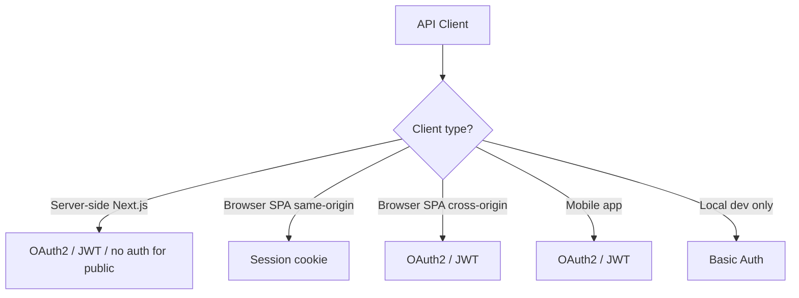
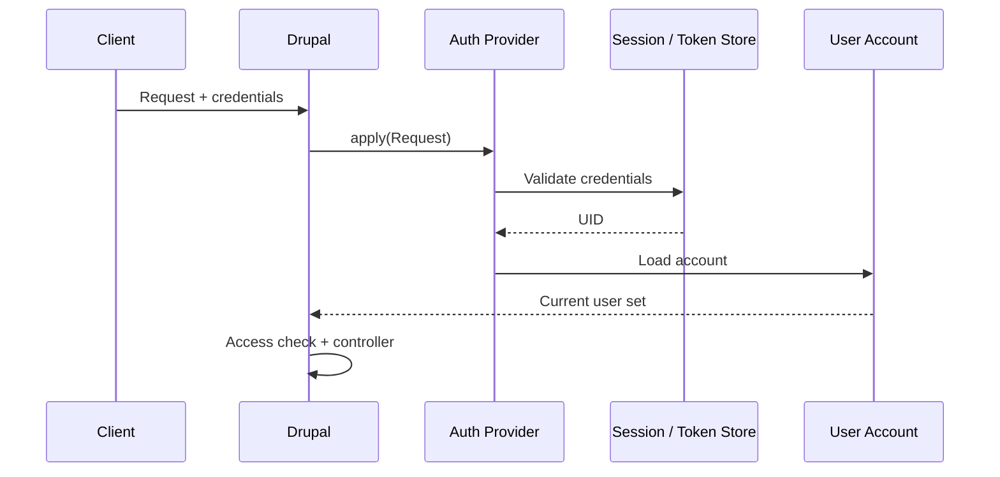

# Authentication for Headless Drupal

Headless frontends must authenticate API requests without the traditional login form redirect flow. Drupal supports several patterns—choose based on client type, security requirements, and whether requests are same-origin.

## Authentication options



| Method | Use case | Credentials in browser? |
|--------|----------|-------------------------|
| [Session auth](session-auth.md) | Same-origin, admin tools | Yes (cookie) |
| [Cookie auth](cookie-auth.md) | Cross-origin with credentials | Yes (HttpOnly cookie) |
| [OAuth 2.0](oauth2.md) | SPAs, mobile, server-to-server | No (access token) |
| [JWT](jwt.md) | Stateless APIs, microservices | No (Bearer token) |
| Basic Auth | Local development only | Yes (never in production) |

## How Drupal authenticates API requests

Drupal's authentication stack runs during the `KernelEvents::REQUEST` phase. Each authentication provider attempts to identify the user:



Enabled providers are configured per REST resource or apply globally for JSON:API.

## CORS and credentials

Cross-origin browser requests with cookies require explicit CORS configuration:

```yaml
# web/sites/default/services.yml
parameters:
  cors.config:
    enabled: true
    allowedHeaders: ['*']
    allowedMethods: ['GET', 'POST', 'PATCH', 'DELETE', 'OPTIONS']
    allowedOrigins: ['https://my-app.vercel.app']
    supportsCredentials: true
    maxAge: 1000
```

Frontend fetch must include credentials:

```typescript
fetch(`${DRUPAL_URL}/jsonapi/node/article`, {
  credentials: 'include',
  headers: { Accept: 'application/vnd.api+json' },
});
```

## Permissions model

Authentication identifies **who** the user is. **Permissions** still gate access:

JSON:API has no permissions of its own; it applies normal entity access. Grant the entity permissions the client needs:

```bash
# Read published content ("View published content")
drush role:perm:add api_consumer 'access content'

# Create and edit own articles (JSON:API must also have read_only: false)
drush role:perm:add api_consumer 'create article content,edit own article content'
```

## Recommended production setup

| Client | Auth method |
|--------|-------------|
| Next.js SSR / SSG (public content) | No auth; CDN cache |
| Next.js SSR (personalized) | OAuth2 client credentials or session |
| Next.js client components (logged-in) | OAuth2 authorization code + PKCE |
| Mobile app | OAuth2 + refresh tokens |
| Webhook / CI | OAuth2 client credentials or API key |

## Security checklist

- [ ] Always use HTTPS in production
- [ ] Never use Basic Auth on public endpoints
- [ ] Set short access token TTL (15–60 minutes)
- [ ] Use refresh token rotation
- [ ] Scope OAuth tokens to minimum permissions
- [ ] Rate-limit authentication endpoints
- [ ] Log failed authentication attempts

## Related pages

- [Session Auth](session-auth.md)
- [Cookie Auth](cookie-auth.md)
- [OAuth 2.0](oauth2.md)
- [JWT](jwt.md)
- [Next.js integration](../nextjs.md)
