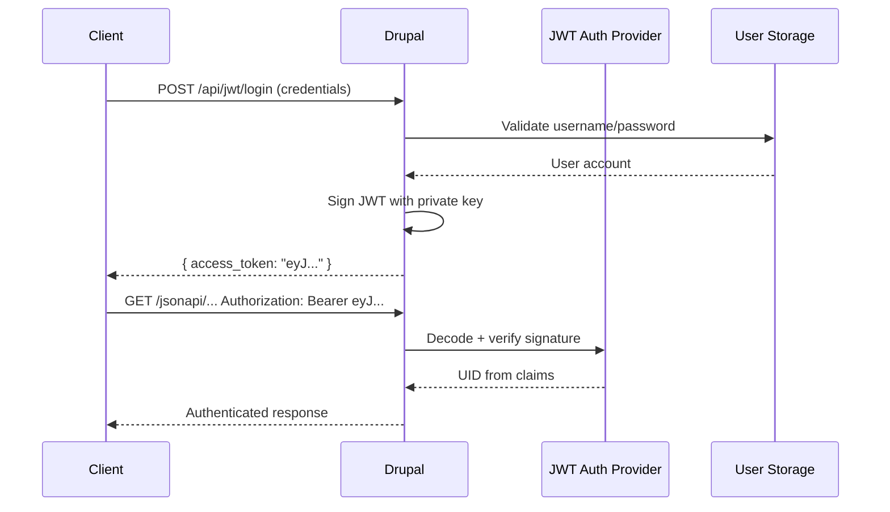

# JWT Authentication

JSON Web Tokens (JWT) provide **stateless authentication**—Drupal validates a signed token on each request without database session lookups. This page includes a complete custom JWT module implementation.

## When to use JWT

| Use JWT | Use OAuth 2.0 instead |
|---------|----------------------|
| Microservices sharing auth | Standard OAuth flows needed |
| External apps with shared secret | Token revocation is critical |
| High-throughput APIs | You want contrib-maintained auth |
| Custom claims in tokens | PKCE authorization code flow |

## Architecture



## Complete module: jwt_auth

### Directory structure

```
modules/custom/jwt_auth/
├── jwt_auth.info.yml
├── jwt_auth.services.yml
├── jwt_auth.routing.yml
├── jwt_auth.permissions.yml
├── config/
│   ├── install/
│   │   └── jwt_auth.settings.yml
│   └── schema/
│       └── jwt_auth.schema.yml
└── src/
    ├── Authentication/
    │   └── Provider/
    │       └── JwtAuthProvider.php
    ├── Controller/
    │   └── JwtAuthController.php
    ├── PageCache/
    │   └── DisallowJwtAuthRequests.php
    └── Service/
        └── JwtTokenService.php
```

### jwt_auth.info.yml

```yaml
name: JWT Auth
type: module
description: 'Stateless JWT authentication for headless Drupal.'
core_version_requirement: ^11
package: Custom
dependencies:
  - drupal:user
```

### jwt_auth.settings.yml

```yaml
# Never store the real key here: this file is exported to config/sync (and
# usually committed). Provide it through a settings.php override instead.
secret_key: ''
token_ttl: 3600
issuer: 'https://my-site.ddev.site'
algorithm: 'HS256'
```

### jwt_auth.schema.yml

```yaml
jwt_auth.settings:
  type: config_object
  label: 'JWT Auth settings'
  mapping:
    secret_key:
      type: string
      label: 'HMAC secret key'
    token_ttl:
      type: integer
      label: 'Token TTL in seconds'
    issuer:
      type: string
      label: 'Token issuer (iss claim)'
    algorithm:
      type: string
      label: 'Signing algorithm'
```

### Install firebase/php-jwt

Run Composer from the project root (where the site's `composer.json` lives). Running it inside the module directory creates a separate `vendor/` that Drupal never autoloads:

```bash
composer require firebase/php-jwt
```

### JwtTokenService.php

```php
<?php

declare(strict_types=1);

namespace Drupal\jwt_auth\Service;

use Drupal\Core\Config\ConfigFactoryInterface;
use Drupal\user\UserInterface;
use Firebase\JWT\JWT;
use Firebase\JWT\Key;
use Firebase\JWT\ExpiredException;
use Firebase\JWT\SignatureInvalidException;

/**
 * Creates and validates JWT tokens.
 */
final class JwtTokenService {

  public function __construct(
    private readonly ConfigFactoryInterface $configFactory,
  ) {}

  /**
   * Creates a signed JWT for the given user.
   */
  public function createToken(UserInterface $user): string {
    $config = $this->configFactory->get('jwt_auth.settings');
    $now = time();
    $ttl = (int) $config->get('token_ttl');

    $payload = [
      'iss' => $config->get('issuer'),
      'iat' => $now,
      'exp' => $now + $ttl,
      'sub' => (int) $user->id(),
      'drupal' => [
        'uid' => (int) $user->id(),
        'uuid' => $user->uuid(),
        'roles' => $user->getRoles(),
        'name' => $user->getAccountName(),
      ],
    ];

    return JWT::encode(
      $payload,
      $config->get('secret_key'),
      $config->get('algorithm'),
    );
  }

  /**
   * Validates a token and returns the payload.
   *
   * @throws \RuntimeException
   */
  public function validateToken(string $token): object {
    $config = $this->configFactory->get('jwt_auth.settings');

    try {
      $payload = JWT::decode(
        $token,
        new Key($config->get('secret_key'), $config->get('algorithm')),
      );
    }
    catch (ExpiredException) {
      throw new \RuntimeException('Token has expired.', 401);
    }
    catch (SignatureInvalidException) {
      throw new \RuntimeException('Invalid token signature.', 401);
    }
    catch (\Exception $e) {
      throw new \RuntimeException('Invalid token: ' . $e->getMessage(), 401);
    }

    if (($payload->iss ?? NULL) !== $config->get('issuer')) {
      throw new \RuntimeException('Invalid token issuer.', 401);
    }

    return $payload;
  }

  /**
   * Cheap pre-check for the authentication provider's applies().
   *
   * Reads the UNVERIFIED payload only to see whether this module issued the
   * token (matching issuer + custom "drupal" claim). validateToken() still
   * verifies the signature, expiry and issuer.
   */
  public function isOwnToken(string $token): bool {
    $parts = explode('.', $token);
    if (count($parts) !== 3) {
      return FALSE;
    }

    $claims = json_decode(JWT::urlsafeB64Decode($parts[1]));

    return is_object($claims)
      && isset($claims->drupal)
      && ($claims->iss ?? NULL) === $this->configFactory->get('jwt_auth.settings')->get('issuer');
  }

}
```

### JwtAuthProvider.php

```php
<?php

declare(strict_types=1);

namespace Drupal\jwt_auth\Authentication\Provider;

use Drupal\Core\Authentication\AuthenticationProviderInterface;
use Drupal\Core\Entity\EntityTypeManagerInterface;
use Drupal\Core\Session\AccountInterface;
use Drupal\jwt_auth\Service\JwtTokenService;
use Drupal\user\UserInterface;
use Symfony\Component\HttpFoundation\Request;

/**
 * Authenticates requests via Bearer JWT tokens.
 */
final class JwtAuthProvider implements AuthenticationProviderInterface {

  public function __construct(
    private readonly JwtTokenService $jwtTokenService,
    private readonly EntityTypeManagerInterface $entityTypeManager,
  ) {}

  /**
   * {@inheritdoc}
   */
  public function applies(Request $request): bool {
    // Drupal uses only the first provider whose applies() returns TRUE. Claim
    // only tokens this module issued, so other Bearer tokens (e.g. Simple
    // OAuth's oauth2 provider) still reach their own provider.
    $token = $this->getBearerToken($request);
    return $token !== NULL && $this->jwtTokenService->isOwnToken($token);
  }

  /**
   * {@inheritdoc}
   */
  public function authenticate(Request $request): ?AccountInterface {
    $token = $this->getBearerToken($request);
    if ($token === NULL) {
      return NULL;
    }

    try {
      $payload = $this->jwtTokenService->validateToken($token);
    }
    catch (\RuntimeException) {
      return NULL;
    }

    $uid = $payload->drupal->uid ?? $payload->sub ?? NULL;
    if (!$uid) {
      return NULL;
    }

    $account = $this->entityTypeManager
      ->getStorage('user')
      ->load((int) $uid);

    // A token must stop working once the account is blocked or deleted.
    return ($account instanceof UserInterface && $account->isActive()) ? $account : NULL;
  }

  /**
   * Extracts the Bearer token from the Authorization header.
   */
  private function getBearerToken(Request $request): ?string {
    $authorization = (string) $request->headers->get('Authorization', '');
    if (!str_starts_with($authorization, 'Bearer ')) {
      return NULL;
    }
    $token = trim(substr($authorization, 7));
    return $token === '' ? NULL : $token;
  }

}
```

### DisallowJwtAuthRequests.php

Page Cache runs before authentication. Without a request policy, a response built for a JWT-authenticated user can be stored in the anonymous page cache and then served to everyone. Core's `basic_auth` and Simple OAuth ship the same kind of policy:

```php
<?php

declare(strict_types=1);

namespace Drupal\jwt_auth\PageCache;

use Drupal\Core\PageCache\RequestPolicyInterface;
use Symfony\Component\HttpFoundation\Request;

/**
 * Keeps Bearer-token requests out of the page cache.
 */
final class DisallowJwtAuthRequests implements RequestPolicyInterface {

  /**
   * {@inheritdoc}
   */
  public function check(Request $request) {
    $authorization = (string) $request->headers->get('Authorization', '');
    if (str_starts_with($authorization, 'Bearer ')) {
      return self::DENY;
    }
    return NULL;
  }

}
```

### JwtAuthController.php

The login endpoint uses `UserAuthenticationInterface` (Drupal 10.3+) instead of the legacy `UserAuthInterface::authenticate()` (its `UserAuth` implementation is deprecated in 10.3 and removed in 12.0), and reuses core's login flood control settings and counters (`user.flood` config), like core's `/user/login?_format=json` route.

```php
<?php

declare(strict_types=1);

namespace Drupal\jwt_auth\Controller;

use Drupal\Core\Controller\ControllerBase;
use Drupal\jwt_auth\Service\JwtTokenService;
use Drupal\user\UserAuthenticationInterface;
use Drupal\user\UserFloodControlInterface;
use Symfony\Component\DependencyInjection\ContainerInterface;
use Symfony\Component\HttpFoundation\JsonResponse;
use Symfony\Component\HttpFoundation\Request;

/**
 * JWT login and token refresh endpoints.
 */
final class JwtAuthController extends ControllerBase {

  public function __construct(
    private readonly UserAuthenticationInterface $userAuth,
    private readonly UserFloodControlInterface $userFloodControl,
    private readonly JwtTokenService $jwtTokenService,
  ) {}

  /**
   * {@inheritdoc}
   */
  public static function create(ContainerInterface $container): static {
    return new static(
      $container->get('user.auth'),
      $container->get('user.flood_control'),
      $container->get('jwt_auth.token'),
    );
  }

  /**
   * Issues a JWT for valid credentials.
   */
  public function login(Request $request): JsonResponse {
    $payload = json_decode($request->getContent(), TRUE) ?? [];
    $username = $payload['username'] ?? '';
    $password = $payload['password'] ?? '';

    if ($username === '' || $password === '') {
      return new JsonResponse(['error' => 'username and password required'], 400);
    }

    // Same flood settings and event names as core's HTTP login.
    $flood = $this->config('user.flood');
    if (!$this->userFloodControl->isAllowed('user.failed_login_ip', $flood->get('ip_limit'), $flood->get('ip_window'))) {
      return new JsonResponse(['error' => 'Too many failed login attempts'], 429);
    }

    $account = $this->userAuth->lookupAccount($username);
    $identifier = NULL;
    if ($account) {
      $identifier = $flood->get('uid_only')
        ? (string) $account->id()
        : $account->id() . '-' . $request->getClientIp();
      if (!$this->userFloodControl->isAllowed('user.http_login', $flood->get('user_limit'), $flood->get('user_window'), $identifier)) {
        return new JsonResponse(['error' => 'Too many failed login attempts'], 429);
      }
    }

    if (!$account || $account->isBlocked() || !$this->userAuth->authenticateAccount($account, $password)) {
      if ($identifier !== NULL) {
        $this->userFloodControl->register('user.http_login', $flood->get('user_window'), $identifier);
      }
      $this->userFloodControl->register('user.failed_login_ip', $flood->get('ip_window'));
      return new JsonResponse(['error' => 'Invalid credentials'], 401);
    }

    $this->userFloodControl->clear('user.http_login', $identifier);

    $token = $this->jwtTokenService->createToken($account);
    $ttl = (int) $this->config('jwt_auth.settings')->get('token_ttl');

    return new JsonResponse([
      'access_token' => $token,
      'token_type' => 'Bearer',
      'expires_in' => $ttl,
    ]);
  }

  /**
   * Returns the current user from a valid JWT.
   */
  public function me(): JsonResponse {
    $account = $this->currentUser();

    return new JsonResponse([
      'uid' => (int) $account->id(),
      'name' => $account->getAccountName(),
      'roles' => $account->getRoles(),
    ]);
  }

}
```

### jwt_auth.services.yml

```yaml
services:
  jwt_auth.token:
    class: Drupal\jwt_auth\Service\JwtTokenService
    arguments: ['@config.factory']

  jwt_auth.authentication.jwt:
    class: Drupal\jwt_auth\Authentication\Provider\JwtAuthProvider
    arguments: ['@jwt_auth.token', '@entity_type.manager']
    tags:
      # global: TRUE lets the provider authenticate routes that don't list it
      # in an _auth option (such as /api/jwt/me below).
      - { name: authentication_provider, provider_id: jwt_auth, global: TRUE, priority: 100 }

  jwt_auth.page_cache_request_policy.disallow_jwt_requests:
    class: Drupal\jwt_auth\PageCache\DisallowJwtAuthRequests
    public: false
    tags:
      - { name: page_cache_request_policy }
```

### jwt_auth.routing.yml

```yaml
jwt_auth.login:
  path: '/api/jwt/login'
  defaults:
    _controller: '\Drupal\jwt_auth\Controller\JwtAuthController::login'
  requirements:
    _access: 'TRUE'
  methods: [POST]

jwt_auth.me:
  path: '/api/jwt/me'
  defaults:
    _controller: '\Drupal\jwt_auth\Controller\JwtAuthController::me'
  requirements:
    _user_is_logged_in: 'TRUE'
  methods: [GET]
```

### jwt_auth.permissions.yml

```yaml
issue jwt tokens:
  title: 'Issue JWT tokens via API'
  restrict access: true
```

## Enable and test

```php
// web/sites/default/settings.php — config overrides are never exported.
$config['jwt_auth.settings']['secret_key'] = getenv('JWT_AUTH_SECRET');
```

```bash
drush en jwt_auth -y
drush cr

# Generate a strong secret, store it in your environment / secret store as
# JWT_AUTH_SECRET, and load it in settings.php (see below) — not in config.
openssl rand -base64 48

# Login and get token
curl -s -X POST \
  -H "Content-Type: application/json" \
  https://my-site.ddev.site/api/jwt/login \
  -d '{"username":"admin","password":"admin"}' \
  | jq -r '.access_token' > /tmp/token.txt

# Use token with JSON:API
curl -s \
  -H "Authorization: Bearer $(cat /tmp/token.txt)" \
  -H "Accept: application/vnd.api+json" \
  https://my-site.ddev.site/api/jwt/me | jq .

curl -s \
  -H "Authorization: Bearer $(cat /tmp/token.txt)" \
  -H "Accept: application/vnd.api+json" \
  https://my-site.ddev.site/jsonapi/node/article | jq '.data | length'
```

## Frontend integration

```typescript
// lib/jwt-auth.ts
const DRUPAL_URL = process.env.NEXT_PUBLIC_DRUPAL_BASE_URL!;

interface TokenResponse {
  access_token: string;
  token_type: string;
  expires_in: number;
}

export async function loginWithJwt(
  username: string,
  password: string,
): Promise<TokenResponse> {
  const response = await fetch(`${DRUPAL_URL}/api/jwt/login`, {
    method: 'POST',
    headers: { 'Content-Type': 'application/json' },
    body: JSON.stringify({ username, password }),
  });

  if (!response.ok) {
    throw new Error('Authentication failed');
  }

  return response.json();
}

export async function fetchWithJwt(
  path: string,
  accessToken: string,
  options: RequestInit = {},
): Promise<Response> {
  return fetch(`${DRUPAL_URL}${path}`, {
    ...options,
    headers: {
      Authorization: `Bearer ${accessToken}`,
      Accept: 'application/vnd.api+json',
      ...options.headers,
    },
  });
}
```

Store tokens in memory (not localStorage) when possible:

```typescript
// Store in React context or server-side session — avoid localStorage for XSS-sensitive apps
let accessToken: string | null = null;
let expiresAt = 0;

export async function getValidToken(credentials: Credentials): Promise<string> {
  if (accessToken && Date.now() < expiresAt) {
    return accessToken;
  }

  const tokens = await loginWithJwt(credentials.username, credentials.password);
  accessToken = tokens.access_token;
  expiresAt = Date.now() + tokens.expires_in * 1000 - 30_000;
  return accessToken;
}
```

## RS256 variant (asymmetric keys)

For multi-service architectures, sign with a private key and distribute the public key to validators:

```bash
openssl genrsa -out private.pem 2048
openssl rsa -in private.pem -pubout -out public.pem
```

```php
use Firebase\JWT\JWT;
use Firebase\JWT\Key;

// Sign with private key
$token = JWT::encode($payload, file_get_contents('private.pem'), 'RS256');

// Verify with public key
$decoded = JWT::decode($token, new Key(file_get_contents('public.pem'), 'RS256'));
```

## Security considerations

| Risk | Mitigation |
|------|------------|
| Secret key leak | Use RS256; rotate keys; store in environment |
| Token theft (XSS) | HttpOnly cookies or memory-only storage |
| No revocation | Short TTL; maintain blocklist for logout |
| Role changes not reflected | Include `iat` claim; re-login on role change |
| Brute force on login | Rate limit `/api/jwt/login` |

## JWT vs Simple OAuth

Simple OAuth already issues JWT access tokens. Use this custom module when you need:

- Custom claims (`drupal.uuid`, app-specific metadata)
- Full control over token format and validation
- Integration with external identity providers

## Related pages

- [OAuth 2.0](oauth2.md) — contrib OAuth server
- [Authentication overview](index.md)
- [Next.js integration](../nextjs.md)
