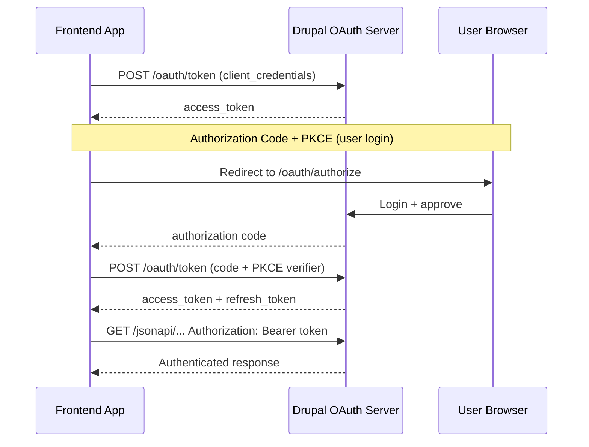
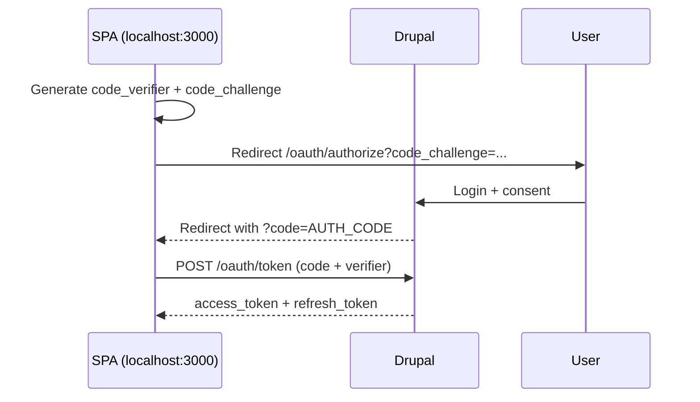

# OAuth 2.0 Authentication

**Simple OAuth** (`drupal/simple_oauth`) implements OAuth 2.0 for Drupal, enabling secure token-based authentication for SPAs, mobile apps, and server-to-server integrations.

## Install and configure

```bash
composer require drupal/simple_oauth drupal/consumers
drush en simple_oauth consumers -y
drush cr

# Generate OAuth keys (store outside web root)
mkdir -p ../oauth-keys
openssl genrsa -out ../oauth-keys/private.key 2048
openssl rsa -in ../oauth-keys/private.key -pubout -out ../oauth-keys/public.key
```

Configure key paths:

```bash
drush config:set simple_oauth.settings private_key /var/www/oauth-keys/private.key -y
drush config:set simple_oauth.settings public_key /var/www/oauth-keys/public.key -y
```

Or in `settings.php`:

```php
$config['simple_oauth.settings']['private_key'] = '/var/www/oauth-keys/private.key';
$config['simple_oauth.settings']['public_key'] = '/var/www/oauth-keys/public.key';
```

## OAuth flow overview



## Create a consumer

Via admin UI: **Configuration → Web services → Consumers → Add consumer**

Or programmatically:

```php
$consumer = \Drupal::entityTypeManager()
  ->getStorage('consumer')
  ->create([
    'label' => 'Next.js Frontend',
    'client_id' => 'nextjs_app',
    'secret' => 'your-client-secret-change-in-production',
    'user_id' => 1,
    'roles' => ['api_consumer'],
    'is_confidential' => TRUE,
    'redirect' => 'http://localhost:3000/api/auth/callback',
    'grant_types' => [
      'client_credentials',
      'authorization_code',
      'refresh_token',
    ],
    'scopes' => ['authenticated'],
  ]);
$consumer->save();
```

## Grant types

### Client credentials (server-to-server)

Best for Next.js server components and CI pipelines—no user context unless you assign a service account user to the consumer.

```bash
curl -s -X POST \
  https://my-site.ddev.site/oauth/token \
  -H "Content-Type: application/x-www-form-urlencoded" \
  -d "grant_type=client_credentials" \
  -d "client_id=nextjs_app" \
  -d "client_secret=your-client-secret" \
  -d "scope=authenticated"
```

Response:

```json
{
  "token_type": "Bearer",
  "expires_in": 3600,
  "access_token": "eyJ0eXAiOiJKV1QiLCJhbG..."
}
```

### Authorization code + PKCE (user login in SPA)



Generate PKCE values:

```typescript
import { createHash, randomBytes } from 'crypto';

function base64UrlEncode(buffer: Buffer): string {
  return buffer.toString('base64url');
}

export function generatePkce() {
  const verifier = base64UrlEncode(randomBytes(32));
  const challenge = base64UrlEncode(
    createHash('sha256').update(verifier).digest(),
  );
  return { verifier, challenge };
}
```

Authorization URL:

```typescript
const { verifier, challenge } = generatePkce();
sessionStorage.setItem('pkce_verifier', verifier);

const params = new URLSearchParams({
  response_type: 'code',
  client_id: 'nextjs_app',
  redirect_uri: 'http://localhost:3000/api/auth/callback',
  scope: 'authenticated',
  code_challenge: challenge,
  code_challenge_method: 'S256',
});

window.location.href = `${DRUPAL_URL}/oauth/authorize?${params}`;
```

Token exchange:

```typescript
// app/api/auth/callback/route.ts
import { NextRequest, NextResponse } from 'next/server';

export async function GET(request: NextRequest) {
  const code = request.nextUrl.searchParams.get('code');
  const verifier = request.cookies.get('pkce_verifier')?.value;

  const response = await fetch(`${process.env.DRUPAL_BASE_URL}/oauth/token`, {
    method: 'POST',
    headers: { 'Content-Type': 'application/x-www-form-urlencoded' },
    body: new URLSearchParams({
      grant_type: 'authorization_code',
      client_id: process.env.OAUTH_CLIENT_ID!,
      client_secret: process.env.OAUTH_CLIENT_SECRET!,
      redirect_uri: `${process.env.NEXT_PUBLIC_BASE_URL}/api/auth/callback`,
      code: code!,
      code_verifier: verifier!,
    }),
  });

  const tokens = await response.json();

  const res = NextResponse.redirect('/dashboard');
  res.cookies.set('access_token', tokens.access_token, {
    httpOnly: true,
    secure: true,
    sameSite: 'lax',
    maxAge: tokens.expires_in,
  });

  return res;
}
```

### Refresh token

```typescript
async function refreshAccessToken(refreshToken: string) {
  const response = await fetch(`${DRUPAL_URL}/oauth/token`, {
    method: 'POST',
    headers: { 'Content-Type': 'application/x-www-form-urlencoded' },
    body: new URLSearchParams({
      grant_type: 'refresh_token',
      client_id: process.env.OAUTH_CLIENT_ID!,
      client_secret: process.env.OAUTH_CLIENT_SECRET!,
      refresh_token: refreshToken,
    }),
  });

  return response.json();
}
```

## Using access tokens with JSON:API

```bash
TOKEN="eyJ0eXAiOiJKV1QiLCJhbG..."

curl -s \
  -H "Authorization: Bearer $TOKEN" \
  -H "Accept: application/vnd.api+json" \
  https://my-site.ddev.site/jsonapi/node/article
```

```typescript
export async function fetchWithToken(path: string, accessToken: string) {
  return fetch(`${DRUPAL_URL}${path}`, {
    headers: {
      Authorization: `Bearer ${accessToken}`,
      Accept: 'application/vnd.api+json',
    },
  });
}
```

## Scopes and roles

Assign roles to consumers to control token permissions:

```yaml
# Consumer entity: roles = [api_consumer]
# user.role.api_consumer.yml
id: api_consumer
label: 'API Consumer'
permissions:
  - 'access jsonapi resource'
  - 'view published content'
  - 'create article content'
  - 'edit own article content'
```

## Token expiration

```bash
drush config:set simple_oauth.settings access_token_expiration 3600 -y
drush config:set simple_oauth.settings refresh_token_expiration 1209600 -y
```

## REST resource authentication config

Enable OAuth for REST endpoints:

```yaml
# rest.resource.dashboard_summary.yml
configuration:
  authentication:
    - oauth2
    - cookie
```

## Troubleshooting

| Issue | Solution |
|-------|----------|
| `invalid_client` | Check client_id and secret |
| `invalid_grant` | PKCE verifier mismatch or expired code |
| 401 on JSON:API | Token expired; check scope and role permissions |
| CORS on token endpoint | Add token URL to CORS allowed origins |

## Related pages

- [JWT](jwt.md) — custom stateless tokens
- [Cookie Auth](cookie-auth.md) — session alternative
- [Next.js integration](../nextjs.md) — server-side token usage
