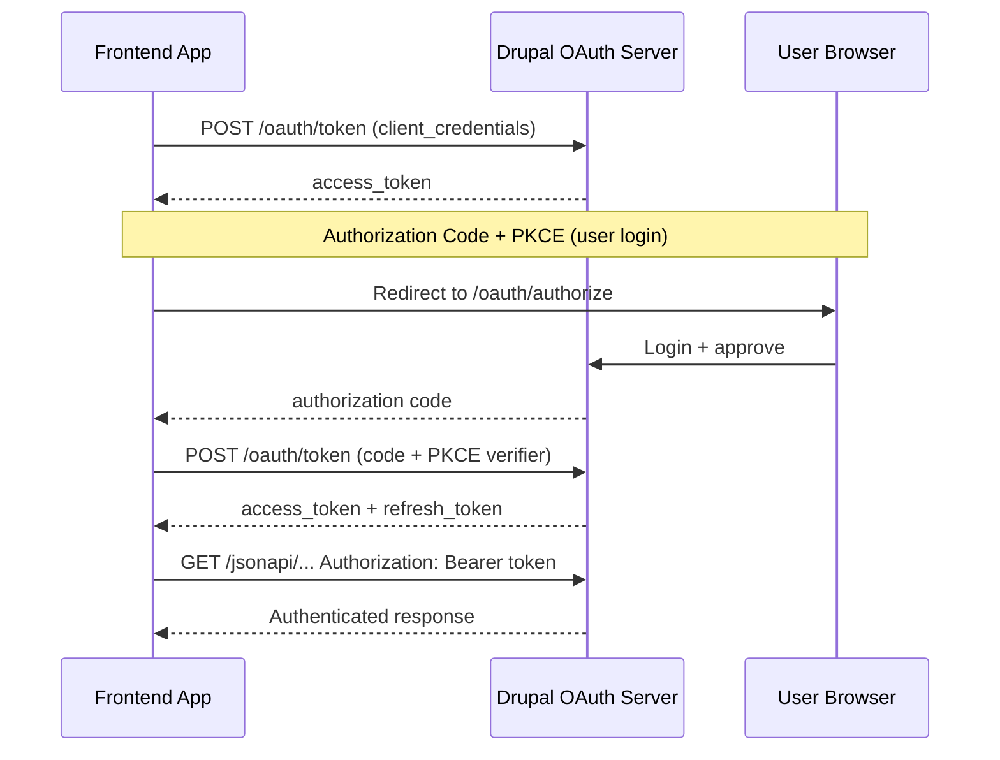
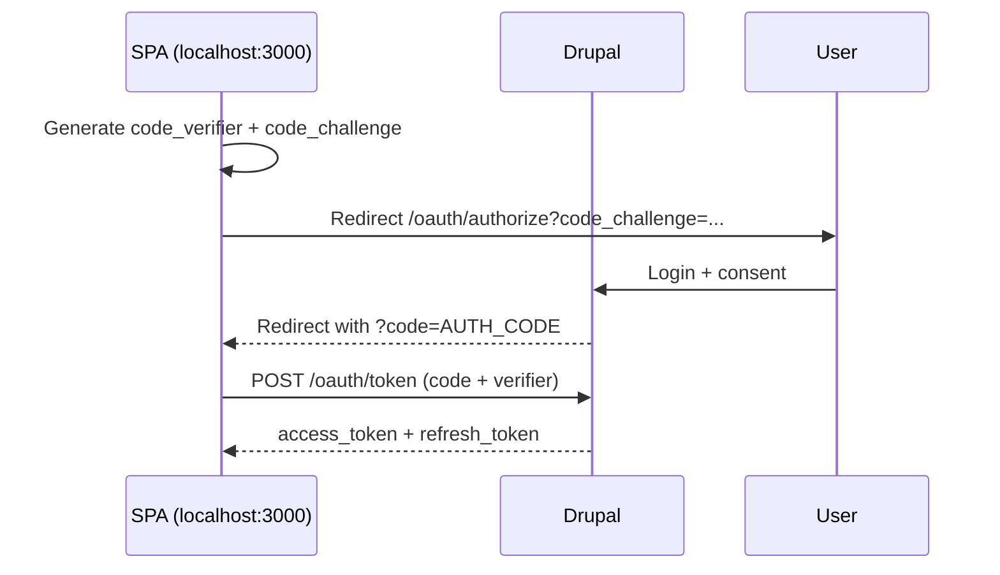

# OAuth 2.0 Authentication

**Simple OAuth** (`drupal/simple_oauth`) implements OAuth 2.0 for Drupal, enabling secure token-based authentication for SPAs, mobile apps, and server-to-server integrations.

## Install and configure

```bash
composer require drupal/simple_oauth drupal/consumers
drush en simple_oauth consumers -y
drush cr

# Generate OAuth keys (store outside web root)
mkdir -p ../oauth-keys
openssl genrsa -out ../oauth-keys/private.key 2048
openssl rsa -in ../oauth-keys/private.key -pubout -out ../oauth-keys/public.key
```

Configure key paths:

```bash
drush config:set simple_oauth.settings private_key /var/www/oauth-keys/private.key -y
drush config:set simple_oauth.settings public_key /var/www/oauth-keys/public.key -y
```

Or in `settings.php`:

```php
$config['simple_oauth.settings']['private_key'] = '/var/www/oauth-keys/private.key';
$config['simple_oauth.settings']['public_key'] = '/var/www/oauth-keys/public.key';
```

## OAuth flow overview



## Create a consumer

Via admin UI: **Configuration → Web services → Consumers → Add consumer**

Or programmatically (simple_oauth 6.x field names). Create the `article_editor` scope first (see [Scopes and roles](#scopes-and-roles)):

```php
// A dedicated, unprivileged service account. Client-credentials tokens act as
// this user. Never use uid 1 or an administrator: either bypasses scope limits.
$service_account = \Drupal::entityTypeManager()
  ->getStorage('user')
  ->create([
    'name' => 'svc_nextjs',
    'mail' => 'svc-nextjs@example.com',
    'status' => 1,
    'roles' => ['api_consumer'],
  ]);
$service_account->save();

$consumer = \Drupal::entityTypeManager()
  ->getStorage('consumer')
  ->create([
    'label' => 'Next.js Frontend',
    'client_id' => 'nextjs_app',
    'secret' => 'your-client-secret-change-in-production',
    'user_id' => $service_account->id(),
    'confidential' => TRUE,
    'pkce' => TRUE,
    'redirect' => ['http://localhost:3000/api/auth/callback'],
    'grant_types' => [
      'client_credentials',
      'authorization_code',
      'refresh_token',
    ],
    // References to oauth2_scope config entities, not role IDs.
    'scopes' => ['article_editor'],
    'access_token_expiration' => 300,
    'refresh_token_expiration' => 1209600,
  ]);
$consumer->save();
```

## Grant types

### Client credentials (server-to-server)

Best for Next.js server components and CI pipelines. Tokens act as the consumer's service account (`user_id`), with the permissions granted by the requested scopes.

```bash
curl -s -X POST \
  https://my-site.ddev.site/oauth/token \
  -H "Content-Type: application/x-www-form-urlencoded" \
  -d "grant_type=client_credentials" \
  -d "client_id=nextjs_app" \
  -d "client_secret=your-client-secret" \
  -d "scope=article_editor"
```

Response:

```json
{
  "token_type": "Bearer",
  "expires_in": 3600,
  "access_token": "eyJ0eXAiOiJKV1QiLCJhbG..."
}
```

### Authorization code + PKCE (user login in SPA)



Generate PKCE values with the Web Crypto API (available in browsers and in Node.js 18+, so the same code runs in route handlers):

```typescript
// lib/pkce.ts
function base64UrlEncode(bytes: Uint8Array): string {
  let binary = '';
  for (const byte of bytes) binary += String.fromCharCode(byte);
  return btoa(binary).replace(/\+/g, '-').replace(/\//g, '_').replace(/=+$/, '');
}

export function randomToken(byteLength = 32): string {
  return base64UrlEncode(crypto.getRandomValues(new Uint8Array(byteLength)));
}

export async function generatePkce() {
  const verifier = randomToken(32);
  const digest = await crypto.subtle.digest(
    'SHA-256',
    new TextEncoder().encode(verifier),
  );
  const challenge = base64UrlEncode(new Uint8Array(digest));
  return { verifier, challenge };
}
```

Authorization URL: start the flow from a route handler, so the verifier and the `state` value are kept in HttpOnly cookies that page scripts cannot read:

```typescript
// app/api/auth/login/route.ts
import { NextResponse } from 'next/server';
import { generatePkce, randomToken } from '@/lib/pkce';

export async function GET() {
  const { verifier, challenge } = await generatePkce();
  const state = randomToken(16);

  const params = new URLSearchParams({
    response_type: 'code',
    client_id: process.env.OAUTH_CLIENT_ID!,
    redirect_uri: `${process.env.NEXT_PUBLIC_BASE_URL}/api/auth/callback`,
    scope: 'article_editor',
    code_challenge: challenge,
    code_challenge_method: 'S256',
    state,
  });

  const res = NextResponse.redirect(
    `${process.env.DRUPAL_BASE_URL}/oauth/authorize?${params}`,
  );
  // sameSite 'lax' so the cookies come back on the top-level redirect from Drupal.
  const flowCookie = { httpOnly: true, secure: true, sameSite: 'lax' as const, path: '/', maxAge: 600 };
  res.cookies.set('pkce_verifier', verifier, flowCookie);
  res.cookies.set('oauth_state', state, flowCookie);
  return res;
}
```

Token exchange:

```typescript
// app/api/auth/callback/route.ts
import { NextRequest, NextResponse } from 'next/server';

export async function GET(request: NextRequest) {
  const code = request.nextUrl.searchParams.get('code');
  const state = request.nextUrl.searchParams.get('state');
  const verifier = request.cookies.get('pkce_verifier')?.value;
  const expectedState = request.cookies.get('oauth_state')?.value;

  // Reject callbacks this browser did not start (login CSRF protection).
  if (!code || !verifier || !state || state !== expectedState) {
    return NextResponse.json({ error: 'Invalid OAuth callback' }, { status: 400 });
  }

  const response = await fetch(`${process.env.DRUPAL_BASE_URL}/oauth/token`, {
    method: 'POST',
    headers: { 'Content-Type': 'application/x-www-form-urlencoded' },
    body: new URLSearchParams({
      grant_type: 'authorization_code',
      client_id: process.env.OAUTH_CLIENT_ID!,
      client_secret: process.env.OAUTH_CLIENT_SECRET!,
      redirect_uri: `${process.env.NEXT_PUBLIC_BASE_URL}/api/auth/callback`,
      code,
      code_verifier: verifier,
    }),
  });

  if (!response.ok) {
    return NextResponse.json({ error: 'Token exchange failed' }, { status: 401 });
  }

  const tokens = await response.json();

  // NextResponse.redirect() needs an absolute URL.
  const res = NextResponse.redirect(new URL('/dashboard', request.url));
  const tokenCookie = { httpOnly: true, secure: true, sameSite: 'lax' as const, path: '/' };
  res.cookies.set('access_token', tokens.access_token, {
    ...tokenCookie,
    maxAge: tokens.expires_in,
  });
  if (tokens.refresh_token) {
    res.cookies.set('refresh_token', tokens.refresh_token, {
      ...tokenCookie,
      maxAge: 1209600, // match the consumer's refresh_token_expiration
    });
  }
  res.cookies.delete('pkce_verifier');
  res.cookies.delete('oauth_state');

  return res;
}
```

### Refresh token

Read the refresh token from the `refresh_token` cookie on the server, and store the new pair it returns (simple_oauth issues a new refresh token on each refresh):

```typescript
async function refreshAccessToken(refreshToken: string) {
  const response = await fetch(`${DRUPAL_URL}/oauth/token`, {
    method: 'POST',
    headers: { 'Content-Type': 'application/x-www-form-urlencoded' },
    body: new URLSearchParams({
      grant_type: 'refresh_token',
      client_id: process.env.OAUTH_CLIENT_ID!,
      client_secret: process.env.OAUTH_CLIENT_SECRET!,
      refresh_token: refreshToken,
    }),
  });

  return response.json();
}
```

## Using access tokens with JSON:API

```bash
TOKEN="eyJ0eXAiOiJKV1QiLCJhbG..."

curl -s \
  -H "Authorization: Bearer $TOKEN" \
  -H "Accept: application/vnd.api+json" \
  https://my-site.ddev.site/jsonapi/node/article
```

```typescript
export async function fetchWithToken(path: string, accessToken: string) {
  return fetch(`${DRUPAL_URL}${path}`, {
    headers: {
      Authorization: `Bearer ${accessToken}`,
      Accept: 'application/vnd.api+json',
    },
  });
}
```

## Scopes and roles

In simple_oauth 6.x, scopes are `oauth2_scope` config entities, managed at `/admin/config/people/simple_oauth/oauth2_scope/dynamic`. Roles are no longer used directly as scopes. Each scope maps to a single **permission** or to a **role** (its granularity) and is enabled per grant type.

For this guide, create a scope named `article_editor` with granularity **Role → API Consumer**, enabled for the Authorization Code, Client Credentials and Refresh Token grants. The role holds the actual permissions:

```yaml
# user.role.api_consumer.yml
id: api_consumer
label: 'API Consumer'
permissions:
  - 'access content'
  - 'create article content'
  - 'edit own article content'
```

## Token expiration

In simple_oauth 6.x, token lifetimes are set **per consumer** (the `access_token_expiration` and `refresh_token_expiration` fields on the consumer form; defaults 300 and 1209600 seconds). The old `simple_oauth.settings` expiration keys are deprecated.

```php
$consumer->set('access_token_expiration', 900)->save();
```

## REST resource authentication config

Enable OAuth for REST endpoints:

```yaml
# rest.resource.dashboard_summary.yml
configuration:
  authentication:
    - oauth2
    - cookie
```

## Troubleshooting

| Issue | Solution |
|-------|----------|
| `invalid_client` | Check client_id and secret |
| `invalid_grant` | PKCE verifier mismatch or expired code |
| 401 on JSON:API | Token expired; check scope and role permissions |
| CORS on token endpoint | Add the frontend origin to `cors.config` `allowedOrigins` |

## Related pages

- [JWT](jwt.md) — custom stateless tokens
- [Cookie Auth](cookie-auth.md) — session alternative
- [Next.js integration](../nextjs.md) — server-side token usage
