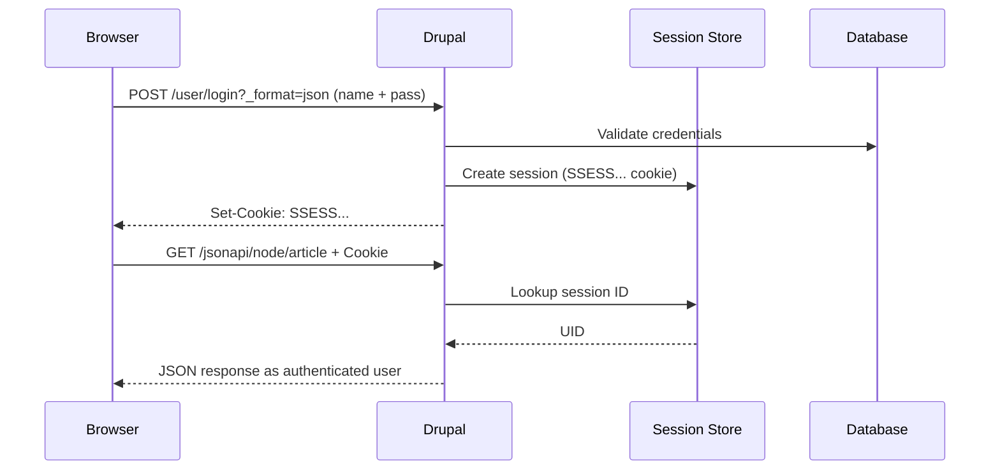

# Session Authentication

Drupal's session authentication uses PHP sessions backed by cookies. It is the default for the admin UI and works for API requests when the client shares the same origin (or is server-side).

## How Drupal sessions work



## Login via JSON

Drupal core's User module ships JSON endpoints for session login, so you do not need a custom controller:

| Route | Method | Purpose |
|-------|--------|---------|
| `/user/login?_format=json` | POST | Log in. Body: `{"name": "...", "pass": "..."}` |
| `/user/login_status?_format=json` | GET | Returns `1` when logged in, `0` when not |
| `/user/logout?_format=json&token={logout_token}` | POST | Log out. `token` is the `logout_token` from the login response |
| `/user/password?_format=json` | POST | Send a password-reset email |

The login route already applies core flood control (the IP and per-account limits in `user.flood` config), rejects blocked accounts, and regenerates the session.

```bash
# Log in: the session cookie is stored in cookies.txt
curl -s -c cookies.txt -X POST \
  -H "Content-Type: application/json" \
  "https://my-site.ddev.site/user/login?_format=json" \
  -d '{"name":"editor","pass":"secret"}'
```

Response:

```json
{
  "current_user": { "uid": "2", "roles": ["authenticated", "editor"], "name": "editor" },
  "csrf_token": "x3Fc...",
  "logout_token": "9QxP..."
}
```

```bash
# Check login status
curl -s -b cookies.txt "https://my-site.ddev.site/user/login_status?_format=json"

# Log out with the logout_token from the login response
curl -s -b cookies.txt -X POST \
  "https://my-site.ddev.site/user/logout?_format=json&token=$LOGOUT_TOKEN"
```

!!! warning "Writing your own login endpoint"
    Prefer the core routes. If you must build a custom one, authenticate with `UserAuthenticationInterface::lookupAccount()` and `authenticateAccount()` (Drupal 10.3+), not the legacy `UserAuthInterface::authenticate()` (its `UserAuth` implementation is deprecated in 10.3 and removed in 12.0). Also copy the `user.flood_control` checks from core's `UserAuthenticationController`: a login route without flood control is open to password brute-forcing.

## CSRF protection for state-changing requests

Session-authenticated POST/PATCH/DELETE requests require a CSRF token:

```bash
# 1. Login (establishes session cookie; the response contains csrf_token)
TOKEN=$(curl -s -c cookies.txt -X POST \
  -H "Content-Type: application/json" \
  "https://my-site.ddev.site/user/login?_format=json" \
  -d '{"name":"editor","pass":"secret"}' | jq -r '.csrf_token')

# 2. Or fetch a CSRF token for an existing session
TOKEN=$(curl -s -b cookies.txt https://my-site.ddev.site/session/token)

# 3. PATCH with CSRF header (JSON:API must allow writes: read_only false)
curl -s -b cookies.txt -X PATCH \
  -H "X-CSRF-Token: $TOKEN" \
  -H "Content-Type: application/vnd.api+json" \
  -H "Accept: application/vnd.api+json" \
  https://my-site.ddev.site/jsonapi/node/article/uuid-here \
  -d '{"data":{"type":"node--article","id":"uuid-here","attributes":{"title":"Updated"}}}'
```

## Session cookie names

| Environment | Cookie prefix |
|-------------|---------------|
| HTTPS | `SSESS` + hash |
| HTTP (dev) | `SESS` + hash |

Configure cookie domain in `settings.php` for subdomains:

```php
// web/sites/default/settings.php
$settings['cookie_domain'] = '.example.com';
```

## Session authentication provider

Session auth is registered as `cookie` in REST resource configuration:

```yaml
# rest.resource.entity.node.yml
configuration:
  authentication:
    - cookie
```

JSON:API uses all enabled authentication providers by default.

## Server-side usage (Next.js)

Server components can forward session cookies without exposing them to the browser:

```typescript
// app/api/drupal/route.ts
import { cookies } from 'next/headers';

export async function GET() {
  const cookieStore = await cookies();
  const sessionCookie = cookieStore.get('SSESS...')?.value;

  const response = await fetch(`${process.env.DRUPAL_BASE_URL}/jsonapi/user/user`, {
    headers: {
      Accept: 'application/vnd.api+json',
      Cookie: `SSESS...=${sessionCookie}`,
    },
  });

  return Response.json(await response.json());
}
```

!!! tip "Prefer OAuth for SPAs"
    For browser-based single-page apps on a different origin, use [OAuth 2.0](oauth2.md) instead of session cookies to avoid CSRF complexity and third-party cookie restrictions.

## Related pages

- [Cookie Auth](cookie-auth.md) — cross-origin cookie patterns
- [OAuth 2.0](oauth2.md) — token-based auth for SPAs
- [JWT](jwt.md) — stateless tokens
