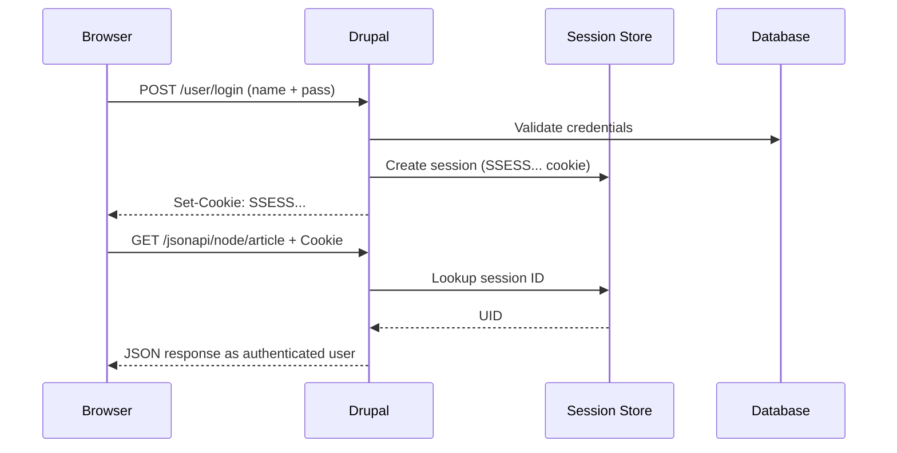

# Session Authentication

Drupal's session authentication uses PHP sessions backed by cookies. It is the default for the admin UI and works for API requests when the client shares the same origin (or is server-side).

## How Drupal sessions work



## Login via JSON

Drupal core does not ship a JSON login endpoint. Options:

1. **User HTTP Routes** (contrib) — `drupal/user_http_auth`
2. **Custom login controller** (shown below)
3. **OAuth 2.0** for cross-origin SPAs (preferred)

### Custom session login controller

```php
<?php

declare(strict_types=1);

namespace Drupal\my_auth\Controller;

use Drupal\Core\Controller\ControllerBase;
use Drupal\user\UserAuthInterface;
use Symfony\Component\DependencyInjection\ContainerInterface;
use Symfony\Component\HttpFoundation\JsonResponse;
use Symfony\Component\HttpFoundation\Request;
use Symfony\Component\HttpFoundation\Response;

/**
 * JSON login endpoint that establishes a Drupal session.
 */
final class SessionLoginController extends ControllerBase {

  public function __construct(
    private readonly UserAuthInterface $userAuth,
  ) {}

  /**
   * {@inheritdoc}
   */
  public static function create(ContainerInterface $container): static {
    return new static(
      $container->get('user.auth'),
    );
  }

  /**
   * Authenticates user and returns session info.
   */
  public function login(Request $request): JsonResponse {
    $payload = json_decode($request->getContent(), TRUE) ?? [];
    $username = $payload['username'] ?? '';
    $password = $payload['password'] ?? '';

    if ($username === '' || $password === '') {
      return new JsonResponse(['error' => 'username and password required'], 400);
    }

    $uid = $this->userAuth->authenticate($username, $password);
    if (!$uid) {
      return new JsonResponse(['error' => 'Invalid credentials'], 401);
    }

    $user = $this->entityTypeManager()->getStorage('user')->load($uid);
    user_login_finalize($user);

    return new JsonResponse([
      'uid' => (int) $uid,
      'name' => $user->getAccountName(),
      'csrf_token' => \Drupal::csrfToken()->get('rest'),
    ]);
  }

  /**
   * Destroys the current session.
   */
  public function logout(): Response {
    user_logout();
    return new JsonResponse(['message' => 'Logged out']);
  }

}
```

```yaml
# my_auth.routing.yml
my_auth.session_login:
  path: '/api/auth/login'
  defaults:
    _controller: '\Drupal\my_auth\Controller\SessionLoginController::login'
  requirements:
    _access: 'TRUE'
  methods: [POST]

my_auth.session_logout:
  path: '/api/auth/logout'
  defaults:
    _controller: '\Drupal\my_auth\Controller\SessionLoginController::logout'
  requirements:
    _user_is_logged_in: 'TRUE'
  methods: [POST]
```

## CSRF protection for state-changing requests

Session-authenticated POST/PATCH/DELETE requests require a CSRF token:

```bash
# 1. Login (establishes session cookie)
curl -s -c cookies.txt -X POST \
  -H "Content-Type: application/json" \
  https://my-site.ddev.site/api/auth/login \
  -d '{"username":"editor","password":"secret"}'

# 2. Extract CSRF token from response
TOKEN=$(curl -s -b cookies.txt https://my-site.ddev.site/session/token)

# 3. PATCH with CSRF header
curl -s -b cookies.txt -X PATCH \
  -H "X-CSRF-Token: $TOKEN" \
  -H "Content-Type: application/vnd.api+json" \
  -H "Accept: application/vnd.api+json" \
  https://my-site.ddev.site/jsonapi/node/article/uuid-here \
  -d '{"data":{"type":"node--article","id":"uuid-here","attributes":{"title":"Updated"}}}'
```

## Session cookie names

| Environment | Cookie prefix |
|-------------|---------------|
| HTTPS | `SSESS` + hash |
| HTTP (dev) | `SESS` + hash |

Configure cookie domain in `settings.php` for subdomains:

```php
// web/sites/default/settings.php
$settings['cookie_domain'] = '.example.com';
```

## Session authentication provider

Session auth is registered as `cookie` in REST resource configuration:

```yaml
# rest.resource.entity.node.yml
configuration:
  authentication:
    - cookie
```

JSON:API uses all enabled authentication providers by default.

## Server-side usage (Next.js)

Server components can forward session cookies without exposing them to the browser:

```typescript
// app/api/drupal/route.ts
import { cookies } from 'next/headers';

export async function GET() {
  const cookieStore = await cookies();
  const sessionCookie = cookieStore.get('SSESS...')?.value;

  const response = await fetch(`${process.env.DRUPAL_BASE_URL}/jsonapi/user/user`, {
    headers: {
      Accept: 'application/vnd.api+json',
      Cookie: `SSESS...=${sessionCookie}`,
    },
  });

  return Response.json(await response.json());
}
```

!!! tip "Prefer OAuth for SPAs"
    For browser-based single-page apps on a different origin, use [OAuth 2.0](oauth2.md) instead of session cookies to avoid CSRF complexity and third-party cookie restrictions.

## Related pages

- [Cookie Auth](cookie-auth.md) — cross-origin cookie patterns
- [OAuth 2.0](oauth2.md) — token-based auth for SPAs
- [JWT](jwt.md) — stateless tokens
