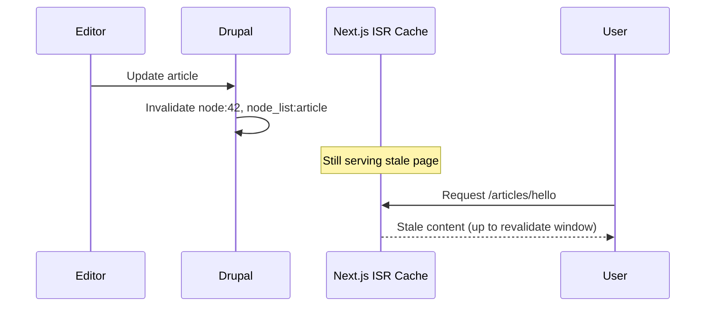
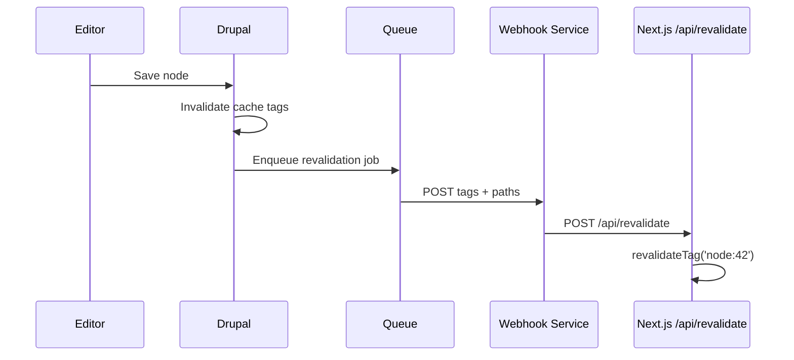

# Cache Invalidation for Headless

Drupal's cache tag system enables precise invalidation. In headless architectures, you must **propagate those tags to your frontend** so ISR and CDN caches stay fresh when content changes.

## The problem



## Solution: tag-aware webhooks



## Drupal webhook module

### Module structure

```
modules/custom/headless_revalidate/
├── headless_revalidate.info.yml
├── headless_revalidate.services.yml
├── config/
│   ├── install/
│   │   └── headless_revalidate.settings.yml
│   └── schema/
│       └── headless_revalidate.schema.yml
├── headless_revalidate.module
└── src/
    └── Service/
        └── RevalidateClient.php
```

### headless_revalidate.settings.yml

```yaml
frontend_url: 'https://my-frontend.vercel.app'
revalidate_endpoint: '/api/revalidate'
secret: 'CHANGE-ME-random-secret'
enabled_bundles:
  - article
  - page
```

### RevalidateClient.php

```php
<?php

declare(strict_types=1);

namespace Drupal\headless_revalidate\Service;

use Drupal\Core\Config\ConfigFactoryInterface;
use Drupal\Core\Entity\EntityInterface;
use GuzzleHttp\ClientInterface;
use Psr\Log\LoggerInterface;

/**
 * Sends cache revalidation requests to the frontend.
 */
final class RevalidateClient {

  public function __construct(
    private readonly ClientInterface $httpClient,
    private readonly ConfigFactoryInterface $configFactory,
    private readonly LoggerInterface $logger,
  ) {}

  /**
   * Revalidates frontend cache for an entity.
   */
  public function revalidateEntity(EntityInterface $entity): void {
    $config = $this->configFactory->get('headless_revalidate.settings');

    if (!in_array($entity->bundle(), $config->get('enabled_bundles') ?? [], TRUE)) {
      return;
    }

    $frontendUrl = rtrim($config->get('frontend_url'), '/');
    $endpoint = $config->get('revalidate_endpoint');
    $secret = $config->get('secret');

    $tags = $entity->getCacheTags();
    $tags[] = 'node_list:' . $entity->bundle();

    $paths = [];
    if ($entity->hasField('path') && !$entity->get('path')->isEmpty()) {
      $alias = $entity->get('path')->alias;
      if ($alias) {
        $paths[] = $alias;
      }
    }

    try {
      $this->httpClient->post("{$frontendUrl}{$endpoint}", [
        'headers' => [
          'Content-Type' => 'application/json',
          'X-Revalidate-Secret' => $secret,
        ],
        'json' => [
          'tags' => $tags,
          'paths' => $paths,
          'entity_type' => $entity->getEntityTypeId(),
          'bundle' => $entity->bundle(),
          'id' => $entity->id(),
        ],
        'timeout' => 5,
      ]);

      $this->logger->info('Revalidated frontend for @type:@id tags=@tags', [
        '@type' => $entity->getEntityTypeId(),
        '@id' => $entity->id(),
        '@tags' => implode(',', $tags),
      ]);
    }
    catch (\Exception $e) {
      $this->logger->error('Revalidation failed: @message', [
        '@message' => $e->getMessage(),
      ]);
    }
  }

}
```

### headless_revalidate.module

```php
<?php

declare(strict_types=1);

use Drupal\Core\Entity\EntityInterface;

/**
 * Implements hook_entity_insert().
 */
function headless_revalidate_entity_insert(EntityInterface $entity): void {
  _headless_revalidate_queue_entity($entity);
}

/**
 * Implements hook_entity_update().
 */
function headless_revalidate_entity_update(EntityInterface $entity): void {
  _headless_revalidate_queue_entity($entity);
}

/**
 * Implements hook_entity_delete().
 */
function headless_revalidate_entity_delete(EntityInterface $entity): void {
  _headless_revalidate_queue_entity($entity);
}

/**
 * Queues frontend revalidation for node entities.
 */
function _headless_revalidate_queue_entity(EntityInterface $entity): void {
  if ($entity->getEntityTypeId() !== 'node') {
    return;
  }

  // Queue for async processing to avoid blocking editor saves.
  $queue = \Drupal::queue('headless_revalidate');
  $queue->createItem([
    'entity_type' => $entity->getEntityTypeId(),
    'entity_id' => $entity->id(),
  ]);
}
```

### Queue worker

```php
<?php

declare(strict_types=1);

namespace Drupal\headless_revalidate\Plugin\QueueWorker;

use Drupal\Core\Entity\EntityTypeManagerInterface;
use Drupal\Core\Plugin\ContainerFactoryPluginInterface;
use Drupal\Core\Queue\Attribute\QueueWorker;
use Drupal\Core\Queue\QueueWorkerBase;
use Drupal\Core\StringTranslation\TranslatableMarkup;
use Drupal\headless_revalidate\Service\RevalidateClient;
use Symfony\Component\DependencyInjection\ContainerInterface;

/**
 * Processes frontend revalidation queue items.
 */
#[QueueWorker(
  id: 'headless_revalidate',
  title: new TranslatableMarkup('Headless revalidation'),
  cron: ['time' => 30],
)]
final class RevalidateQueueWorker extends QueueWorkerBase implements ContainerFactoryPluginInterface {

  public function __construct(
    array $configuration,
    $plugin_id,
    $plugin_definition,
    private readonly EntityTypeManagerInterface $entityTypeManager,
    private readonly RevalidateClient $revalidateClient,
  ) {
    parent::__construct($configuration, $plugin_id, $plugin_definition);
  }

  /**
   * {@inheritdoc}
   */
  public static function create(ContainerInterface $container, array $configuration, $plugin_id, $plugin_definition): static {
    return new static(
      $configuration,
      $plugin_id,
      $plugin_definition,
      $container->get('entity_type.manager'),
      $container->get('headless_revalidate.client'),
    );
  }

  /**
   * {@inheritdoc}
   */
  public function processItem($data): void {
    $entity = $this->entityTypeManager
      ->getStorage($data['entity_type'])
      ->load($data['entity_id']);

    if ($entity) {
      $this->revalidateClient->revalidateEntity($entity);
    }
  }

}
```

### headless_revalidate.services.yml

```yaml
services:
  headless_revalidate.client:
    class: Drupal\headless_revalidate\Service\RevalidateClient
    arguments: ['@http_client', '@config.factory', '@logger.channel.headless_revalidate']

  logger.channel.headless_revalidate:
    parent: logger.channel_base
    arguments: ['headless_revalidate']


```

## Cache tag mapping

| Drupal event | Cache tags | Frontend action |
|--------------|------------|-----------------|
| Node saved | `node:{nid}`, `node_list:{bundle}` | `revalidateTag` both |
| Node deleted | same | `revalidateTag` + `revalidatePath` |
| Config import | `config:{name}` | `revalidateTag('config:...')` |
| Menu changed | `config:system.menu.main` | Revalidate layout |
| Media changed | `media:{mid}` | Revalidate referencing nodes |
| Taxonomy term | `taxonomy_term:{tid}` | Revalidate tagged content lists |

## Next.js revalidation handler

See [Next.js integration](nextjs.md) for the full route handler. Key mapping:

```typescript
// Map Drupal tags to Next.js cache tags used in fetch()
const TAG_MAP: Record<string, string> = {
  'node_list:article': 'node_list:article',
  'node:': 'node:article', // prefix match
};

export function mapDrupalTags(drupalTags: string[]): string[] {
  return drupalTags.map((tag) => TAG_MAP[tag] ?? tag);
}
```

Use matching tags in fetch calls:

```typescript
const articles = await drupal.getResourceCollection('node--article', {
  next: { tags: ['node_list:article'] },
});
```

## JSON:API cache headers

Drupal sends cache metadata in responses. Inspect headers:

```bash
curl -sI \
  -H "Accept: application/vnd.api+json" \
  https://my-site.ddev.site/jsonapi/node/article \
  | grep -i cache
```

For authenticated responses, use shorter `max-age` or `private` cache directives.

## Purge module (CDN integration)

For Varnish, Cloudflare, or Acquia Purge:

```bash
composer require drupal/purge
drush en purge purge_ui -y
```

Configure a purger for your CDN so Drupal cache tag invalidation also purges edge caches.

## Testing revalidation

```bash
# 1. Edit article in Drupal admin
# 2. Process queue
drush queue:run headless_revalidate

# 3. Or test webhook directly
curl -s -X POST \
  -H "Content-Type: application/json" \
  -H "X-Revalidate-Secret: your-secret" \
  -d '{"tags":["node:42","node_list:article"],"paths":["/articles/hello"]}' \
  https://my-frontend.vercel.app/api/revalidate
```

## Related pages

- [Caching](../caching/cache-tags.md) — Drupal cache tag fundamentals
- [Next.js integration](nextjs.md) — ISR setup
- [JSON:API Deep Dive](jsonapi.md) — fetch cache tags
