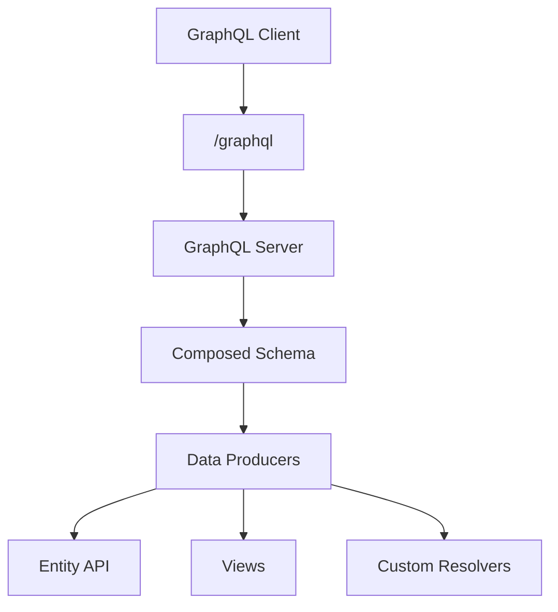

# GraphQL

Drupal's **GraphQL** contrib module exposes a typed schema over your Drupal data. Use it when frontend teams prefer GraphQL's query language over JSON:API's resource-oriented URLs.

## Install

```bash
composer require drupal/graphql drupal/graphql_compose
drush en graphql graphql_compose -y
drush cr
```

GraphiQL explorer (GraphQL 4.x, per server): `https://my-site.ddev.site/admin/config/graphql/servers/manage/{server}/explorer`

## Architecture



## GraphQL Compose (recommended)

GraphQL Compose auto-generates schema from entity types and fields:

```bash
drush en graphql_compose -y
```

Configure at **Configuration → Web services → GraphQL Compose**.

Enable entity types:

- `node` → bundles: `article`, `page`
- `taxonomy_term` → bundles: `tags`
- `media` → bundles: `image`
- `user`

## Example queries

### List articles

```graphql
query ArticleList($limit: Int = 10) {
  nodeArticles(first: $limit, sortKey: CREATED_AT, reverse: true) {
    nodes {
      id
      title
      path
      created {
        timestamp
      }
      author {
        ... on User {
          name
          mail
        }
      }
      tags {
        ... on TermTags {
          name
        }
      }
      heroImage {
        ... on MediaImage {
          mediaImage {
            url
            alt
            width
            height
          }
        }
      }
      body {
        processed
      }
    }
  }
}
```

Variables:

```json
{ "limit": 5 }
```

### Single article by path

```graphql
query ArticleByPath($path: String!) {
  route(path: $path) {
    ... on RouteInternal {
      entity {
        ... on NodeArticle {
          id
          title
          body {
            processed
          }
          heroImage {
            ... on MediaImage {
              mediaImage {
                url
                alt
              }
            }
          }
        }
      }
    }
  }
}
```

```json
{ "path": "/articles/my-article-slug" }
```

## Custom data producer

Extend the schema with computed fields or aggregations.

### Module structure

```
modules/custom/my_graphql/
├── my_graphql.info.yml
├── my_graphql.services.yml
└── src/
    └── Plugin/GraphQL/DataProducer/
        └── ArticleStats.php
```

### ArticleStats.php

```php
<?php

declare(strict_types=1);

namespace Drupal\my_graphql\Plugin\GraphQL\DataProducer;

use Drupal\Core\Entity\EntityTypeManagerInterface;
use Drupal\Core\Plugin\ContainerFactoryPluginInterface;
use Drupal\graphql\Plugin\GraphQL\DataProducer\DataProducerPluginBase;
use Symfony\Component\DependencyInjection\ContainerInterface;

/**
 * Returns article statistics.
 *
 * @DataProducer(
 *   id = "article_stats",
 *   name = @Translation("Article statistics"),
 *   description = @Translation("Returns count of published articles."),
 *   produces = @ContextDefinition("any",
 *     label = @Translation("Article stats")
 *   )
 * )
 */
final class ArticleStats extends DataProducerPluginBase implements ContainerFactoryPluginInterface {

  public function __construct(
    array $configuration,
    $plugin_id,
    $plugin_definition,
    private readonly EntityTypeManagerInterface $entityTypeManager,
  ) {
    parent::__construct($configuration, $plugin_id, $plugin_definition);
  }

  /**
   * {@inheritdoc}
   */
  public static function create(ContainerInterface $container, array $configuration, $plugin_id, $plugin_definition): static {
    return new static(
      $configuration,
      $plugin_id,
      $plugin_definition,
      $container->get('entity_type.manager'),
    );
  }

  /**
   * Resolves article statistics.
   */
  public function resolve(): array {
    $count = $this->entityTypeManager
      ->getStorage('node')
      ->getQuery()
      ->accessCheck(TRUE)
      ->condition('type', 'article')
      ->condition('status', 1)
      ->count()
      ->execute();

    return [
      'published_count' => (int) $count,
      'generated_at' => time(),
    ];
  }

}
```

### Schema extension (graphql.schema.yml)

```yaml
# my_graphql.graphqls.yml
type ArticleStats {
  published_count: Int!
  generated_at: Int!
}

type Query {
  articleStats: ArticleStats
}
```

Register resolver in `my_graphql.services.yml` or via GraphQL Compose schema extension UI.

## Frontend client (Apollo)

```bash
npm install @apollo/client graphql
```

```typescript
// lib/apollo.ts
import { ApolloClient, InMemoryCache, gql, HttpLink } from '@apollo/client';

const client = new ApolloClient({
  link: new HttpLink({
    uri: `${process.env.NEXT_PUBLIC_DRUPAL_BASE_URL}/graphql`,
    headers: {
      Authorization: `Bearer ${process.env.DRUPAL_ACCESS_TOKEN}`,
    },
  }),
  cache: new InMemoryCache(),
});

const ARTICLE_LIST = gql`
  query ArticleList($limit: Int) {
    nodeArticles(first: $limit, sortKey: CREATED_AT, reverse: true) {
      nodes {
        id
        title
        path
        body {
          processed
        }
      }
    }
  }
`;

export async function getArticles(limit = 10) {
  const { data } = await client.query({
    query: ARTICLE_LIST,
    variables: { limit },
  });
  return data.nodeArticles.nodes;
}
```

## GraphQL vs JSON:API

| Factor | GraphQL | JSON:API |
|--------|---------|----------|
| Query flexibility | Client shapes response | Server defines resources |
| Caching | Complex (POST requests) | HTTP cache friendly |
| Drupal support | Contrib module | Core |
| Learning curve | GraphQL schema | JSON:API spec |
| Tooling | GraphiQL, Apollo | Standard REST tools |
| Recommended for | Teams with GraphQL expertise | Most headless projects |

!!! tip "Default to JSON:API"
    JSON:API is in core, has better HTTP caching, and integrates with next-drupal out of the box. Choose GraphQL when your team has strong GraphQL requirements.

## Authentication

GraphQL endpoints respect Drupal authentication providers:

```bash
curl -s -X POST \
  -H "Content-Type: application/json" \
  -H "Authorization: Bearer $TOKEN" \
  -d '{"query":"{ nodeArticles(first:5) { nodes { title } } }"}' \
  https://my-site.ddev.site/graphql
```

## Related pages

- [JSON:API Deep Dive](jsonapi.md)
- [Authentication](auth/index.md)
- [Next.js integration](nextjs.md)
