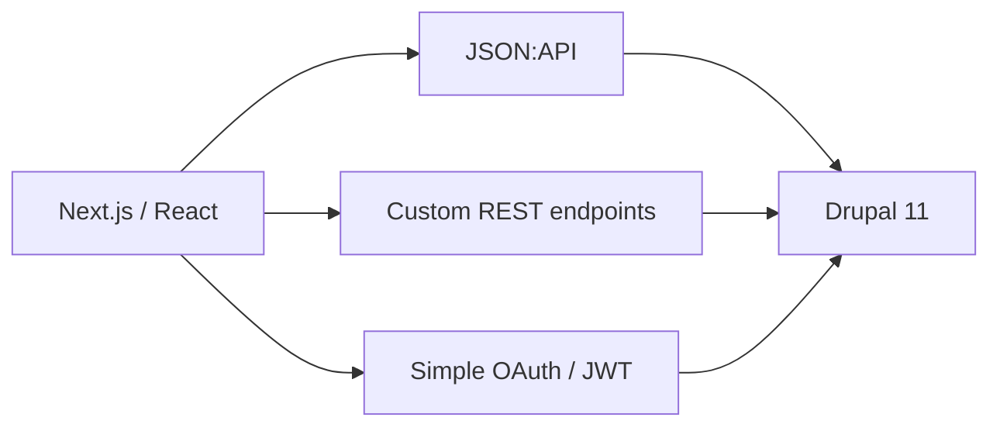
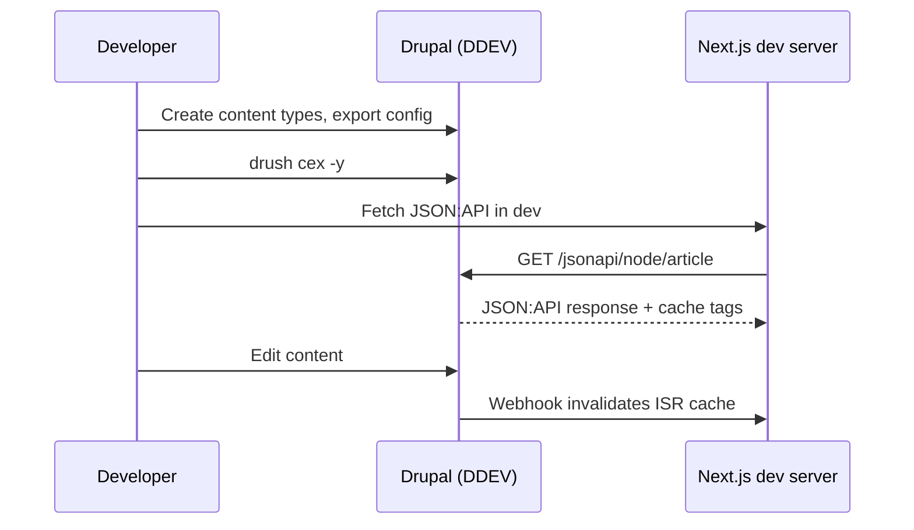

# Headless Drupal

Headless Drupal exposes content and configuration through HTTP APIs instead of (or in addition to) server-rendered HTML. Your frontend—Next.js, React Native, a voice assistant—consumes structured JSON while Drupal remains the content authority.

## What this section covers

| Topic | Page |
|-------|------|
| Architecture patterns | [Architecture](architecture.md) |
| Core REST module | [REST API](rest-api.md) |
| JSON:API (recommended) | [JSON:API Deep Dive](jsonapi.md) |
| Custom endpoints | [Custom JSON APIs](custom-json-apis.md) |
| Authentication | [Auth overview](auth/index.md) |
| Next.js integration | [Drupal + Next.js](nextjs.md) |
| GraphQL | [GraphQL](graphql.md) |
| Media & images | [Media & Images](media-images.md) |
| Frontend cache invalidation | [Cache Invalidation](cache-invalidation.md) |

## Recommended API stack

For new projects in Drupal 11, use this stack unless you have a specific reason not to:



| Layer | Recommendation |
|-------|----------------|
| Primary read API | JSON:API (core) |
| Custom mutations / aggregations | REST plugins or custom controllers |
| Auth (SPA / mobile) | Simple OAuth 2.0 or JWT |
| Auth (same-origin admin) | Session cookies |
| Frontend bridge | [next-drupal](https://next-drupal.org/) for Next.js |
| Cache coordination | Cache tags + webhooks |

## Enable the API modules

```bash
# JSON:API is in core — enable it
drush en jsonapi serialization -y

# Optional: REST for custom resource plugins
drush en rest -y

# Optional: GraphQL contrib
composer require drupal/graphql
drush en graphql -y

# Verify JSON:API discovery document
curl -s https://my-site.ddev.site/jsonapi | jq '.links'
```

## First API request

```bash
# List article nodes (anonymous access requires permission)
curl -s \
  -H "Accept: application/vnd.api+json" \
  https://my-site.ddev.site/jsonapi/node/article \
  | jq '.data[0].attributes.title'
```

!!! note "Permissions"
    JSON:API has no permissions of its own: every request goes through normal entity access. In the Standard profile anonymous users already have **View published content** (`access content`), so published nodes are readable without authentication; unpublished content, user emails and other restricted data require an authenticated request with the matching permissions. See [Authentication](auth/index.md).

## CORS for browser clients

Browser-based frontends on a different origin need CORS headers. Add to `web/sites/default/services.yml`:

```yaml
parameters:
  cors.config:
    enabled: true
    allowedHeaders: ['*']
    allowedMethods: ['GET', 'POST', 'PATCH', 'DELETE', 'OPTIONS']
    allowedOrigins: ['https://my-frontend.vercel.app', 'http://localhost:3000']
    exposedHeaders: false
    maxAge: 1000
    supportsCredentials: true
```

Clear caches after editing services configuration:

```bash
drush cr
```

## Content modeling for APIs

Design content types with API consumers in mind:

- Use **entity references** instead of embedding HTML in text fields
- Store images in the **Media** system, not direct file fields
- Add **machine-readable** fields (slug, SEO metadata, display order)
- Use **paragraphs** or **Layout Builder** only if your frontend can render them

```php
// Example: article with references the API can include
$node = Node::create([
  'type' => 'article',
  'title' => 'Headless Launch',
  'field_slug' => 'headless-launch',
  'field_author' => ['target_id' => 5],
  'field_hero_media' => ['target_id' => 12],
  'field_tags' => [
    ['target_id' => 3],
    ['target_id' => 7],
  ],
]);
$node->save();
```

## Development workflow



## Next steps

1. Understand [architecture patterns](architecture.md) — traditional vs decoupled vs fully headless
2. Learn [JSON:API](jsonapi.md) — your primary read API
3. Configure [authentication](auth/index.md) for your frontend
4. Integrate with [Next.js](nextjs.md) using next-drupal
5. Wire up [cache invalidation](cache-invalidation.md) for production
