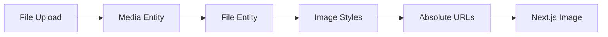
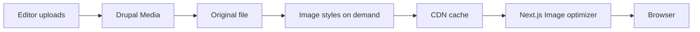

# Media & Images

Headless frontends must resolve image URLs, image styles, and responsive variants from Drupal's Media system. This page covers the full pipeline from upload to frontend rendering.

## Media architecture in headless



## Content model

Use the standard Media → Image bundle:

| Entity | Field | Purpose |
|--------|-------|---------|
| Media (image) | `field_media_image` | File reference + alt text |
| Node (article) | `field_hero_media` | Entity reference to Media |

```bash
# Verify media is exposed via JSON:API
curl -s -H "Accept: application/vnd.api+json" \
  https://my-site.ddev.site/jsonapi/media/image | jq '.data[0].type'
```

## JSON:API image response

```bash
curl -s -G \
  -H "Accept: application/vnd.api+json" \
  --data-urlencode 'include=field_hero_media.field_media_image' \
  --data-urlencode 'fields[media--image]=field_media_image' \
  --data-urlencode 'fields[file--file]=uri,filemime,filesize' \
  https://my-site.ddev.site/jsonapi/node/article/{uuid}
```

Response excerpt:

```json
{
  "included": [
    {
      "type": "file--file",
      "id": "file-uuid",
      "attributes": {
        "uri": {
          "value": "public://2026-01/hero.jpg",
          "url": "/sites/default/files/2026-01/hero.jpg"
        },
        "filemime": "image/jpeg",
        "filesize": 245760
      }
    }
  ]
}
```

Build absolute URL:

```typescript
function absoluteFileUrl(relativeUrl: string): string {
  return `${process.env.NEXT_PUBLIC_DRUPAL_BASE_URL}${relativeUrl}`;
}
```

## Image styles

Drupal generates derivatives (thumbnails, hero sizes) via image styles.

### Core image styles

| Style | Typical use |
|-------|-------------|
| `thumbnail` | 100×100 admin previews |
| `medium` | 220×220 embeds |
| `large` | 480×480 content |
| `wide` | 1090×wide responsive |

### Custom image style

Create via UI: **Configuration → Media → Image styles → Add**

Or export config:

```yaml
# image.style.hero.yml
langcode: en
status: true
dependencies: {  }
name: hero
label: 'Hero (1200×630)'
effects:
  1c49c123-4567-890a-bcde-f1234567890a:
    uuid: 1c49c123-4567-890a-bcde-f1234567890a
    id: image_scale_and_crop
    weight: 0
    data:
      width: 1200
      height: 630
      anchor: center-center
```

```bash
drush config:import -y
```

### Image style URLs

Drupal image style URLs follow this pattern:

```
/sites/default/files/styles/{style_name}/public/{file_path}?itok={token}
```

Example:

```
https://my-site.ddev.site/sites/default/files/styles/hero/public/2026-01/hero.jpg?itok=Ab12Cd34
```

!!! warning "Don't build style URLs in the frontend"
    The `itok` token is an HMAC that only Drupal can compute. A derivative that has not been generated yet is only created when the request carries a valid `itok`; without it Drupal returns `404`. (Setting `image.settings:allow_insecure_derivatives` relaxes this, but it re-opens the denial-of-service hole the token closes.) Get finished style URLs from Drupal instead:

    - **[Consumer Image Styles](https://www.drupal.org/project/consumer_image_styles)** (contrib) adds signed derivative URLs (`meta.imageDerivatives`) to image data in JSON:API responses, for the styles enabled on the consumer.
    - **`ImageStyle::buildUrl()`** in your own code returns the absolute URL including `itok` (see `ResponsiveImageBuilder` below).

### Helper function

```typescript
// lib/drupal-image.ts

// One image style URL as delivered by Drupal (absolute, already signed with itok).
export interface DrupalImageSource {
  url: string;
  width: number;
}

// Pick the smallest delivered style at least `minWidth` wide.
export function pickImageSource(
  sources: DrupalImageSource[],
  minWidth: number,
): DrupalImageSource | undefined {
  const sorted = [...sources].sort((a, b) => a.width - b.width);
  return sorted.find((source) => source.width >= minWidth) ?? sorted.at(-1);
}
```

## Responsive images module

Enable responsive image styles for `srcset` generation:

```bash
drush en responsive_image -y
```

Configure a responsive image style:

```yaml
# responsive_image.styles.article_hero.yml
langcode: en
status: true
dependencies:
  config:
    - image.style.hero
    - image.style.large
id: article_hero
label: 'Article hero responsive'
image_style_mappings:
  -
    image_mapping_type: sizes
    image_mapping:
      sizes: '(max-width: 768px) 100vw, 1200px'
      sizes_image_styles:
        - hero
        - large
    breakpoint_id: responsive_image.viewport_sizing
    multiplier: 1x
fallback_image_style: large
```

### Expose responsive data via custom normalizer

JSON:API does not natively expose responsive image `srcset`. Build the data with a service like this, then expose it through a computed field (see [Adding data to JSON:API output](custom-json-apis.md#adding-data-to-jsonapi-output)) or a custom endpoint:

```php
<?php

declare(strict_types=1);

namespace Drupal\my_headless\Service;

use Drupal\Core\File\FileUrlGeneratorInterface;
use Drupal\image\Entity\ImageStyle;
use Drupal\media\MediaInterface;

/**
 * Builds responsive image data for headless consumers.
 */
final class ResponsiveImageBuilder {

  public function __construct(
    private readonly FileUrlGeneratorInterface $fileUrlGenerator,
  ) {}

  /**
   * Returns srcset-ready data for a media image entity.
   */
  public function build(MediaInterface $media): ?array {
    if ($media->bundle() !== 'image' || $media->get('field_media_image')->isEmpty()) {
      return NULL;
    }

    $imageField = $media->get('field_media_image')->first();
    $file = $imageField->entity;
    if (!$file) {
      return NULL;
    }

    $uri = $file->getFileUri();
    $styles = ['thumbnail' => 100, 'medium' => 220, 'large' => 480, 'hero' => 1200];
    $sources = [];

    foreach ($styles as $name => $width) {
      $style = ImageStyle::load($name);
      if ($style) {
        $sources[] = [
          'url' => $style->buildUrl($uri),
          'width' => $width,
        ];
      }
    }

    return [
      'alt' => $imageField->alt ?? '',
      'title' => $imageField->title ?? '',
      'original' => $this->fileUrlGenerator->generateAbsoluteString($uri),
      'sources' => $sources,
      'srcset' => implode(', ', array_map(
        fn ($s) => "{$s['url']} {$s['width']}w",
        $sources,
      )),
      'sizes' => '(max-width: 768px) 100vw, 1200px',
    ];
  }

}
```

## Next.js Image component

```tsx
// components/ArticleHero.tsx
import Image from 'next/image';

interface ArticleHeroProps {
  // The `hero` style URL as delivered by Drupal (includes ?itok=...).
  heroUrl: string;
  alt: string;
  width?: number;
  height?: number;
}

export function ArticleHero({
  heroUrl,
  alt,
  width = 1200,
  height = 630,
}: ArticleHeroProps) {
  return (
    <Image
      src={heroUrl}
      alt={alt}
      width={width}
      height={height}
      sizes="(max-width: 768px) 100vw, 1200px"
      className="w-full h-auto rounded-lg"
      priority
    />
  );
}
```

!!! note "Next.js 16"
    `priority` is deprecated in Next.js 16; use `preload` (or `loading="eager"`). Next.js 16 also refuses to optimize images from hosts that resolve to local IPs (e.g. DDEV), see [Drupal + Next.js](nextjs.md).

### Native srcset without next/image

```tsx
interface ResponsiveImageProps {
  srcset: string;
  sizes: string;
  alt: string;
  src: string;
}

export function ResponsiveImage({ srcset, sizes, alt, src }: ResponsiveImageProps) {
  return (
    
  );
}
```

## SVG and non-image media

```bash
# Media document bundle
curl -s -H "Accept: application/vnd.api+json" \
  https://my-site.ddev.site/jsonapi/media/document/{uuid}
```

For SVG files, serve directly without image styles:

```typescript
function isSvg(mimeType: string): boolean {
  return mimeType === 'image/svg+xml';
}
```

## Image optimization pipeline



!!! tip "CDN caching"
    Image style URLs are deterministic. Set long `Cache-Control` headers at the CDN for `/sites/default/files/styles/**`.

## Focal point (contrib)

For art-directed cropping:

```bash
composer require drupal/focal_point
drush en focal_point -y
```

Focal point coordinates are available in file `meta` when using JSON:API with appropriate normalizers.

## Related pages

- [JSON:API Deep Dive](jsonapi.md) — include media relationships
- [Next.js integration](nextjs.md) — Image component setup
- [Cache Invalidation](cache-invalidation.md) — invalidate on media update
