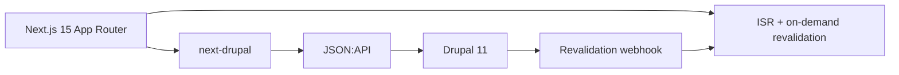

# Drupal + Next.js 15

This guide builds a complete **Next.js 15** application using [next-drupal](https://next-drupal.org/) with App Router, Server Components, SSG, ISR, and route handlers.

## Stack overview



## Project setup

```bash
npx create-next-app@latest my-drupal-frontend --typescript --tailwind --app --src-dir
cd my-drupal-frontend
npm install next-drupal
```

### Environment variables

```bash
# .env.local
NEXT_PUBLIC_DRUPAL_BASE_URL=https://my-site.ddev.site
NEXT_IMAGE_DOMAIN=my-site.ddev.site
DRUPAL_CLIENT_ID=nextjs_app
DRUPAL_CLIENT_SECRET=your-client-secret
DRUPAL_REVALIDATE_SECRET=random-secret-for-webhooks
```

### next.config.ts

```typescript
import type { NextConfig } from 'next';

const nextConfig: NextConfig = {
  images: {
    remotePatterns: [
      {
        protocol: 'https',
        hostname: process.env.NEXT_IMAGE_DOMAIN!,
        pathname: '/sites/default/files/**',
      },
    ],
  },
  async rewrites() {
    return [
      {
        source: '/drupal/:path*',
        destination: `${process.env.NEXT_PUBLIC_DRUPAL_BASE_URL}/:path*`,
      },
    ];
  },
};

export default nextConfig;
```

!!! note "Next.js 16"
    Next.js 16 blocks `next/image` optimization of images whose host resolves to a local/private IP. DDEV hostnames such as `my-site.ddev.site` resolve to `127.0.0.1`, so local images return `400` until you set `images.dangerouslyAllowLocalIP: true`. Enable it in development only; it re-opens an SSRF vector.

## Drupal client

```typescript
// src/lib/drupal.ts
import { DrupalClient } from 'next-drupal';

export const drupal = new DrupalClient(
  process.env.NEXT_PUBLIC_DRUPAL_BASE_URL!,
  {
    auth: {
      clientId: process.env.DRUPAL_CLIENT_ID!,
      clientSecret: process.env.DRUPAL_CLIENT_SECRET!,
    },
    debug: process.env.NODE_ENV === 'development',
    withAuth: true,
  },
);
```

## TypeScript types

```typescript
// src/types/drupal.ts
import type { DrupalNode } from 'next-drupal';

export interface ArticleNode extends DrupalNode {
  type: 'node--article';
  title: string;
  body: {
    processed: string;
  };
  field_summary?: string;
  field_slug?: string;
  field_author?: {
    display_name: string;
  };
  field_hero_media?: {
    field_media_image: {
      uri: { url: string };
      resourceIdObjMeta: {
        alt: string;
        width: number;
        height: number;
      };
    };
  };
  // `path` (alias, pid, langcode) and `drupal_internal__nid` come from DrupalNode.
  // At runtime `path.alias` is null for nodes without an alias.
}
```

## SSG — static article list

```typescript
// src/app/articles/page.tsx
import Link from 'next/link';
import { drupal } from '@/lib/drupal';
import type { ArticleNode } from '@/types/drupal';

export const revalidate = 3600; // ISR: revalidate every hour

export default async function ArticlesPage() {
  const articles = await drupal.getResourceCollection<ArticleNode[]>(
    'node--article',
    {
      params: {
        'filter[status]': '1',
        'sort': '-created',
        'fields[node--article]': 'title,path,field_summary,created',
        'page[limit]': '50',
      },
      next: {
        revalidate: 3600,
        tags: ['node_list:article'],
      },
    },
  );

  return (
    <main className="mx-auto max-w-4xl p-8">
      <h1 className="text-3xl font-bold mb-8">Articles</h1>
      <ul className="space-y-6">
        {/* Only aliased articles under /articles/ are served by app/articles/[...slug] */}
        {articles
          .filter((article) => article.path?.alias?.startsWith('/articles/'))
          .map((article) => (
            <li key={article.id} className="border-b pb-4">
              <Link
                href={article.path.alias}
                className="text-xl font-semibold hover:underline"
              >
                {article.title}
              </Link>
              {article.field_summary && (
                <p className="text-gray-600 mt-2">{article.field_summary}</p>
              )}
            </li>
          ))}
      </ul>
    </main>
  );
}
```

## Server Components — article detail with includes

```typescript
// src/app/articles/[...slug]/page.tsx
import Image from 'next/image';
import { notFound } from 'next/navigation';
import { drupal } from '@/lib/drupal';
import type { ArticleNode } from '@/types/drupal';
import type { Metadata } from 'next';

interface PageProps {
  params: Promise<{ slug: string[] }>;
}

// Assumes the Pathauto pattern for articles is /articles/[node:title], so the
// Next.js URL /articles/foo and the Drupal alias /articles/foo are identical.
const ARTICLE_PREFIX = '/articles/';
const PAGE_SIZE = 50; // JSON:API caps page[limit] at 50

export async function generateStaticParams() {
  const params: { slug: string[] }[] = [];

  for (let offset = 0; ; offset += PAGE_SIZE) {
    const articles = await drupal.getResourceCollection<ArticleNode[]>(
      'node--article',
      {
        params: {
          'filter[status]': '1',
          'fields[node--article]': 'path',
          'sort': 'drupal_internal__nid',
          'page[limit]': String(PAGE_SIZE),
          'page[offset]': String(offset),
        },
      },
    );

    for (const article of articles) {
      const alias = article.path?.alias;
      // Skip nodes without an alias or outside /articles/: this route can't serve them.
      if (alias?.startsWith(ARTICLE_PREFIX)) {
        params.push({ slug: alias.slice(ARTICLE_PREFIX.length).split('/') });
      }
    }

    if (articles.length < PAGE_SIZE) break;
  }

  return params;
}

async function getArticle(slug: string[]): Promise<ArticleNode | null> {
  // The [...slug] segment excludes /articles/, so add it back to get the alias.
  const path = `${ARTICLE_PREFIX}${slug.join('/')}`;

  try {
    // Resolve the alias first so the fetch can carry the node's own cache tag
    // (node:{nid}), which is the tag Drupal invalidates when the node is saved.
    const translated = await drupal.translatePath(path, {
      next: { revalidate: 3600 },
    });
    if (!translated?.entity || translated.entity.bundle !== 'article') {
      return null;
    }

    return await drupal.getResource<ArticleNode>(
      'node--article',
      translated.entity.uuid,
      {
        params: {
          include: 'field_author,field_hero_media.field_media_image,field_tags',
        },
        next: {
          tags: [`node:${translated.entity.id}`],
        },
      },
    );
  } catch {
    return null;
  }
}

export async function generateMetadata({ params }: PageProps): Promise<Metadata> {
  const { slug } = await params;
  const article = await getArticle(slug);

  if (!article) return { title: 'Not Found' };

  return {
    title: article.title,
    description: article.field_summary,
  };
}

export default async function ArticlePage({ params }: PageProps) {
  const { slug } = await params;
  const article = await getArticle(slug);

  if (!article) notFound();

  const image = article.field_hero_media?.field_media_image;
  const imageUrl = image?.uri?.url
    ? `${process.env.NEXT_PUBLIC_DRUPAL_BASE_URL}${image.uri.url}`
    : null;

  return (
    <article className="mx-auto max-w-3xl p-8">
      <h1 className="text-4xl font-bold mb-4">{article.title}</h1>

      {article.field_author && (
        <p className="text-gray-500 mb-6">
          By {article.field_author.display_name}
        </p>
      )}

      {imageUrl && image && (
        <Image
          src={imageUrl}
          alt={image.resourceIdObjMeta?.alt ?? article.title}
          width={image.resourceIdObjMeta?.width ?? 1200}
          height={image.resourceIdObjMeta?.height ?? 630}
          className="rounded-lg mb-8"
          priority
        />
      )}

      <div
        className="prose prose-lg"
        dangerouslySetInnerHTML={{ __html: article.body.processed }}
      />
    </article>
  );
}
```

`translatePath()` uses Drupal's `decoupled_router` module (also required by `getResourceByPath()`).

!!! note "Next.js 16"
    The `priority` prop of `next/image` is deprecated in Next.js 16. Use `preload` (or `loading="eager"`) instead.

## ISR with on-demand revalidation

### Next.js revalidation route handler

```typescript
// src/app/api/revalidate/route.ts
import { revalidatePath, revalidateTag } from 'next/cache';
import { NextRequest, NextResponse } from 'next/server';

export async function POST(request: NextRequest) {
  const secret = request.headers.get('x-revalidate-secret');

  if (secret !== process.env.DRUPAL_REVALIDATE_SECRET) {
    return NextResponse.json({ message: 'Invalid secret' }, { status: 401 });
  }

  const body = await request.json();
  const { tags, paths } = body as {
    tags?: string[];
    paths?: string[];
  };

  if (tags) {
    for (const tag of tags) {
      revalidateTag(tag);
    }
  }

  if (paths) {
    for (const path of paths) {
      revalidatePath(path);
    }
  }

  return NextResponse.json({
    revalidated: true,
    tags: tags ?? [],
    paths: paths ?? [],
    now: Date.now(),
  });
}
```

!!! note "Next.js 16"
    Single-argument `revalidateTag(tag)` is deprecated in Next.js 16 (a TypeScript error). Pass a `cacheLife` profile as the second argument, e.g. `revalidateTag(tag, 'max')`, for stale-while-revalidate behaviour.

## Draft mode indicator and preview

The draft-mode cookie (`__prerender_bypass`) is `HttpOnly`, so client code cannot see it through `document.cookie`. Read the state on the server with `draftMode()` instead:

```tsx
// src/components/DraftModeIndicator.tsx (Server Component)
import { draftMode } from 'next/headers';

export async function DraftModeIndicator() {
  const { isEnabled } = await draftMode();

  if (!isEnabled) return null;

  return (
    <div className="fixed bottom-4 right-4 bg-yellow-400 text-black px-4 py-2 rounded shadow">
      Draft mode active{' '}
      <a href="/api/exit-preview" className="underline ml-2">
        Exit
      </a>
    </div>
  );
}
```

### Preview route handlers

```typescript
// src/app/api/preview/route.ts
import { draftMode } from 'next/headers';
import { redirect } from 'next/navigation';
import { NextRequest } from 'next/server';

export async function GET(request: NextRequest) {
  const secret = request.nextUrl.searchParams.get('secret');
  const slug = request.nextUrl.searchParams.get('slug');

  if (secret !== process.env.DRUPAL_REVALIDATE_SECRET || !slug) {
    return new Response('Invalid token', { status: 401 });
  }

  const draft = await draftMode();
  draft.enable();
  redirect(slug);
}
```

```typescript
// src/app/api/exit-preview/route.ts
import { draftMode } from 'next/headers';
import { redirect } from 'next/navigation';

export async function GET() {
  const draft = await draftMode();
  draft.disable();
  redirect('/');
}
```

## Route handler — proxy search API

```typescript
// src/app/api/search/route.ts
import { drupal } from '@/lib/drupal';
import { NextRequest, NextResponse } from 'next/server';

export async function GET(request: NextRequest) {
  const query = request.nextUrl.searchParams.get('q') ?? '';

  if (query.length < 2) {
    return NextResponse.json({ results: [] });
  }

  const articles = await drupal.getResourceCollection('node--article', {
    params: {
      'filter[title][condition][path]': 'title',
      'filter[title][condition][operator]': 'CONTAINS',
      'filter[title][condition][value]': query,
      'filter[status]': '1',
      'fields[node--article]': 'title,path,field_summary',
      'page[limit]': '10',
    },
    cache: 'no-store',
  });

  return NextResponse.json({ results: articles });
}
```

## Layout with global data

```typescript
// src/app/layout.tsx
import { drupal } from '@/lib/drupal';
import { DraftModeIndicator } from '@/components/DraftModeIndicator';
import './globals.css';

export default async function RootLayout({
  children,
}: {
  children: React.ReactNode;
}) {
  // Fetch the main menu at layout level. getMenu() needs the contrib
  // JSON:API Menu Items module (jsonapi_menu_items) on Drupal: plain JSON:API
  // menu_link_content resources require the 'administer menu' permission to view.
  const { tree } = await drupal.getMenu('main', {
    next: { tags: ['config:system.menu.main'], revalidate: 86400 },
  });

  return (
    <html lang="en">
      <body>
        <nav className="border-b p-4">
          <ul className="flex gap-6">
            {tree.map((item) => (
              <li key={item.id}>
                <a href={item.url}>{item.title}</a>
              </li>
            ))}
          </ul>
        </nav>
        {children}
        <DraftModeIndicator />
      </body>
    </html>
  );
}
```

## Deployment checklist

| Item | Configuration |
|------|---------------|
| Drupal CORS | Allow Vercel domain |
| OAuth consumer | Client credentials for server fetches |
| Image domains | `next.config.ts` remotePatterns |
| Webhook secret | Match Drupal module config |
| ISR tags | Align with Drupal cache tags |
| Env vars | Set in Vercel dashboard |

## Related pages

- [JSON:API Deep Dive](jsonapi.md)
- [Authentication](auth/index.md)
- [Cache Invalidation](cache-invalidation.md)
- [Media & Images](media-images.md)
