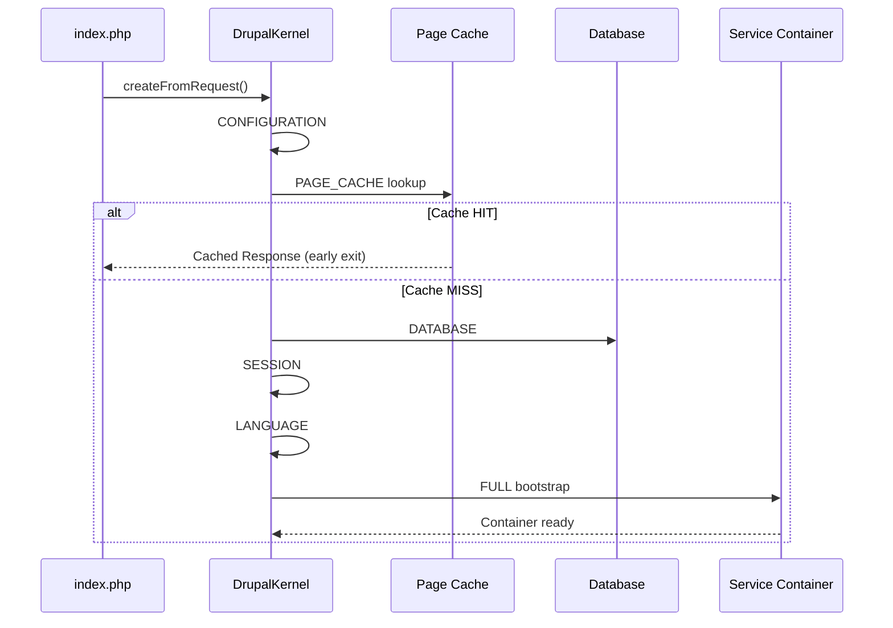

# Bootstrap Phases

Before Drupal can route a request or load an entity, it must **bootstrap** — progressively loading configuration, the database connection, the session, and finally the full service container. Understanding bootstrap phases explains cache rebuilds, early-exit code paths, and why some APIs are unavailable in cron or Drush until a certain phase completes.

## Bootstrap constants

Drupal defines seven bootstrap phases as integer constants in `core/includes/bootstrap.inc`:

| Constant | Value | What loads |
|----------|-------|------------|
| `DRUPAL_BOOTSTRAP_CONFIGURATION` | 0 | Settings, site path, autoloader |
| `DRUPAL_BOOTSTRAP_PAGE_CACHE` | 1 | Page cache lookup (may short-circuit) |
| `DRUPAL_BOOTSTRAP_DATABASE` | 2 | Database connection |
| `DRUPAL_BOOTSTRAP_VARIABLES` | 3 | *(Deprecated — merged into configuration)* |
| `DRUPAL_BOOTSTRAP_SESSION` | 4 | Session handling |
| `DRUPAL_BOOTSTRAP_PAGE_HEADER` | 5 | HTTP headers for cached pages |
| `DRUPAL_BOOTSTRAP_LANGUAGE` | 6 | Interface/content language |
| `DRUPAL_BOOTSTRAP_FULL` | 7 | Full kernel: modules, container, hooks |

```php
<?php
// core/includes/bootstrap.inc (excerpt)
define('DRUPAL_BOOTSTRAP_CONFIGURATION', 0);
define('DRUPAL_BOOTSTRAP_PAGE_CACHE', 1);
define('DRUPAL_BOOTSTRAP_DATABASE', 2);
define('DRUPAL_BOOTSTRAP_VARIABLES', 3);
define('DRUPAL_BOOTSTRAP_SESSION', 4);
define('DRUPAL_BOOTSTRAP_PAGE_HEADER', 5);
define('DRUPAL_BOOTSTRAP_LANGUAGE', 6);
define('DRUPAL_BOOTSTRAP_FULL', 7);
```

!!! note "Variables phase is legacy"
    `DRUPAL_BOOTSTRAP_VARIABLES` still exists for backward compatibility but no longer performs meaningful work. Configuration and state replaced the old `$conf` / `variable_*` system.

## Phase flow



## Entry point: index.php

Every web request starts here:

```php
<?php
// web/index.php (simplified)
use Drupal\Core\DrupalKernel;
use Symfony\Component\HttpFoundation\Request;

$autoloader = require_once 'autoload.php';
$kernel = DrupalKernel::createFromRequest(
  Request::createFromGlobals(),
  $autoloader,
  'prod',
);
$request = Request::createFromGlobals();
$response = $kernel->handle($request);
$response->send();
$kernel->terminate($request, $response);
```

`DrupalKernel::handle()` internally calls `boot()` which advances through bootstrap phases until `DRUPAL_BOOTSTRAP_FULL`.

## What each phase does

### Configuration (phase 0)

Loads `settings.php`, discovers the site path (`sites/default` or multisite directory), and initializes the class autoloader. No database yet.

```php
<?php

declare(strict_types=1);

// Conceptual — settings are read before the container exists.
$settings = [];
$settings['config_sync_directory'] = '../config/sync';
$settings['hash_salt'] = 'your-random-salt';
$settings['trusted_host_patterns'] = ['^example\.com$'];
```

### Page cache (phase 1)

Checks the internal page cache for a matching response. On a **cache hit**, Drupal can return the cached page without bootstrapping the full kernel — a major performance win for anonymous traffic.

```bash
# Warm the page cache by visiting as anonymous user
curl -s -o /dev/null -w "%{http_code}" https://example.com/node/1

# Clear page cache (requires full bootstrap via Drush)
drush cr
```

### Database (phase 2)

Opens the database connection defined in `settings.php`. The connection is registered in a minimal container stub before the full container is compiled.

```php
<?php
// sites/default/settings.php (excerpt)
$databases['default']['default'] = [
  'database' => 'drupal',
  'username' => 'drupal',
  'password' => 'drupal',
  'host' => 'db',
  'port' => '3306',
  'driver' => 'mysql',
  'prefix' => '',
  'collation' => 'utf8mb4_general_ci',
];
```

### Session (phase 4)

Initializes PHP session handling via Symfony's session subsystem. Session data is stored in the database (default) or Redis if configured.

### Language (phase 6)

Determines the active interface and content language from the request, user preference, and site configuration.

### Full (phase 7)

The heavy phase:

1. Discovers and loads all enabled modules
2. Compiles (or loads cached) the service container
3. Registers all plugin managers
4. Fires `hook_boot` / kernel boot events

```php
<?php

declare(strict_types=1);

namespace Drupal\Core;

// DrupalKernelBoot.php (conceptual excerpt)
trait DrupalKernelBoot {

  protected function bootstrapToPhase(int $phase, &$current_phase): void {
    while ($current_phase < $phase) {
      $current_phase++;
      match ($current_phase) {
        DRUPAL_BOOTSTRAP_CONFIGURATION => $this->initializeConfiguration(),
        DRUPAL_BOOTSTRAP_PAGE_CACHE => $this->bootstrapPageCache(),
        DRUPAL_BOOTSTRAP_DATABASE => $this->initializeDatabaseConnection(),
        DRUPAL_BOOTSTRAP_SESSION => $this->initializeSession(),
        DRUPAL_BOOTSTRAP_LANGUAGE => $this->initializeLanguage(),
        DRUPAL_BOOTSTRAP_FULL => $this->container = $this->initializeContainer(),
        default => NULL,
      };
    }
  }
}
```

## Requesting a specific bootstrap level

Most code never calls bootstrap directly — the kernel handles it. But Drush, cron, and custom scripts can bootstrap to a specific phase:

```php
<?php

declare(strict_types=1);

use Drupal\Core\DrupalKernel;
use Symfony\Component\HttpFoundation\Request;

$autoloader = require_once 'autoload.php';
$kernel = DrupalKernel::createFromRequest(
  Request::createFromGlobals(),
  $autoloader,
  'prod',
);
$kernel->boot(); // DRUPAL_BOOTSTRAP_FULL

// Now safe to use services
$connection = \Drupal::database();
$count = $connection->select('node_field_data', 'n')
  ->condition('status', 1)
  ->countQuery()
  ->execute()
  ->fetchField();
echo "Published nodes: {$count}\n";
```

```bash
# Drush bootstraps to FULL automatically for most commands
drush php:eval "echo \Drupal::VERSION;"

# Early bootstrap commands (cache, sql) use fewer phases internally
drush sql:query "SELECT COUNT(*) FROM node_field_data"
```

## Container compilation during FULL bootstrap

On first request after a cache clear, FULL bootstrap compiles the container and writes a PHP cache file:

```bash
# After drush cr, inspect the compiled container
ls -la web/sites/default/files/php/twig/
ls -la web/sites/default/files/php/

# Container cache lives under sites/default/files/php/
find web/sites/default/files/php -name "drupal_container*" 2>/dev/null | head -5
```

```php
<?php

declare(strict_types=1);

// The compiled container is a generated PHP class implementing ContainerInterface.
// It is rebuilt when:
// - drush cr (cache rebuild)
// - A module is enabled/disabled
// - services.yml changes are detected
```

!!! warning "First request after cache rebuild is slow"
    Container compilation can take several seconds on large sites. This is normal. Subsequent requests load the cached PHP file and are fast. Use `drush cr` sparingly in production.

## Bootstrap in different contexts

| Context | Typical bootstrap | Notes |
|---------|-------------------|-------|
| Web (`index.php`) | Full (0→7) | Page cache may exit early at phase 1 |
| Drush | Full | `drush` bootstraps kernel for most commands |
| Cron (`/cron/KEY`) | Full | Runs queue workers, hook_cron |
| `update.php` | Partial → Full | Database updates may run before full module load |
| Custom script | You choose | Call `$kernel->boot()` for full access |

## Debugging bootstrap

```bash
# Enable devel and inspect bootstrap timing
drush en devel -y

# Check current bootstrap state in a one-liner
drush php:eval "echo 'Drupal ' . \Drupal::VERSION . ' bootstrapped.';"
```

```php
<?php

declare(strict_types=1);

namespace Drupal\my_module\EventSubscriber;

use Drupal\Core\Routing\RouteMatchInterface;
use Symfony\Component\EventDispatcher\EventSubscriberInterface;
use Symfony\Component\HttpKernel\Event\RequestEvent;
use Symfony\Component\HttpKernel\KernelEvents;

/**
 * Logs when full bootstrap has completed and request processing begins.
 */
final class BootstrapProbeSubscriber implements EventSubscriberInterface {

  public function __construct(
    private readonly RouteMatchInterface $routeMatch,
  ) {}

  public function onRequest(RequestEvent $event): void {
    if (!$event->isMainRequest()) {
      return;
    }
  }

  public static function getSubscribedEvents(): array {
    // Priority 1000 = early in REQUEST phase, after bootstrap.
    return [KernelEvents::REQUEST => ['onRequest', 1000]];
  }

}
```

## Related reading

- [Request Lifecycle](request-lifecycle.md) — what happens after FULL bootstrap
- [Service Container](service-container.md) — container compilation details
- [Tracing a Request](tracing-request.md) — end-to-end walkthrough
