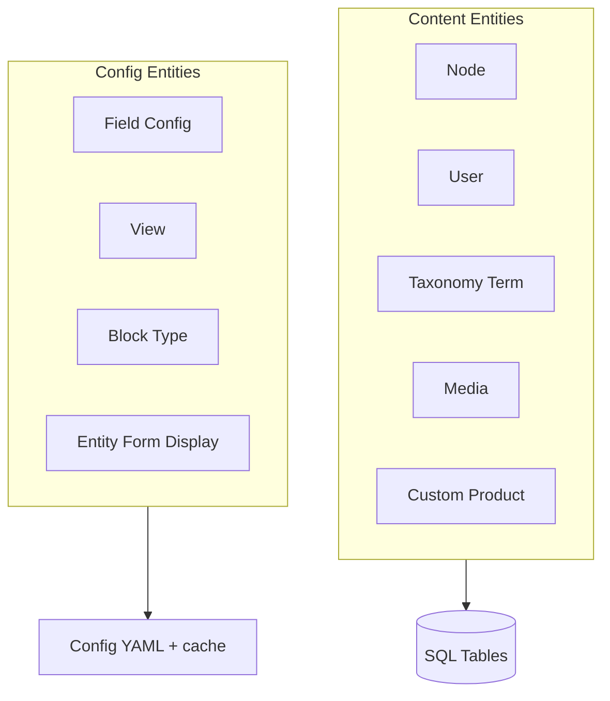
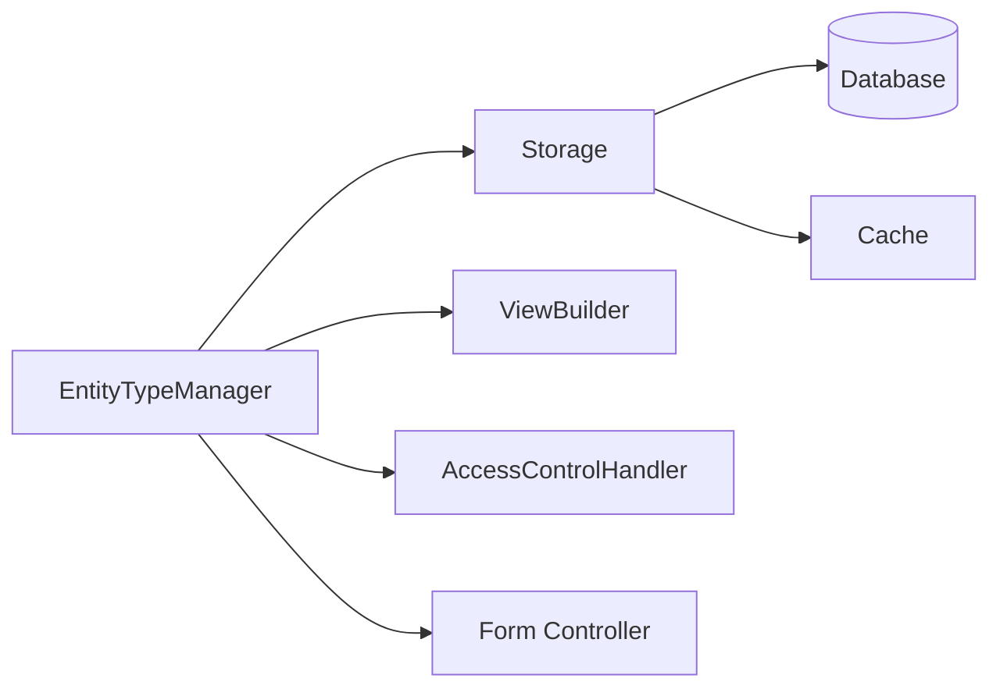

# Entity System

The Entity API is Drupal's unified data model. Nodes, users, taxonomy terms, media, views, fields, and your custom content types are all **entities** — objects with identity, fields, storage handlers, and access control. For headless Drupal, entities are the source of truth behind JSON:API and REST responses.

## Entity type categories



| Category | Stored in | Exported | Examples |
|----------|-----------|----------|----------|
| Content | Database tables | No (content) | Node, User, Media, custom entities |
| Config | `config` table + sync dir | Yes (`drush cex`) | Field, View, Entity form display |
| Internal | Database | No | Path alias, Comment (content but tied to nodes) |

## Entity type definition

Content entities use the `#[ContentEntityType]` attribute (Drupal 10.2+):

```php
<?php

declare(strict_types=1);

namespace Drupal\my_module\Entity;

use Drupal\Core\Entity\Attribute\ContentEntityType;
use Drupal\Core\Entity\ContentEntityBase;
use Drupal\Core\Entity\EntityTypeInterface;
use Drupal\Core\Field\BaseFieldDefinition;
use Drupal\Core\StringTranslation\TranslatableMarkup;
use Drupal\my_module\ProductAccessControlHandler;
use Drupal\my_module\ProductListBuilder;
use Drupal\my_module\Form\ProductForm;

#[ContentEntityType(
  id: 'product',
  label: new TranslatableMarkup('Product'),
  label_collection: new TranslatableMarkup('Products'),
  handlers: [
    'storage' => 'Drupal\Core\Entity\Sql\SqlContentEntityStorage',
    'access' => ProductAccessControlHandler::class,
    'list_builder' => ProductListBuilder::class,
    'form' => [
      'default' => ProductForm::class,
      'add' => ProductForm::class,
      'edit' => ProductForm::class,
      'delete' => 'Drupal\Core\Entity\ContentEntityDeleteForm',
    ],
    'views_data' => 'Drupal\views\EntityViewsData',
  ],
  base_table: 'product',
  admin_permission: 'administer products',
  entity_keys: [
    'id' => 'id',
    'label' => 'title',
    'uuid' => 'uuid',
    'langcode' => 'langcode',
    'published' => 'status',
  ],
  links: [
    'canonical' => '/product/{product}',
    'add-form' => '/admin/content/product/add',
    'edit-form' => '/product/{product}/edit',
    'delete-form' => '/product/{product}/delete',
    'collection' => '/admin/content/products',
  ],
  field_ui_base_route: 'entity.product.settings',
)]
final class Product extends ContentEntityBase implements ProductInterface {

  public static function baseFieldDefinitions(EntityTypeInterface $entity_type): array {
    $fields = parent::baseFieldDefinitions($entity_type);

    $fields['title'] = BaseFieldDefinition::create('string')
      ->setLabel(new TranslatableMarkup('Title'))
      ->setRequired(TRUE)
      ->setDisplayOptions('view', ['label' => 'hidden', 'weight' => 0])
      ->setDisplayOptions('form', ['type' => 'string_textfield', 'weight' => 0]);

    $fields['sku'] = BaseFieldDefinition::create('string')
      ->setLabel(new TranslatableMarkup('SKU'))
      ->setRequired(TRUE)
      ->addConstraint('UniqueField');

    $fields['price'] = BaseFieldDefinition::create('decimal')
      ->setLabel(new TranslatableMarkup('Price'))
      ->setSetting('precision', 10)
      ->setSetting('scale', 2);

    $fields['status'] = BaseFieldDefinition::create('boolean')
      ->setLabel(new TranslatableMarkup('Published'))
      ->setDefaultValue(TRUE);

    $fields['created'] = BaseFieldDefinition::create('created')
      ->setLabel(new TranslatableMarkup('Created'));

    return $fields;
  }

}
```

## EntityTypeManager

The central registry for all entity types:

```php
<?php

declare(strict_types=1);

$manager = \Drupal::entityTypeManager();

// Get storage handler for an entity type.
$storage = $manager->getStorage('product');

// Load entities.
$product = $storage->load(42);
$products = $storage->loadMultiple([1, 2, 3]);

// Query without loading full entities.
$query = $storage->getQuery()
  ->accessCheck(TRUE)
  ->condition('status', 1)
  ->condition('price', 50, '>')
  ->sort('created', 'DESC')
  ->range(0, 10);
$ids = $query->execute();
$products = $storage->loadMultiple($ids);
```



## Storage handlers

`SqlContentEntityStorage` is the default for content entities:

```php
<?php

declare(strict_types=1);

namespace Drupal\my_module\Service;

use Drupal\Core\Entity\EntityTypeManagerInterface;
use Drupal\my_module\Entity\Product;

final class ProductRepository {

  public function __construct(
    private readonly EntityTypeManagerInterface $entityTypeManager,
  ) {}

  public function findBySku(string $sku): ?Product {
    $storage = $this->entityTypeManager->getStorage('product');
    $ids = $storage->getQuery()
      ->accessCheck(FALSE)
      ->condition('sku', $sku)
      ->range(0, 1)
      ->execute();

    if (empty($ids)) {
      return NULL;
    }
    return $storage->load(reset($ids));
  }

  public function createProduct(string $title, string $sku, float $price): Product {
    /** @var \Drupal\my_module\Entity\Product $product */
    $product = $this->entityTypeManager->getStorage('product')->create([
      'title' => $title,
      'sku' => $sku,
      'price' => $price,
      'status' => TRUE,
    ]);
    $product->save();
    return $product;
  }

}
```

### Storage schema

Content entities need an update hook for the base table:

```php
<?php

declare(strict_types=1);

/**
 * @file
 * Install, update and schema hooks for my_module.
 */

/**
 * Implements hook_schema().
 */
function my_module_schema(): array {
  // Base fields create columns automatically via entity updates.
  // hook_schema is only needed for custom non-field tables.
  return [];
}
```

```bash
# After adding a new entity type, run entity schema updates
drush entup -y
# Or full database update
drush updatedb -y
```

## Field system

Fields attach to entity types in two ways:

### Base fields

Defined in code on the entity class (`baseFieldDefinitions`). Ship with the module.

### Configurable fields

Added via UI or config — stored as `field.storage.*` and `field.field.*` config entities:

```yaml
# config/install/field.storage.node.field_subtitle.yml
langcode: en
status: true
dependencies:
  module:
    - node
id: node.field_subtitle
field_name: field_subtitle
entity_type: node
type: string
settings:
  max_length: 255
module: core
locked: false
cardinality: 1
```

```php
<?php

declare(strict_types=1);

// Reading field values on a node
$node = \Drupal::entityTypeManager()->getStorage('node')->load(1);
$subtitle = $node->get('field_subtitle')->value;
$tags = $node->get('field_tags')->referencedEntities();

// Writing field values
$node->set('field_subtitle', 'A compelling subtitle');
$node->get('field_tags')->appendItem(['target_id' => 5]);
$node->save();
```

## Entity access

```php
<?php

declare(strict_types=1);

namespace Drupal\my_module;

use Drupal\Core\Access\AccessResult;
use Drupal\Core\Entity\EntityAccessControlHandler;
use Drupal\Core\Entity\EntityInterface;
use Drupal\Core\Session\AccountInterface;

final class ProductAccessControlHandler extends EntityAccessControlHandler {

  protected function checkAccess(EntityInterface $entity, $operation, AccountInterface $account): AccessResult {
    /** @var \Drupal\my_module\Entity\Product $entity */
    if ($operation === 'view' && !$entity->get('status')->value) {
      return AccessResult::allowedIfHasPermission($account, 'view unpublished products');
    }
    return parent::checkAccess($entity, $operation, $account);
  }

  protected function checkCreateAccess(AccountInterface $account, array $context, $entity_bundle = NULL): AccessResult {
    return AccessResult::allowedIfHasPermission($account, 'create products');
  }

}
```

## Config entities

Config entities are lightweight definitions exported as YAML:

```php
<?php

declare(strict_types=1);

namespace Drupal\my_module\Entity;

use Drupal\Core\Config\Entity\ConfigEntityBase;
use Drupal\Core\Entity\Attribute\ConfigEntityType;
use Drupal\Core\StringTranslation\TranslatableMarkup;

#[ConfigEntityType(
  id: 'product_type',
  label: new TranslatableMarkup('Product type'),
  handlers: [
    'list_builder' => 'Drupal\my_module\ProductTypeListBuilder',
    'form' => [
      'add' => 'Drupal\my_module\Form\ProductTypeForm',
      'edit' => 'Drupal\my_module\Form\ProductTypeForm',
      'delete' => 'Drupal\Core\Entity\EntityDeleteForm',
    ],
  ],
  config_prefix: 'product_type',
  admin_permission: 'administer products',
  entity_keys: [
    'id' => 'id',
    'label' => 'label',
  ],
  config_export: [
    'id',
    'label',
    'description',
  ],
  links: [
    'add-form' => '/admin/structure/product-types/add',
    'edit-form' => '/admin/structure/product-types/manage/{product_type}',
    'delete-form' => '/admin/structure/product-types/manage/{product_type}/delete',
    'collection' => '/admin/structure/product-types',
  ],
)]
final class ProductType extends ConfigEntityBase implements ProductTypeInterface {

  protected string $id = '';
  protected string $label = '';
  protected string $description = '';

  public function getDescription(): string {
    return $this->description;
  }

}
```

## Entities in headless APIs

JSON:API exposes entities automatically when the module providing the entity is enabled:

```bash
# List product entities via JSON:API
curl -s -H "Accept: application/vnd.api+json" \
  "https://example.com/jsonapi/product/product" \
  | jq '.data[0].attributes'
```

!!! tip "Always use entity API"
    Never write raw SQL against entity tables unless you have a measured performance reason. The entity API handles revisions, translations, hooks, and cache invalidation.

## Related reading

- [Plugin System](plugin-system.md) — field formatters, widgets are plugins
- [Routing](routing.md) — entity link templates generate routes
- [Request Lifecycle](request-lifecycle.md) — paramconverter loads entities for controllers
