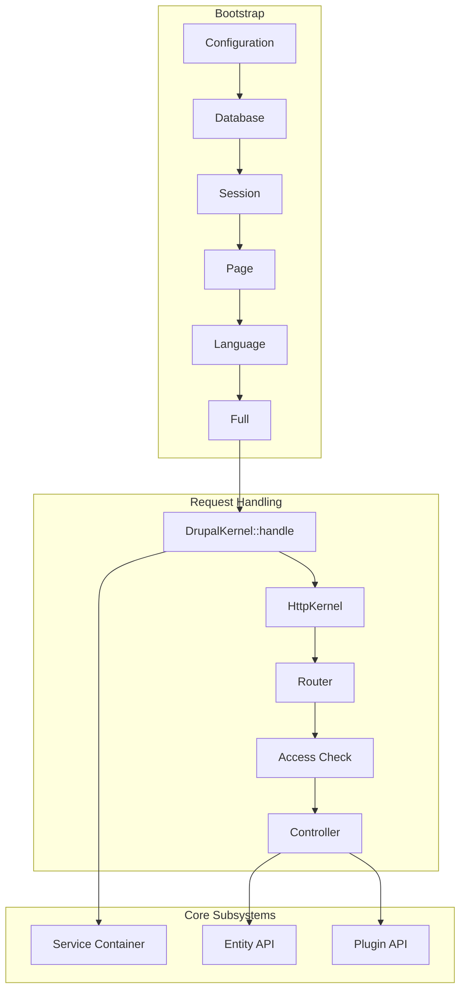

# Drupal Internals

This section goes under the hood of Drupal 11 — how a request becomes a response, how core subsystems wire together, and how to trace and debug what happens at runtime.

## Chapters

- **[Bootstrap Phases](bootstrap.md)** — `DRUPAL_BOOTSTRAP_*` constants and what loads at each phase
- **[Request Lifecycle](request-lifecycle.md)** — full HTTP flow, `KernelEvents`, middleware stack
- **[Service Container](service-container.md)** — how Drupal builds, compiles, and caches the container
- **[Routing](routing.md)** — route providers, route builders, dynamic routes
- **[Entity System](entity-system.md)** — entity types, storage handlers, field system
- **[Plugin System](plugin-system.md)** — discovery, plugin managers, derivatives
- **[Tracing a Request](tracing-request.md)** — step-by-step walkthrough with real code
- **[Debugging Services](debugging-services.md)** — Drush, `php:eval`, container inspection
- **[Route Inspection](route-inspection.md)** — `drush route`, `RouteProvider` internals

## How the pieces connect

## When to read this section

| You want to… | Start here |
|--------------|------------|
| Understand why `index.php` is slow on first hit | [Bootstrap](bootstrap.md) |
| Debug why a route returns 403 or 404 | [Routing](routing.md) + [Route Inspection](route-inspection.md) |
| Figure out which service handles something | [Debugging Services](debugging-services.md) |
| Learn how nodes, config, and fields are stored | [Entity System](entity-system.md) |
| See the full path from URL to JSON response | [Tracing a Request](tracing-request.md) |

!!! tip "Pair with Dependency Injection"
    The service container is central to every internal subsystem. Read [Dependency Injection](../dependency-injection/index.md) alongside this section for the full picture of how services are defined and wired.

## Key source files

These core files are worth bookmarking when reading this section:

| File | Purpose |
|------|---------|
| `core/includes/bootstrap.inc` | Bootstrap phase constants and helpers |
| `core/lib/Drupal/Core/DrupalKernel.php` | Kernel bootstrap and request handling |
| `core/lib/Drupal/Core/DrupalKernelBoot.php` | Boot trait with phase logic |
| `core/lib/Drupal/Core/Routing/RouteProvider.php` | Route lookup and caching |
| `core/lib/Drupal/Core/Entity/EntityTypeManager.php` | Entity type registry |
| `core/lib/Drupal/Core/Plugin/DefaultPluginManager.php` | Base plugin manager |
