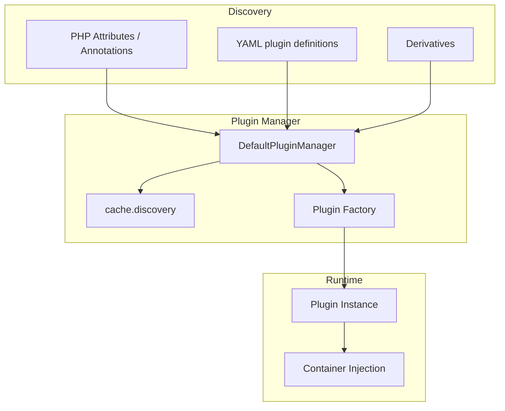

# Plugin System

Drupal's Plugin API provides discoverable, swappable implementations for blocks, field formatters, views handlers, migration plugins, and hundreds of other extension points. Plugins are discovered from attributes (or annotations), cached, and instantiated through **plugin managers** registered as services.

## Plugin architecture



## Defining a plugin

Modern Drupal uses PHP attributes (Drupal 10.2+):

```php
<?php

declare(strict_types=1);

namespace Drupal\my_module\Plugin\Block;

use Drupal\Core\Block\Attribute\Block;
use Drupal\Core\Block\BlockBase;
use Drupal\Core\Plugin\ContainerFactoryPluginInterface;
use Drupal\my_module\Service\ProductStats;
use Drupal\Core\StringTranslation\TranslatableMarkup;
use Symfony\Component\DependencyInjection\ContainerInterface;

#[Block(
  id: 'product_stats_block',
  admin_label: new TranslatableMarkup('Product statistics'),
  category: new TranslatableMarkup('My Module'),
)]
final class ProductStatsBlock extends BlockBase implements ContainerFactoryPluginInterface {

  public function __construct(
    array $configuration,
    $plugin_id,
    $plugin_definition,
    private readonly ProductStats $productStats,
  ) {
    parent::__construct($configuration, $plugin_id, $plugin_definition);
  }

  public static function create(ContainerInterface $container, array $configuration, $plugin_id, $plugin_definition): static {
    return new static(
      $configuration,
      $plugin_id,
      $plugin_definition,
      $container->get('my_module.product_stats'),
    );
  }

  public function build(): array {
    $stats = $this->productStats->getSummary();
    return [
      '#theme' => 'item_list',
      '#items' => [
        $this->t('Total products: @count', ['@count' => $stats['total']]),
        $this->t('Published: @count', ['@count' => $stats['published']]),
      ],
      '#cache' => [
        'tags' => ['product_list'],
        'max-age' => 300,
      ],
    ];
  }

}
```

## Plugin managers

Each plugin type has a manager service following the naming convention `plugin.manager.{type}`:

```php
<?php

declare(strict_types=1);

// Block plugin manager
$block_manager = \Drupal::service('plugin.manager.block');
$definitions = $block_manager->getDefinitions();

// Create a configured block plugin instance
$plugin = $block_manager->createInstance('product_stats_block', [
  'label' => 'Store stats',
  'provider' => 'my_module',
]);

$build = $plugin->build();
```

| Manager service | Plugin type |
|-----------------|-------------|
| `plugin.manager.block` | Block plugins |
| `plugin.manager.field.formatter` | Field formatters |
| `plugin.manager.field.widget` | Field widgets |
| `plugin.manager.views.field` | Views field handlers |
| `plugin.manager.menu.link` | Menu link plugins |
| `plugin.manager.archiver` | Archiver plugins |

## DefaultPluginManager

Most managers extend `DefaultPluginManager`:

```php
<?php

declare(strict_types=1);

namespace Drupal\my_module;

use Drupal\Core\Cache\CacheBackendInterface;
use Drupal\Core\Extension\ModuleHandlerInterface;
use Drupal\Core\Plugin\DefaultPluginManager;
use Drupal\my_module\Attribute\Report;
use Drupal\my_module\ReportPluginInterface;

final class ReportPluginManager extends DefaultPluginManager {

  public function __construct(
    \Traversable $namespaces,
    CacheBackendInterface $cache_backend,
    ModuleHandlerInterface $module_handler,
  ) {
    parent::__construct(
      'Plugin/Report',
      $namespaces,
      $module_handler,
      ReportPluginInterface::class,
      Report::class,
    );
    $this->alterInfo('my_module_report_info');
    $this->setCacheBackend($cache_backend, 'my_module_report_plugins');
  }

}
```

Register the manager as a service:

```yaml
# my_module.services.yml
services:
  plugin.manager.my_module.report:
    class: Drupal\my_module\ReportPluginManager
    arguments:
      - '@container.namespaces'
      - '@cache.discovery'
      - '@module_handler'
```

## Discovery mechanisms

### Attribute discovery

Scans `src/Plugin/` for classes with the plugin attribute:

```php
<?php

declare(strict_types=1);

namespace Drupal\my_module\Attribute;

use Drupal\Component\Plugin\Attribute\Plugin;
use Drupal\Core\StringTranslation\TranslatableMarkup;

#[\Attribute(\Attribute::TARGET_CLASS)]
final class Report extends Plugin {

  public function __construct(
    public readonly string $id,
    public readonly TranslatableMarkup $title,
    public readonly int $weight = 0,
  ) {}

}
```

### YAML discovery

Some plugin types use YAML files in the module root (for example `*.links.menu.yml`):

```yaml
# my_module.my_plugins.yml (hypothetical plugin type)
my_plugin_alpha:
  class: Drupal\my_module\Plugin\MyPlugin\AlphaPlugin
  label: 'Alpha processor'
my_plugin_beta:
  class: Drupal\my_module\Plugin\MyPlugin\BetaPlugin
  label: 'Beta processor'
```

### Derivatives

One plugin class can provide many instances via a **deriver**:

```php
<?php

declare(strict_types=1);

namespace Drupal\my_module\Plugin\Derivative;

use Drupal\Component\Plugin\Derivative\DeriverBase;
use Drupal\Core\Entity\EntityTypeManagerInterface;
use Drupal\Core\Plugin\Discovery\ContainerDeriverInterface;
use Symfony\Component\DependencyInjection\ContainerInterface;

// ContainerDeriverInterface makes discovery call create(); without it the
// constructor receives the base plugin ID instead of services.
final class ProductBlockDeriver extends DeriverBase implements ContainerDeriverInterface {

  public function __construct(
    private readonly EntityTypeManagerInterface $entityTypeManager,
  ) {}

  public static function create(ContainerInterface $container, $base_plugin_id): static {
    return new static(
      $container->get('entity_type.manager'),
    );
  }

  public function getDerivativeDefinitions($base_plugin_definition): array {
    $types = $this->entityTypeManager->getStorage('product_type')->loadMultiple();
    foreach ($types as $type) {
      $this->derivatives[$type->id()] = $base_plugin_definition;
      $this->derivatives[$type->id()]['admin_label'] = $type->label();
      $this->derivatives[$type->id()]['product_type'] = $type->id();
    }
    return $this->derivatives;
  }

}
```

```php
<?php

declare(strict_types=1);

namespace Drupal\my_module\Plugin\Block;

use Drupal\Core\Block\Attribute\Block;
use Drupal\Core\Block\BlockBase;
use Drupal\Core\StringTranslation\TranslatableMarkup;
use Drupal\my_module\Plugin\Derivative\ProductBlockDeriver;

#[Block(
  id: 'product_type_block',
  admin_label: new TranslatableMarkup('Products by type'),
  deriver: ProductBlockDeriver::class,
)]
final class ProductTypeBlock extends BlockBase {

  public function build(): array {
    // $this->getDerivativeId() returns the product type ID.
    return [
      '#markup' => $this->t('Products of type @type', ['@type' => $this->getDerivativeId()]),
    ];
  }

}
```

## ContainerFactoryPluginInterface

Plugins needing services implement `create()` for DI:

```php
<?php

declare(strict_types=1);

namespace Drupal\my_module\Plugin\Field\FieldFormatter;

use Drupal\Core\Field\Attribute\FieldFormatter;
use Drupal\Core\Field\FieldItemListInterface;
use Drupal\Core\Field\FormatterBase;
use Drupal\Core\Plugin\ContainerFactoryPluginInterface;
use Drupal\my_module\Service\PriceFormatter;
use Drupal\Core\StringTranslation\TranslatableMarkup;
use Symfony\Component\DependencyInjection\ContainerInterface;

#[FieldFormatter(
  id: 'product_price_formatted',
  label: new TranslatableMarkup('Formatted price'),
  field_types: ['decimal'],
)]
final class ProductPriceFormatter extends FormatterBase implements ContainerFactoryPluginInterface {

  public function __construct(
    $plugin_id,
    $plugin_definition,
    $field_definition,
    array $settings,
    $label,
    $view_mode,
    array $third_party_settings,
    private readonly PriceFormatter $priceFormatter,
  ) {
    parent::__construct($plugin_id, $plugin_definition, $field_definition, $settings, $label, $view_mode, $third_party_settings);
  }

  public static function create(ContainerInterface $container, array $configuration, $plugin_id, $plugin_definition): static {
    return new static(
      $plugin_id,
      $plugin_definition,
      $configuration['field_definition'],
      $configuration['settings'],
      $configuration['label'],
      $configuration['view_mode'],
      $configuration['third_party_settings'],
      $container->get('my_module.price_formatter'),
    );
  }

  public function viewElements(FieldItemListInterface $items, $langcode): array {
    $elements = [];
    foreach ($items as $delta => $item) {
      $elements[$delta] = [
        '#markup' => $this->priceFormatter->format((float) $item->value),
      ];
    }
    return $elements;
  }

}
```

## Altering plugin definitions

```php
<?php

declare(strict_types=1);

/**
 * Implements hook_block_alter().
 */
function my_module_block_alter(array &$definitions): void {
  if (isset($definitions['system_powered_by_block'])) {
    unset($definitions['system_powered_by_block']);
  }
}
```

OOP hooks (Drupal 11.1+):

```php
<?php

declare(strict_types=1);

namespace Drupal\my_module\Hook;

use Drupal\Core\Hook\Attribute\Hook;

final class MyModuleHooks {

  #[Hook('block_alter')]
  public function blockAlter(array &$definitions): void {
    unset($definitions['system_powered_by_block']);
  }

}
```

## Plugin cache

Discovery results are cached in `cache.discovery`:

```bash
# Clear plugin discovery cache
drush cr

# List block plugin definitions
drush php:eval "print_r(array_keys(\Drupal::service('plugin.manager.block')->getDefinitions()));"
```

!!! warning "Plugin ID collisions"
    Plugin IDs must be unique within a type. Prefix with your module name: `my_module_product_stats_block`, not `product_stats`.

## Field plugins example (complete)

```yaml
# Field widget and formatter plugins are discovered automatically from attributes.
# Configure via entity form display config:
# config/install/core.entity_form_display.product.product.default.yml
langcode: en
targetEntityType: product
bundle: product
mode: default
content:
  title:
    type: string_textfield
    weight: 0
  price:
    type: number
    weight: 1
hidden: {}
```

## Related reading

- [Entity System](entity-system.md) — field API builds on plugins
- [Service Container](service-container.md) — plugin managers are services
- [Tagged Services](../dependency-injection/tagged-services.md) — some plugins collected via tags
