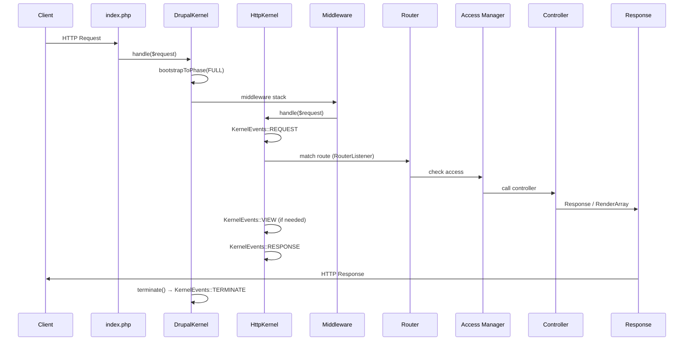
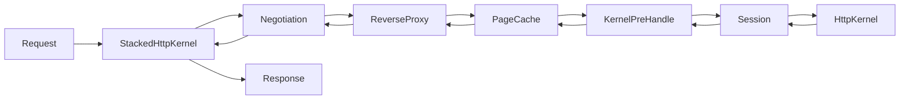
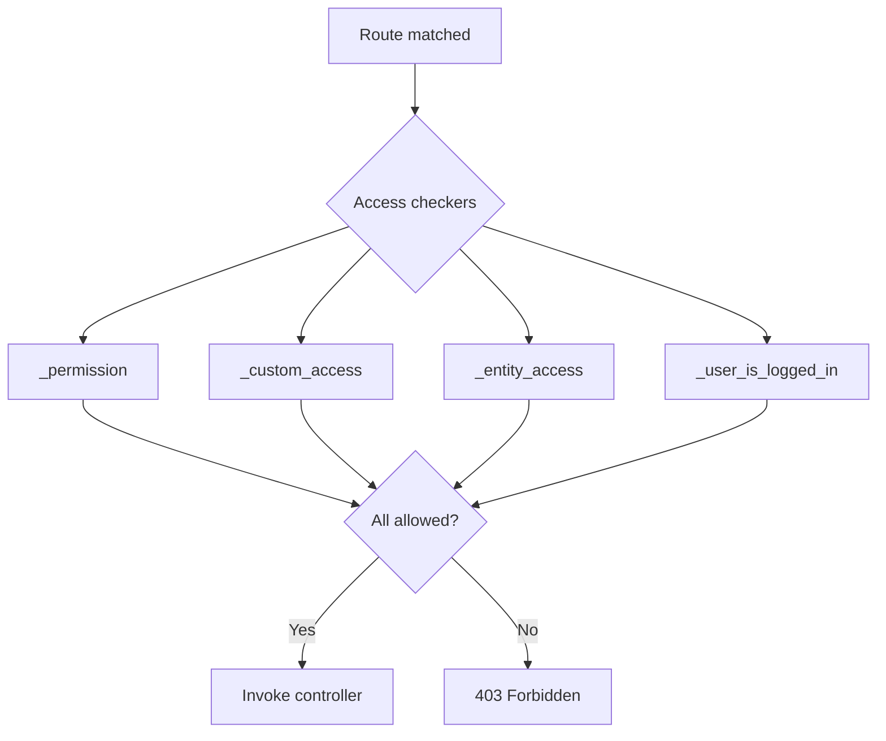
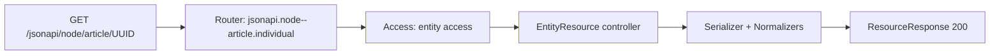

# Request Lifecycle

Once Drupal reaches `DRUPAL_BOOTSTRAP_FULL`, every HTTP request flows through Symfony's HttpKernel event pipeline. Drupal extends this pipeline with middleware, route access checkers, and render subscribers. Understanding `KernelEvents` is essential for debugging redirects, authentication failures, and API responses.

## High-level flow



## KernelEvents reference

Symfony's HttpKernel dispatches these events (Drupal adds subscribers to each):

| Event | Constant | When | Common Drupal use |
|-------|----------|------|-------------------|
| Request | `KernelEvents::REQUEST` | Before routing | Language negotiation, maintenance mode |
| Exception | `KernelEvents::EXCEPTION` | On uncaught exception | Custom error pages, JSON error format |
| Controller | `KernelEvents::CONTROLLER` | After controller resolved | Substitute controller (e.g. `_controller` override) |
| Controller arguments | `KernelEvents::CONTROLLER_ARGUMENTS` | Before controller invoked | Inject route parameters |
| View | `KernelEvents::VIEW` | Controller returned non-Response | Convert render array to Response |
| Response | `KernelEvents::RESPONSE` | Before response sent | Add cache headers, CORS |
| Finish request | `KernelEvents::FINISH_REQUEST` | After response created | Cleanup per-request state |
| Terminate | `KernelEvents::TERMINATE` | After response sent to client | Logging, queue dispatch |

```php
<?php

declare(strict_types=1);

namespace Symfony\Component\HttpKernel;

// KernelEvents.php (excerpt)
final class KernelEvents {
  public const REQUEST = 'kernel.request';
  public const EXCEPTION = 'kernel.exception';
  public const CONTROLLER = 'kernel.controller';
  public const CONTROLLER_ARGUMENTS = 'kernel.controller_arguments';
  public const VIEW = 'kernel.view';
  public const RESPONSE = 'kernel.response';
  public const FINISH_REQUEST = 'kernel.finish_request';
  public const TERMINATE = 'kernel.terminate';
}
```

## DrupalKernel::handle()

```php
<?php

declare(strict_types=1);

namespace Drupal\Core;

use Symfony\Component\HttpFoundation\Request;
use Symfony\Component\HttpFoundation\Response;
use Symfony\Component\HttpKernel\TerminableInterface;

// Simplified excerpt — exception handling omitted.
class DrupalKernel implements DrupalKernelInterface, TerminableInterface {

  public function handle(Request $request, $type = self::MAIN_REQUEST, $catch = TRUE): Response {
    static::bootEnvironment();
    if (!$this->booted) {
      $this->initializeSettings($request);
      $this->boot();
    }
    // Delegate to the 'http_kernel' service: the middleware stack wrapped
    // around Symfony's HttpKernel.
    $response = $this->getHttpKernel()->handle($request, $type, $catch);
    $response->prepare($request);
    return $response;
  }

  public function terminate(Request $request, Response $response): void {
    // Delegates to the stacked kernel (only once preHandle() has run), then
    // destructs services tagged 'needs_destruction'.
    $this->getHttpKernel()->terminate($request, $response);
  }
}
```

## Middleware stack

Drupal wraps the HttpKernel in a **middleware stack** (onion model). Each middleware can modify the request before passing inward or the response on the way out:



Middleware is registered with the `http_middleware` tag (in `core.services.yml` and module service files):

```yaml
# core/core.services.yml (excerpt)
services:
  http_middleware.session:
    class: Drupal\Core\StackMiddleware\Session
    autowire: true
    tags:
      - { name: http_middleware, priority: 50 }
```

```yaml
# core/modules/page_cache/page_cache.services.yml (excerpt)
services:
  http_middleware.page_cache:
    class: Drupal\page_cache\StackMiddleware\PageCache
    arguments: ['@cache.page', '@page_cache_request_policy', '@page_cache_response_policy']
    tags:
      - { name: http_middleware, priority: 200 }
```

Higher priority = outer layer (runs first on the request, last on the response). Core middleware in Drupal 11:

| Service | Priority | Role |
|---------|----------|------|
| `http_middleware.ajax_page_state` | 500 | Expands the compressed `ajax_page_state` query parameter |
| `http_middleware.negotiation` | 400 | Sets the request format |
| `http_middleware.reverse_proxy` | 300 | Trusted proxy headers |
| `http_middleware.cors` | 250 | Only when `cors.config` is enabled |
| `http_middleware.page_cache` | 200 | `page_cache` module; serves cached pages before modules load |
| `http_middleware.big_pipe` | 150 | `big_pipe` module; removes `Content-Length` from BigPipe responses |
| `http_middleware.content_length` | 140 | Adds `Content-Length` |
| `http_middleware.kernel_pre_handle` | 100 | `DrupalKernel::preHandle()` — loads all modules |
| `http_middleware.session` | 50 | Starts the session |

## Routing phase

During `KernelEvents::REQUEST`, `RouterListener` (priority 32) asks the `router` service to match the path to a route; the access-aware router then runs the route's access checks:

```yaml
# my_module.routing.yml
my_module.product_detail:
  path: '/api/products/{product}'
  defaults:
    _controller: '\Drupal\my_module\Controller\ProductApiController::detail'
    _title: 'Product detail'
  requirements:
    _permission: 'access content'
    _format: 'json'
    product: \d+
  methods: [GET]
```

```php
<?php

declare(strict_types=1);

namespace Drupal\my_module\Controller;

use Drupal\Core\Controller\ControllerBase;
use Drupal\my_module\Entity\Product;
use Symfony\Component\HttpFoundation\JsonResponse;

final class ProductApiController extends ControllerBase {

  public function detail(Product $product): JsonResponse {
    return new JsonResponse([
      'id' => $product->id(),
      'title' => $product->label(),
      'sku' => $product->get('sku')->value,
      'price' => (float) $product->get('price')->value,
    ]);
  }
}
```

The `{product}` parameter is resolved via **paramconverter** (`entity:product` upcasting).

## Access checking

Before the controller runs, Drupal runs all access checkers registered for the route:



```php
<?php

declare(strict_types=1);

namespace Drupal\my_module\Access;

use Drupal\Core\Access\AccessResult;
use Drupal\Core\Routing\Access\AccessInterface;
use Drupal\Core\Session\AccountInterface;
use Symfony\Component\Routing\Route;

final class ProductAccessCheck implements AccessInterface {

  public function access(Route $route, AccountInterface $account): AccessResult {
    $require_premium = (bool) $route->getRequirement('_premium_only');
    if (!$require_premium) {
      return AccessResult::allowed();
    }
    return AccessResult::allowedIfHasPermission($account, 'view premium products')
      ->addCacheContexts(['user.permissions']);
  }

}
```

## View event: render arrays to Response

When a controller returns a **render array** (not a `Response`), the `KernelEvents::VIEW` event converts it:

```php
<?php

declare(strict_types=1);

namespace Drupal\my_module\Controller;

use Drupal\Core\Controller\ControllerBase;

final class ArticleListController extends ControllerBase {

  public function list(): array {
    $nodes = $this->entityTypeManager()
      ->getStorage('node')
      ->loadByProperties(['type' => 'article', 'status' => 1]);

    $items = [];
    foreach ($nodes as $node) {
      $items[] = $node->toLink()->toString();
    }

    return [
      '#theme' => 'item_list',
      '#title' => $this->t('Recent articles'),
      '#items' => $items,
      '#cache' => [
        'tags' => ['node_list:article'],
        'contexts' => ['user.permissions'],
        'max-age' => 3600,
      ],
    ];
  }
}
```

`Drupal\Core\EventSubscriber\MainContentViewSubscriber` listens on `KernelEvents::VIEW` and renders the array with the main content renderer chosen by the `_wrapper_format` query parameter (HTML by default; AJAX, dialog and modal otherwise). A render array returned for a non-HTML format such as JSON gets a 406 from `RenderArrayNonHtmlSubscriber`.

## Response event

Subscribers can modify headers before the response is sent:

```php
<?php

declare(strict_types=1);

namespace Drupal\my_module\EventSubscriber;

use Symfony\Component\EventDispatcher\EventSubscriberInterface;
use Symfony\Component\HttpKernel\Event\ResponseEvent;
use Symfony\Component\HttpKernel\KernelEvents;

final class ApiCacheHeaderSubscriber implements EventSubscriberInterface {

  public function onResponse(ResponseEvent $event): void {
    if (!$event->isMainRequest()) {
      return;
    }
    $request = $event->getRequest();
    if (!str_starts_with($request->getPathInfo(), '/api/')) {
      return;
    }
    $response = $event->getResponse();
    $response->headers->set('Cache-Control', 'public, max-age=300');
    $response->headers->set('X-Drupal-Cache', 'MISS');
  }

  public static function getSubscribedEvents(): array {
    return [KernelEvents::RESPONSE => ['onResponse', -10]];
  }

}
```

## Terminate phase

After `response->send()`, `DrupalKernel::terminate()` fires `KernelEvents::TERMINATE`. Use this for work that must not delay the response:

```php
<?php

declare(strict_types=1);

namespace Drupal\my_module\EventSubscriber;

use Symfony\Component\EventDispatcher\EventSubscriberInterface;
use Symfony\Component\HttpKernel\Event\TerminateEvent;
use Symfony\Component\HttpKernel\KernelEvents;

final class RequestLogTerminateSubscriber implements EventSubscriberInterface {

  public function onTerminate(TerminateEvent $event): void {
    $request = $event->getRequest();
    $response = $event->getResponse();
    \Drupal::logger('my_module')->info('{method} {path} → {status}', [
      'method' => $request->getMethod(),
      'path' => $request->getPathInfo(),
      'status' => $response->getStatusCode(),
    ]);
  }

  public static function getSubscribedEvents(): array {
    return [KernelEvents::TERMINATE => ['onTerminate']];
  }

}
```

## JSON:API request path

Headless requests follow the same lifecycle with format negotiation:

```bash
# JSON:API request — Accept header triggers json format
curl -s -H "Accept: application/vnd.api+json" \
  https://example.com/jsonapi/node/article/UUID \
  | jq '.data.attributes.title'
```



## Exception handling

Uncaught exceptions trigger `KernelEvents::EXCEPTION`:

```php
<?php

declare(strict_types=1);

namespace Drupal\my_module\EventSubscriber;

use Symfony\Component\EventDispatcher\EventSubscriberInterface;
use Symfony\Component\HttpFoundation\JsonResponse;
use Symfony\Component\HttpKernel\Event\ExceptionEvent;
use Symfony\Component\HttpKernel\Exception\HttpExceptionInterface;
use Symfony\Component\HttpKernel\KernelEvents;

final class ApiExceptionSubscriber implements EventSubscriberInterface {

  public function onException(ExceptionEvent $event): void {
    $request = $event->getRequest();
    if (!str_starts_with($request->getPathInfo(), '/api/')) {
      return;
    }
    $exception = $event->getThrowable();
    $status = $exception instanceof HttpExceptionInterface
      ? $exception->getStatusCode()
      : 500;

    $event->setResponse(new JsonResponse([
      'error' => $exception->getMessage(),
      'code' => $status,
    ], $status));
  }

  public static function getSubscribedEvents(): array {
    return [KernelEvents::EXCEPTION => ['onException', 50]];
  }

}
```

!!! warning "Never catch exceptions in controllers for APIs"
    Use exception subscribers instead. They integrate with Drupal's logging and maintain consistent error shapes for API consumers.

## Related reading

- [Bootstrap Phases](bootstrap.md) — what happens before the request event
- [Routing](routing.md) — route matching and builders
- [Tracing a Request](tracing-request.md) — concrete step-by-step example
