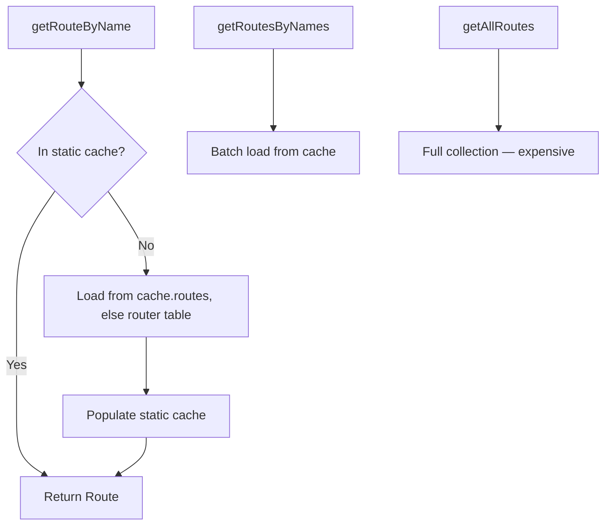

# Route Inspection

Routes are the map between URLs and controllers. When you get unexpected 404s, wrong controllers, or access denials, you need to inspect the route collection and understand how `RouteProvider` resolves paths. This page covers Drush route commands and the core routing code paths.

## Drush route commands

```bash
# List all routes (name → path) — pipe to less
drush route | less

# Full details for one route (exact route name)
drush route --name=entity.node.canonical

# Details of the route that serves a path
drush route --path=/node/1

# Get JSON output for scripting
drush route --name=my_module.api_product --format=json | jq .
```

### Example output

```bash
$ drush route --name=my_module.api_product
name: my_module.api_product
path: '/api/products/{product}'
defaults:
  _controller: '\Drupal\my_module\Controller\ProductApiController::get'
requirements:
  _permission: 'access content'
  _format: json
options:
  parameters:
    product:
      type: entity:product
```

## Programmatic route lookup

### Match a path without access checks

```bash
drush php:eval "
\$router = \Drupal::service('router.no_access_checks');
try {
  \$match = \$router->match('/api/products/42');
  print_r(\$match);
} catch (\Exception \$e) {
  echo 'No match: ' . \$e->getMessage();
}
"
```

### Match with access checks

```bash
drush php:eval "
\$access_manager = \Drupal::service('access_manager');
\$account = \Drupal::currentUser();
// Pass TRUE as the 4th argument to get an AccessResult object instead of a bool.
\$result = \$access_manager->checkNamedRoute('my_module.api_product', ['product' => '42'], \$account, TRUE);
echo \$result->isAllowed() ? 'ALLOWED' : 'FORBIDDEN';
echo PHP_EOL;
if (\$result instanceof \Drupal\Core\Access\AccessResultReasonInterface) {
  echo 'Reason: ' . (\$result->getReason() ?: 'none');
}
"
```

### Get all routes from RouteProvider

```bash
drush php:eval "
\$provider = \Drupal::service('router.route_provider');
\$routes = \$provider->getAllRoutes();
echo 'Total routes: ' . count(\$routes) . PHP_EOL;
foreach (\$routes as \$name => \$route) {
  if (str_starts_with(\$name, 'my_module.')) {
    echo \$name . ' → ' . \$route->getPath() . PHP_EOL;
  }
}
"
```

## RouteProvider internals

`Drupal\Core\Routing\RouteProvider` is the cached route store:



```php
<?php

declare(strict_types=1);

namespace Drupal\Core\Routing;

use Drupal\Core\Cache\CacheBackendInterface;
use Symfony\Component\Routing\Route;
use Symfony\Component\Routing\RouteCollection;

/**
 * RouteProvider — simplified interface view.
 */
interface RouteProviderInterface {

  public function getRouteByName(string $name): Route;

  public function getRoutesByNames(array $names): array;

  public function getRoutesByPattern(string $pattern): RouteCollection;

  public function getAllRoutes(): RouteCollection;

  public function reset(): void;

}
```

### Route cache bins

| Storage / cache | Purpose |
|-----------------|---------|
| `router` database table | Canonical store of all routes, written by `router.builder` on rebuild |
| `cache.data` | Candidate route collections per request path (tag `route_match`) |
| `cache.routes` | Route objects loaded by name (tag `routes`) |
| Static `$routes` | In-request memory cache on RouteProvider |

```bash
# Invalidate route cache
drush php:eval "\Drupal::service('router.builder')->rebuild();"
drush cr
```

## Router vs RouteProvider

Two related services:

```php
<?php

declare(strict_types=1);

// router.route_provider — storage/retrieval of Route objects
$provider = \Drupal::service('router.route_provider');
$route = $provider->getRouteByName('entity.node.canonical');
echo $route->getPath(); // '/node/{node}'

// router — matching engine (Symfony UrlMatcherInterface)
$router = \Drupal::service('router.no_access_checks');
$parameters = $router->match('/node/1');
echo $parameters['_route']; // 'entity.node.canonical'
```


## Inspecting dynamic routes

Views and entity types add routes at rebuild time:

```bash
# Count Views routes
drush php:eval "
\$routes = \Drupal::service('router.route_provider')->getAllRoutes();
\$views = 0;
foreach (\$routes as \$name => \$route) {
  if (str_starts_with(\$name, 'view.')) {
    \$views++;
  }
}
echo \"Views routes: \$views\" . PHP_EOL;
"

# Entity canonical route (--name needs the exact route name)
drush route --name=entity.product.canonical
```

### Rebuild after Views change

```bash
# After importing a View config
drush config:import -y
drush php:eval "\Drupal::service('router.builder')->rebuild();"
drush cr

# Verify new View page route
drush route --name=view.articles.page_1
```

## Route alter debugging

Find what altered a route:

```php
<?php

declare(strict_types=1);

namespace Drupal\my_module\Routing;

use Drupal\Core\Routing\RouteSubscriberBase;
use Symfony\Component\Routing\RouteCollection;

final class DebugRouteSubscriber extends RouteSubscriberBase {

  public function alterRoutes(RouteCollection $collection): void {
    if ($route = $collection->get('system.admin')) {
      // Example: change admin route requirement
      $route->setRequirement('_permission', 'administer site configuration');
    }
  }

}
```

```bash
# Compare route before/after by exporting
drush route --name=system.admin --format=yaml > /tmp/route-before.yaml
# Disable suspect module, rebuild
drush pm:uninstall suspect_module -y
drush cr
drush route --name=system.admin --format=yaml > /tmp/route-after.yaml
diff /tmp/route-before.yaml /tmp/route-after.yaml
```

## Paramconverter inspection

When `{product}` does not upcast to an entity:

```bash
drush php:eval "
\$route = \Drupal::service('router.route_provider')->getRouteByName('my_module.api_product');
\$params = \$route->getOption('parameters');
print_r(\$params);
"
```

Expected:

```
Array
(
    [product] => Array
        (
            [type] => entity:product
        )
)
```

Test converter directly:

```bash
drush php:eval "
// Converters are keyed by service ID.
\$converter = \Drupal::service('paramconverter_manager')->getConverter('paramconverter.entity');
\$entity = \$converter->convert('42', ['type' => 'entity:product'], 'product', []);
echo \$entity ? get_class(\$entity) . ' #' . \$entity->id() : 'NULL';
"
```

## Route collection dump script

Save as a one-off debugging script:

```php
<?php

declare(strict_types=1);

use Drupal\Core\DrupalKernel;
use Symfony\Component\HttpFoundation\Request;

$autoloader = require_once 'autoload.php';
$kernel = DrupalKernel::createFromRequest(Request::createFromGlobals(), $autoloader, 'prod');
$kernel->boot();

$provider = \Drupal::service('router.route_provider');
$collection = $provider->getAllRoutes();

$report = [];
foreach ($collection as $name => $route) {
  if (!str_contains($route->getPath(), '/api/')) {
    continue;
  }
  $report[] = [
    'name' => $name,
    'path' => $route->getPath(),
    'methods' => $route->getMethods() ?: ['ANY'],
    'controller' => $route->getDefault('_controller'),
  ];
}

usort($report, fn(array $a, array $b): int => $a['path'] <=> $b['path']);
foreach ($report as $row) {
  printf("%-40s %-30s %s\n", $row['name'], $row['path'], $row['controller'] ?? '(none)');
}
```

```bash
php scripts/dump-api-routes.php
```

## Common inspection scenarios

| Symptom | Command | What to look for |
|---------|---------|------------------|
| 404 on custom path | `drush route --path=/your/path` | Route missing → enable module, rebuild |
| 403 on valid route | `drush route --name=ROUTE_NAME` | `_permission`, `_role`, `_entity_access` |
| Wrong controller | `drush route --name=ROUTE_NAME` | `defaults._controller` value |
| Parameter is string | `drush route --name=ROUTE_NAME` | `options.parameters.type` |
| Route exists but old | `drush cr` | Stale route cache |

!!! note "router.no_access_checks"
    The `router.no_access_checks` service matches paths without running access checkers. Use it to separate routing problems from permission problems.

## Related reading

- [Routing](routing.md) — route providers and builders
- [Tracing a Request](tracing-request.md) — where route matching fits in the lifecycle
- [Debugging Services](debugging-services.md) — inspecting router services
