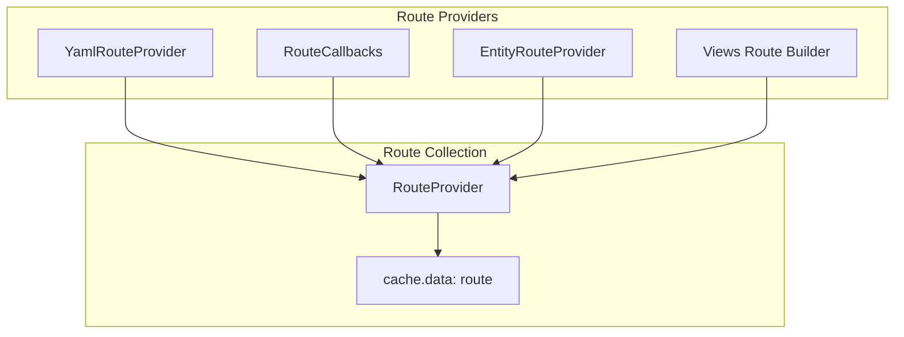
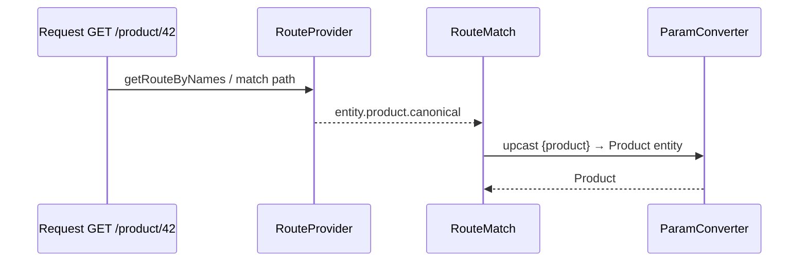

# Routing

Drupal maps every URL to a **route** — a named configuration object with a path pattern, controller, access requirements, and options. Routes come from static YAML, route callbacks, and **route alter** events. The `RouteProvider` aggregates and caches them for fast lookup.

## Route anatomy

```yaml
# my_module.routing.yml
my_module.product_list:
  path: '/admin/commerce/products'
  defaults:
    _controller: '\Drupal\my_module\Controller\ProductAdminController::list'
    _title: 'Products'
  requirements:
    _permission: 'administer products'
  options:
    _admin_route: TRUE
    parameters:
      category:
        type: entity:taxonomy_term
        bundle:
          - product_categories
```

| Key | Purpose |
|-----|---------|
| `path` | URL pattern with `{placeholders}` |
| `defaults._controller` | Callable (class::method or service:method) |
| `defaults._form` | Form class for entity forms |
| `defaults._entity_form` | Generic entity form route |
| `defaults._title` | Page title (string or `_title_callback`) |
| `requirements` | Access checks (`_permission`, `_role`, `_custom_access`) |
| `options` | Admin route, parameters, `_format`, etc. |
| `methods` | HTTP verbs (`GET`, `POST`, …) |

## Route providers

Routes are collected from multiple **route providers**, each implementing `RouteProviderInterface`:



### Static YAML routes

The primary source — one `*.routing.yml` per module:

```yaml
# my_module.routing.yml
my_module.api_search:
  path: '/api/v1/search'
  defaults:
    _controller: '\Drupal\my_module\Controller\SearchApiController::search'
  requirements:
    _permission: 'access content'
  methods: [GET]
  options:
    _format: 'json'
```

### Route callbacks (dynamic routes)

Modules implement `hook_route_callbacks()` or OOP equivalent to return route collections:

```php
<?php

declare(strict_types=1);

namespace Drupal\my_module\Routing;

use Drupal\Core\DependencyInjection\ContainerInjectionInterface;
use Symfony\Component\DependencyInjection\ContainerInterface;
use Symfony\Component\Routing\Route;
use Symfony\Component\Routing\RouteCollection;

final class ProductRoutes implements ContainerInjectionInterface {

  public function __construct(
    private readonly array $productTypes,
  ) {}

  public static function create(ContainerInterface $container): static {
    return new static(
      $container->getParameter('my_module.product_types'),
    );
  }

  public function routes(): RouteCollection {
    $collection = new RouteCollection();

    foreach ($this->productTypes as $type => $label) {
      $collection->add("my_module.product_type.{$type}", new Route(
        "/products/{$type}",
        [
          '_controller' => '\Drupal\my_module\Controller\ProductTypeController::listing',
          '_title' => $label,
          'product_type' => $type,
        ],
        [
          '_permission' => 'access content',
        ],
      ));
    }

    return $collection;
  }

}
```

```yaml
# my_module.services.yml
parameters:
  my_module.product_types:
    physical: 'Physical products'
    digital: 'Digital downloads'

services:
  my_module.route_subscriber:
    class: Drupal\my_module\Routing\ProductRouteSubscriber
    tags:
      - { name: event_subscriber }
```

```php
<?php

declare(strict_types=1);

namespace Drupal\my_module\Routing;

use Drupal\Core\Routing\RouteSubscriberBase;
use Symfony\Component\Routing\RouteCollection;

final class ProductRouteSubscriber extends RouteSubscriberBase {

  public function alterRoutes(RouteCollection $collection): void {
    if ($route = $collection->get('my_module.api_search')) {
      $route->setRequirement('_csrf_token', 'FALSE');
    }
  }

}
```

### Entity route providers

Content entities declare routes via annotations/attributes on the entity class:

```php
<?php

declare(strict_types=1);

namespace Drupal\my_module\Entity;

use Drupal\Core\Entity\Attribute\ContentEntityType;
use Drupal\Core\Entity\ContentEntityBase;
use Drupal\Core\StringTranslation\TranslatableMarkup;
use Drupal\my_module\ProductAccessControlHandler;
use Drupal\my_module\ProductListBuilder;
use Drupal\my_module\Form\ProductForm;

#[ContentEntityType(
  id: 'product',
  label: new TranslatableMarkup('Product'),
  handlers: [
    'access' => ProductAccessControlHandler::class,
    'list_builder' => ProductListBuilder::class,
    'form' => [
      'default' => ProductForm::class,
      'add' => ProductForm::class,
      'edit' => ProductForm::class,
    ],
  ],
  base_table: 'product',
  entity_keys: [
    'id' => 'id',
    'label' => 'title',
    'uuid' => 'uuid',
  ],
  links: [
    'canonical' => '/product/{product}',
    'add-form' => '/product/add',
    'edit-form' => '/product/{product}/edit',
    'delete-form' => '/product/{product}/delete',
    'collection' => '/admin/content/products',
  ],
)]
final class Product extends ContentEntityBase {}
```

This auto-generates routes like `entity.product.canonical` without manual YAML.

## Route builders

**Route builders** rebuild routes when underlying data changes (Views is the classic example):

```php
<?php

declare(strict_types=1);

namespace Drupal\my_module\Routing;

use Drupal\Core\Routing\RouteBuilderInterface;
use Drupal\Core\Routing\RoutingEvents;
use Symfony\Contracts\EventDispatcher\EventDispatcherInterface;

final class ProductRouteBuilder implements RouteBuilderInterface {

  public function __construct(
    private readonly EventDispatcherInterface $dispatcher,
  ) {}

  public function rebuild(): void {
    // Invalidate route cache and trigger rebuild.
    $this->dispatcher->dispatch(new RouteBuildEvent(), RoutingEvents::DYNAMIC);
  }

}
```

```bash
# Rebuild routes manually
drush php:eval "\Drupal::service('router.builder')->rebuild();"
drush cr
```

## Route matching

```php
<?php

declare(strict_types=1);

namespace Drupal\Core\Routing;

// Simplified match flow
public function getRouteCollectionForRequest(Request $request): RouteCollection {
  $path = $request->getPathInfo();
  // Routes are matched by path + method + format.
  return $this->getRoutesByPath($path);
}
```



## Parameter upcasting

Placeholders map to typed objects via param converters:

```yaml
my_module.product_edit:
  path: '/api/products/{product}'
  defaults:
    _controller: '\Drupal\my_module\Controller\ProductApiController::edit'
  requirements:
    _entity_access: 'product.update'
  options:
    parameters:
      product:
        type: entity:product
```

```php
<?php

declare(strict_types=1);

namespace Drupal\my_module\Controller;

use Drupal\Core\Controller\ControllerBase;
use Drupal\my_module\Entity\Product;
use Symfony\Component\HttpFoundation\JsonResponse;
use Symfony\Component\HttpFoundation\Request;

final class ProductApiController extends ControllerBase {

  public function edit(Product $product, Request $request): JsonResponse {
    $payload = json_decode($request->getContent(), TRUE, 512, JSON_THROW_ON_ERROR);
    $product->set('title', $payload['title']);
    $product->save();

    return new JsonResponse(['id' => $product->id(), 'title' => $product->label()]);
  }

}
```

## Route caching

Routes are cached in `cache.data` with tag `route_match`:

```bash
# Inspect a specific route
drush route:get entity.node.canonical

# List routes matching a path
drush route --path=/node/1
```

!!! note "Route vs URL"
    A **route** is internal (machine name + path pattern). A **URL** is the outward-facing link. Use `Url::fromRoute('entity.node.canonical', ['node' => 1])` to generate URLs.

## Common pitfalls

| Problem | Cause | Fix |
|---------|-------|-----|
| 404 on custom route | Module not enabled, cache stale | `drush en my_module -y && drush cr` |
| Wrong controller runs | Route alter changed defaults | `drush route:get my_module.foo` |
| Parameter is raw string | Missing `options.parameters` | Add `type: entity:product` |
| Route missing after Views change | Dynamic routes not rebuilt | `drush php:eval` router.builder rebuild |

## Related reading

- [Route Inspection](route-inspection.md) — Drush commands and RouteProvider source
- [Request Lifecycle](request-lifecycle.md) — what happens after a route matches
- [Tracing a Request](tracing-request.md) — end-to-end example
