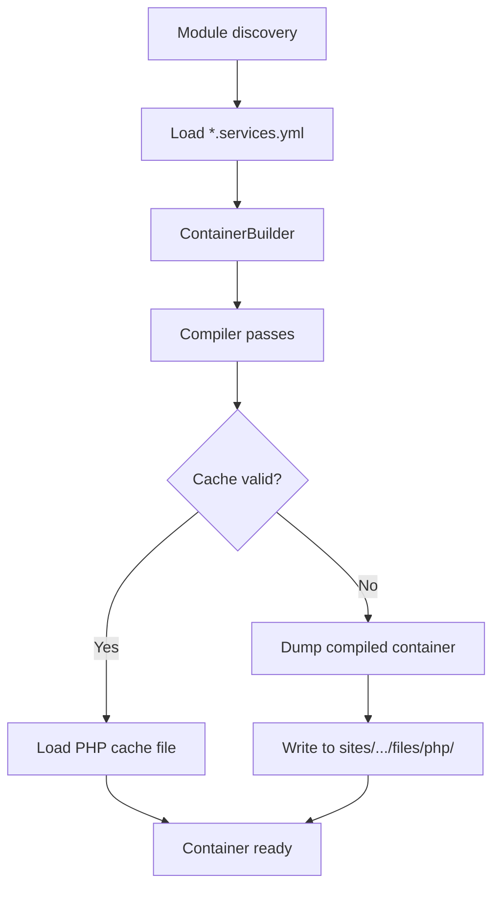

# Service Container (Internals)

Drupal's service container is the runtime registry for every object the application needs — database connections, entity managers, plugin factories, loggers, and your custom services. At `DRUPAL_BOOTSTRAP_FULL`, the kernel either loads a **cached compiled container** or builds one from hundreds of `*.services.yml` files.

## Container lifecycle



## ContainerBuilder

Drupal extends Symfony's `ContainerBuilder` as `Drupal\Core\DependencyInjection\ContainerBuilder`:

```php
<?php

declare(strict_types=1);

namespace Drupal\Core\DependencyInjection;

use Symfony\Component\DependencyInjection\ContainerBuilder as SymfonyContainerBuilder;

/**
 * Drupal's container builder (simplified).
 */
class ContainerBuilder extends SymfonyContainerBuilder {
  // Compiler passes are not added here: CoreServiceProvider::register()
  // registers them, and each module's service provider may add more.
}
```

Key compiler passes registered in `CoreServiceProvider::register()`:

| Pass | Purpose |
|------|---------|
| `RegisterEventSubscribersPass` | Wires `event_subscriber` tags to EventDispatcher |
| `RegisterAccessChecksPass` | Collects `access_check` tagged services |
| `TaggedHandlersPass` | Generic tag → method call collector |
| `ModifyServiceDefinitionsPass` | Runs service providers' `alter()` methods |
| `ProxyServicesPass` | Swaps `lazy: true` services for generated proxy classes |

## How the kernel builds the container

```php
<?php

declare(strict_types=1);

namespace Drupal\Core;

// DrupalKernel.php — initializeContainer() (conceptual)
protected function initializeContainer() {
  $container_definition = $this->getCachedContainerDefinition();

  if ($container_definition) {
    // Fast path: require the pre-compiled PHP class.
    return $container_definition;
  }

  $container = new ContainerBuilder();

  // 1. Add core service providers.
  // 2. Add each enabled module's service provider / YAML.
  // 3. Run compiler passes.
  // 4. Dump and cache the result.

  return $container;
}
```

## Service providers

Modules can register services programmatically (`register()`) or alter existing definitions (`alter()`) with a service provider:

```php
<?php

declare(strict_types=1);

namespace Drupal\my_module;

use Drupal\Core\DependencyInjection\ContainerBuilder;
use Drupal\Core\DependencyInjection\ServiceProviderBase;
use Symfony\Component\DependencyInjection\Reference;

final class MyModuleServiceProvider extends ServiceProviderBase {

  public function alter(ContainerBuilder $container): void {
    // Alter existing definitions at compile time.
    if ($container->hasDefinition('language_manager')) {
      $container->getDefinition('language_manager')
        ->setClass('Drupal\my_module\MyLanguageManager')
        ->addArgument(new Reference('entity_type.manager'));
    }
  }

}
```

No registration is needed: Drupal discovers the provider by naming convention. The class must be `Drupal\{module}\{CamelCasedModule}ServiceProvider` — here `Drupal\my_module\MyModuleServiceProvider` in `src/MyModuleServiceProvider.php`. There is no `service_provider` tag.

## Cached container

After compilation, Drupal dumps a PHP class to the filesystem:

```bash
# Find the compiled container after cache rebuild
drush cr
find web/sites/default/files/php -name "*.php" -newer web/sites/default/settings.php 2>/dev/null | head -3

# Count compiled services (changes when service definitions change)
drush php:eval "echo count(\Drupal::getContainer()->getServiceIds());"
```

The cached file is a generated class implementing `ContainerInterface` with inlined factory methods — no YAML parsing at runtime.

!!! warning "Container cache and deployments"
    The compiled container lives in `sites/default/files/php/`. On deploy, ensure this directory is writable, or run `drush cr` after code changes. Stale containers cause "service not found" errors.

## Core services every developer uses

```yaml
# Conceptual map — actual IDs from core.services.yml
services:
  entity_type.manager:
    class: Drupal\Core\Entity\EntityTypeManager
  plugin.manager.block:
    class: Drupal\Core\Block\BlockManager
  current_user:
    class: Drupal\Core\Session\AccountProxy
  path.validator:
    class: Drupal\Core\Path\PathValidator
  cache.default:
    class: Drupal\Core\Cache\CacheBackendInterface
```

```php
<?php

declare(strict_types=1);

// Resolving services at runtime (prefer constructor injection in new code)
$entity_type_manager = \Drupal::entityTypeManager();
$cache = \Drupal::cache('default');
$current_user = \Drupal::currentUser();
```

## Container parameters

Global parameters are set in `core/core.services.yml` and module YAML:

```yaml
# my_module.services.yml
parameters:
  my_module.api_timeout: 30
  my_module.allowed_origins:
    - 'https://app.example.com'
    - 'https://staging.example.com'

services:
  my_module.api_client:
    class: Drupal\my_module\Http\ApiClient
    arguments: ['%my_module.api_timeout%', '%my_module.allowed_origins%']
```

```php
<?php

declare(strict_types=1);

namespace Drupal\my_module\Http;

final class ApiClient {

  public function __construct(
    private readonly int $timeout,
    private readonly array $allowedOrigins,
  ) {}

  public function getTimeout(): int {
    return $this->timeout;
  }

}
```

## Lazy services

Expensive services use lazy proxies to avoid instantiation until first use:

```yaml
services:
  my_module.heavy_processor:
    class: Drupal\my_module\Service\HeavyProcessor
    lazy: true
```

```php
<?php

declare(strict_types=1);

namespace Drupal\my_module\Service;

final class HeavyProcessor implements HeavyProcessorInterface {

  public function __construct() {
    // Without lazy: true, this runs whenever a service that depends on it is
    // built — even if process() is never called.
    sleep(1); // Simulating expensive init
  }

  public function process(array $data): array {
    return array_map('strtoupper', $data);
  }

}
```

!!! warning "Lazy services need a generated proxy class"
    Drupal does not create lazy proxies on the fly. Generate one and commit it (it lands in `src/ProxyClass/`):

    ```bash
    php core/scripts/generate-proxy-class.php 'Drupal\my_module\Service\HeavyProcessor' 'modules/custom/my_module/src'
    ```

    Without it, the container build emits a "Missing proxy class" warning and the service is not lazy. The proxy implements the class's interfaces but does not extend it, so consumers must type-hint an interface (`HeavyProcessorInterface` above), not the class.

## Synthetic services

Some services are set at runtime after container compilation:

```php
<?php

declare(strict_types=1);

// DrupalKernel registers these as synthetic and sets them itself:
// - 'kernel' — the DrupalKernel instance
// - 'service_container' — the container
// - 'class_loader' — the Composer class loader
// There is no 'request' service (use 'request_stack'). 'current_user' and
// 'current_route_match' are regular services defined in core.services.yml.
```

## Debugging the container

```bash
# List all service IDs (requires devel)
drush devel:services | grep my_module

# Check if a service exists
drush php:eval "var_dump(\Drupal::getContainer()->has('my_module.product_manager'));"

# Inspect service class
drush php:eval "echo get_class(\Drupal::service('entity_type.manager'));"
```

See [Debugging Services](debugging-services.md) for a full debugging guide.

## When the container rebuilds

The container is recompiled when:

1. `drush cr` (cache rebuild)
2. A module is installed or uninstalled
3. The container cache key changes: Drupal version, `$settings['deployment_identifier']`, or the `$settings['container_yamls']` list

Edits to `*.services.yml` or service providers are **not** detected automatically — they take effect only after `drush cr`.

```bash
# Enable a module — triggers container rebuild
drush en my_module -y

# After editing *.services.yml or a service provider
drush cr
```

!!! tip "Development workflow"
    After changing `*.services.yml`, always run `drush cr`. Opcache may also cache old PHP — restart PHP-FPM if changes don't appear.

## Related reading

- [Dependency Injection: Service Container](../dependency-injection/service-container.md) — developer-focused container guide
- [Service Definitions](../dependency-injection/service-definitions.md) — writing `*.services.yml`
- [Tagged Services](../dependency-injection/tagged-services.md) — compiler pass patterns
