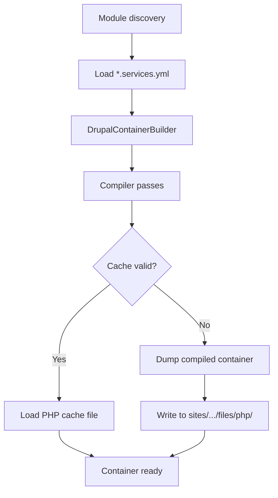

# Service Container (Internals)

Drupal's service container is the runtime registry for every object the application needs — database connections, entity managers, plugin factories, loggers, and your custom services. At `DRUPAL_BOOTSTRAP_FULL`, the kernel either loads a **cached compiled container** or builds one from hundreds of `*.services.yml` files.

## Container lifecycle



## DrupalContainerBuilder

Drupal extends Symfony's `ContainerBuilder` with CMS-specific compiler passes:

```php
<?php

declare(strict_types=1);

namespace Drupal\Core\DependencyInjection;

use Symfony\Component\DependencyInjection\ContainerBuilder as SymfonyContainerBuilder;

/**
 * Drupal's container builder — merges module service definitions.
 */
class DrupalContainerBuilder extends SymfonyContainerBuilder {

  public function __construct() {
    parent::__construct();
    // Drupal registers compiler passes for:
    // - Tagged service collectors (event subscribers, access checkers)
    // - Service provider discovery
    // - Parameter bag merging
  }
}
```

Key compiler passes registered during build:

| Pass | Purpose |
|------|---------|
| `RegisterEventSubscribersPass` | Wires `event_subscriber` tags to EventDispatcher |
| `RegisterAccessCheckPass` | Collects `access_check` tagged services |
| `TaggedHandlersPass` | Generic tag → method call collector |
| `ModifyServiceDefinitionsPass` | Drupal-specific service alterations |
| `ProxyServicesPass` | Lazy-loading proxies for expensive services |

## How the kernel builds the container

```php
<?php

declare(strict_types=1);

namespace Drupal\Core;

// DrupalKernel.php — initializeContainer() (conceptual)
protected function initializeContainer() {
  $container_definition = $this->getCachedContainerDefinition();

  if ($container_definition) {
    // Fast path: require the pre-compiled PHP class.
    return $container_definition;
  }

  $container = new DrupalContainerBuilder();

  // 1. Add core service providers.
  // 2. Add each enabled module's service provider / YAML.
  // 3. Run compiler passes.
  // 4. Dump and cache the result.

  return $container;
}
```

## Service providers

Modules can register services programmatically via `ServiceProviderInterface`:

```php
<?php

declare(strict_types=1);

namespace Drupal\my_module;

use Drupal\Core\DependencyInjection\ContainerBuilder;
use Drupal\Core\DependencyInjection\ServiceProviderInterface;

final class MyModuleServiceProvider implements ServiceProviderInterface {

  public function register(ContainerBuilder $container): void {
    // Alter existing definitions at compile time.
    if ($container->hasDefinition('logger.factory')) {
      $definition = $container->getDefinition('logger.factory');
      $definition->addMethodCall('addLogger', [
        'my_module',
        '@logger.channel.my_module',
      ]);
    }
  }

}
```

Register the provider in `my_module.services.yml`:

```yaml
services:
  my_module.service_provider:
    class: Drupal\my_module\MyModuleServiceProvider
    tags:
      - { name: service_provider }
```

## Cached container

After compilation, Drupal dumps a PHP class to the filesystem:

```bash
# Find the compiled container after cache rebuild
drush cr
find web/sites/default/files/php -name "*.php" -newer web/sites/default/settings.php 2>/dev/null | head -3

# Inspect container hash (changes when services change)
drush php:eval "echo \Drupal::getContainer()->getParameter('container.build_id');"
```

The cached file is a generated class implementing `ContainerInterface` with inlined factory methods — no YAML parsing at runtime.

!!! warning "Container cache and deployments"
    The compiled container lives in `sites/default/files/php/`. On deploy, ensure this directory is writable, or run `drush cr` after code changes. Stale containers cause "service not found" errors.

## Core services every developer uses

```yaml
# Conceptual map — actual IDs from core.services.yml
services:
  entity_type.manager:
    class: Drupal\Core\Entity\EntityTypeManager
  plugin.manager.block:
    class: Drupal\Core\Block\BlockManager
  current_user:
    class: Drupal\Core\Session\AccountProxy
  path.validator:
    class: Drupal\Core\Path\PathValidator
  cache.default:
    class: Drupal\Core\Cache\CacheBackendInterface
```

```php
<?php

declare(strict_types=1);

// Resolving services at runtime (prefer constructor injection in new code)
$entity_type_manager = \Drupal::entityTypeManager();
$cache = \Drupal::cache('default');
$current_user = \Drupal::currentUser();
```

## Container parameters

Global parameters are set in `core/core.services.yml` and module YAML:

```yaml
# my_module.services.yml
parameters:
  my_module.api_timeout: 30
  my_module.allowed_origins:
    - 'https://app.example.com'
    - 'https://staging.example.com'

services:
  my_module.api_client:
    class: Drupal\my_module\Http\ApiClient
    arguments: ['%my_module.api_timeout%', '%my_module.allowed_origins%']
```

```php
<?php

declare(strict_types=1);

namespace Drupal\my_module\Http;

final class ApiClient {

  public function __construct(
    private readonly int $timeout,
    private readonly array $allowedOrigins,
  ) {}

  public function getTimeout(): int {
    return $this->timeout;
  }

}
```

## Lazy services

Expensive services use lazy proxies to avoid instantiation until first use:

```yaml
services:
  my_module.heavy_processor:
    class: Drupal\my_module\Service\HeavyProcessor
    lazy: true
```

```php
<?php

declare(strict_types=1);

namespace Drupal\my_module\Service;

final class HeavyProcessor {

  public function __construct() {
    // Without lazy: true, this runs on every request even if never used.
    sleep(1); // Simulating expensive init
  }

  public function process(array $data): array {
    return array_map('strtoupper', $data);
  }

}
```

## Synthetic services

Some services are set at runtime after container compilation:

```php
<?php

declare(strict_types=1);

// DrupalKernel sets these after boot:
// - 'request' — current Symfony Request
// - 'current_user' — AccountProxy populated from session
```

## Debugging the container

```bash
# List all service IDs (requires devel)
drush devel:services | grep my_module

# Check if a service exists
drush php:eval "var_dump(\Drupal::getContainer()->has('my_module.product_manager'));"

# Inspect service class
drush php:eval "echo get_class(\Drupal::service('entity_type.manager'));"
```

See [Debugging Services](debugging-services.md) for a full debugging guide.

## When the container rebuilds

The container is recompiled when:

1. `drush cr` (cache rebuild)
2. A module is enabled or disabled
3. `*.services.yml` changes are detected (via container build ID hash)
4. Service provider alters change compiled output

```bash
# Enable a module — triggers container rebuild
drush en my_module -y

# Development: disable container caching (settings.local.php)
# $settings['container_yamls'][] = ...  — NOT recommended for production
```

!!! tip "Development workflow"
    After changing `*.services.yml`, always run `drush cr`. Opcache may also cache old PHP — restart PHP-FPM if changes don't appear.

## Related reading

- [Dependency Injection: Service Container](../dependency-injection/service-container.md) — developer-focused container guide
- [Service Definitions](../dependency-injection/service-definitions.md) — writing `*.services.yml`
- [Tagged Services](../dependency-injection/tagged-services.md) — compiler pass patterns
