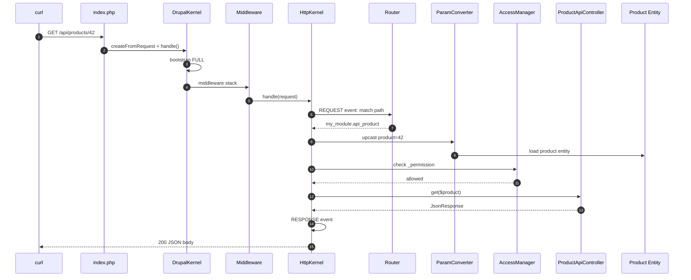

# Tracing a Request

This page walks through a real request — `GET /api/products/42` — from `index.php` to a JSON response. Follow along in your local site with the debugging commands at each step.

## The scenario

A headless frontend fetches product #42 from a custom module:

```yaml
# my_module.routing.yml
my_module.api_product:
  path: '/api/products/{product}'
  defaults:
    _controller: '\Drupal\my_module\Controller\ProductApiController::get'
  requirements:
    _permission: 'access content'
    _format: 'json'
  methods: [GET]
  options:
    parameters:
      product:
        type: entity:product
```

```php
<?php

declare(strict_types=1);

namespace Drupal\my_module\Controller;

use Drupal\Core\Controller\ControllerBase;
use Drupal\my_module\Entity\Product;
use Symfony\Component\HttpFoundation\JsonResponse;

final class ProductApiController extends ControllerBase {

  public function get(Product $product): JsonResponse {
    return new JsonResponse([
      'id' => (int) $product->id(),
      'title' => $product->label(),
      'sku' => $product->get('sku')->value,
      'price' => (float) $product->get('price')->value,
    ]);
  }

}
```

## Step-by-step trace



### Step 1: index.php receives the request

```php
<?php
// web/index.php
$autoloader = require_once 'autoload.php';
$kernel = DrupalKernel::createFromRequest(
  Request::createFromGlobals(),
  $autoloader,
  'prod',
);
$request = Request::createFromGlobals();
$response = $kernel->handle($request);
```

At this point Symfony creates a `Request` object:

```bash
curl -v "https://my-site.ddev.site/api/products/42" \
  -H "Accept: application/json"
```

### Step 2: Bootstrap to FULL

`DrupalKernel::handle()` calls `boot()`, advancing through phases 0–7. The service container loads (from cache or compile). All enabled modules are loaded.

```bash
# Verify bootstrap completed
drush php:eval "echo 'Container has ' . count(\Drupal::getContainer()->getServiceIds()) . ' services';"
```

### Step 3: Middleware stack

Middleware runs before any kernel event, outermost first: content negotiation reads the `Accept` header, page cache serves a cached copy to anonymous users or passes through, `KernelPreHandle` loads all modules, and session middleware starts the session.

### Step 4: KernelEvents::REQUEST

Event subscribers run — language negotiation, maintenance mode check, IP blocking, etc. Routing itself happens here too (`RouterListener`, priority 32). Our API path passes through.

```php
<?php

declare(strict_types=1);

// Before RouterListener runs, $request attributes are still empty.
// $request->getPathInfo() === '/api/products/42'
```

### Step 5: Route matching

The router looks up `/api/products/42` against the route collection:

```bash
# Confirm route exists and see its definition
drush route --name=my_module.api_product

# Match by path
drush route --path=/api/products/42
```

Internally:

```php
<?php

declare(strict_types=1);

$router = \Drupal::service('router.no_access_checks');
$parameters = $router->match('/api/products/42');
// Returns (abridged):
// [
//   '_controller' => '\Drupal\my_module\Controller\ProductApiController::get',
//   '_route' => 'my_module.api_product',
//   '_route_object' => Route,
//   'product' => Product,  // Already upcast: match() runs route enhancers
//   '_raw_variables' => ParameterBag(['product' => '42']),
// ]
// Requirements such as _permission stay on the Route object.
```

### Step 6: Parameter upcasting

`EntityConverter` converts `product=42` to a `Product` entity:

```php
<?php

declare(strict_types=1);

namespace Drupal\Core\ParamConverter;

// EntityConverter::convert() (conceptual)
public function convert($value, $definition, $name, array $defaults): ?EntityInterface {
  $entity_type = $definition['type']; // 'entity:product'
  $id = $value; // '42'
  return $this->entityTypeManager
    ->getStorage('product')
    ->load($id);
}
```

If product 42 does not exist, Drupal throws `NotFoundHttpException` → 404.

```bash
# Test 404 path
curl -s -o /dev/null -w "%{http_code}" "https://my-site.ddev.site/api/products/99999"
# Expected: 404
```

### Step 7: Access check

The `_permission: access content` requirement runs:

```php
<?php

declare(strict_types=1);

$access_manager = \Drupal::service('access_manager');
$result = $access_manager->checkNamedRoute('my_module.api_product', ['product' => $product], \Drupal::currentUser(), TRUE);
// AccessResultInterface (allowed, neutral or forbidden); without TRUE you get a bool.
```

Anonymous users with `access content` permission pass. Without it → 403.

```bash
# Test as anonymous (default Drupal allows access content for anonymous)
curl -s -w "\nHTTP %{http_code}\n" "https://my-site.ddev.site/api/products/42"
```

### Step 8: Controller resolution

`ControllerResolver` instantiates `ProductApiController` via the container:

```php
<?php

declare(strict_types=1);

// ControllerBase provides shortcuts like $this->entityTypeManager().
// ProductApiController::get() receives the upcast Product entity.
```

### Step 9: Controller execution

```php
<?php

declare(strict_types=1);

public function get(Product $product): JsonResponse {
  return new JsonResponse([
    'id' => (int) $product->id(),
    'title' => $product->label(),
    'sku' => $product->get('sku')->value,
    'price' => (float) $product->get('price')->value,
  ]);
}
```

Returns a `JsonResponse` directly — no `KernelEvents::VIEW` needed.

### Step 10: KernelEvents::RESPONSE

Subscribers add headers (cache, CORS, security):

```php
<?php

declare(strict_types=1);

// Response headers you might see:
// Content-Type: application/json
// X-Drupal-Cache: UNCACHED
// X-Content-Type-Options: nosniff
```

### Step 11: Response sent + terminate

```php
$response->send();
$kernel->terminate($request, $response);
// Terminate subscribers: logging, statistics, queue dispatch
```

## Trace with logging

Add temporary logging to see the flow:

```php
<?php

declare(strict_types=1);

namespace Drupal\my_module\EventSubscriber;

use Drupal\Core\Routing\RouteMatchInterface;
use Symfony\Component\EventDispatcher\EventSubscriberInterface;
use Symfony\Component\HttpKernel\Event\ControllerEvent;
use Symfony\Component\HttpKernel\Event\RequestEvent;
use Symfony\Component\HttpKernel\Event\ResponseEvent;
use Symfony\Component\HttpKernel\KernelEvents;
use Psr\Log\LoggerInterface;

final class RequestTraceSubscriber implements EventSubscriberInterface {

  public function __construct(
    private readonly LoggerInterface $logger,
    private readonly RouteMatchInterface $routeMatch,
  ) {}

  public function onRequest(RequestEvent $event): void {
    if (!$event->isMainRequest()) {
      return;
    }
    $this->logger->debug('TRACE request: @path', [
      '@path' => $event->getRequest()->getPathInfo(),
    ]);
  }

  public function onController(ControllerEvent $event): void {
    $route = $this->routeMatch->getRouteName();
    $this->logger->debug('TRACE controller: route=@route', ['@route' => $route]);
  }

  public function onResponse(ResponseEvent $event): void {
    $this->logger->debug('TRACE response: status=@status', [
      '@status' => $event->getResponse()->getStatusCode(),
    ]);
  }

  public static function getSubscribedEvents(): array {
    return [
      KernelEvents::REQUEST => ['onRequest', 100],
      KernelEvents::CONTROLLER => ['onController'],
      KernelEvents::RESPONSE => ['onResponse', -100],
    ];
  }

}
```

```yaml
# my_module.services.yml
services:
  my_module.request_trace_subscriber:
    class: Drupal\my_module\EventSubscriber\RequestTraceSubscriber
    arguments: ['@logger.channel.my_module', '@current_route_match']
    tags:
      - { name: event_subscriber }
```

```bash
# Watch the trace in logs
drush ws --type=my_module --count=10
curl -s "https://my-site.ddev.site/api/products/42" > /dev/null
drush ws --type=my_module --count=5
```

## Trace with Xdebug

Set breakpoints in:

1. `DrupalKernel::handle()` — bootstrap entry
2. `Router::matchRequest()` — route matching
3. `AccessManager::check()` — access decision
4. Your controller method — business logic

```bash
# DDEV Xdebug trigger
ddev xdebug on
curl "https://my-site.ddev.site/api/products/42?XDEBUG_SESSION_START=1"
```

!!! tip "Use Devel query log for entity loads"
    Enable `dblog` and Devel to see the SQL queries fired during entity load in step 6.

## Comparison: JSON:API path

The same trace applies to JSON:API with different route and controller:

```bash
curl -s -H "Accept: application/vnd.api+json" \
  "https://my-site.ddev.site/jsonapi/node/article/UUID" | jq '.data.type'
```

| Step | Custom API | JSON:API |
|------|------------|----------|
| Route | `my_module.api_product` | `jsonapi.node--article.individual` |
| Controller | Your controller | `EntityResource` |
| Response | Manual `JsonResponse` | Serializer normalizers |
| Access | `_permission` | Entity + field access |

## Related reading

- [Request Lifecycle](request-lifecycle.md) — KernelEvents reference
- [Route Inspection](route-inspection.md) — debugging route matching
- [Debugging Services](debugging-services.md) — container and service tools
