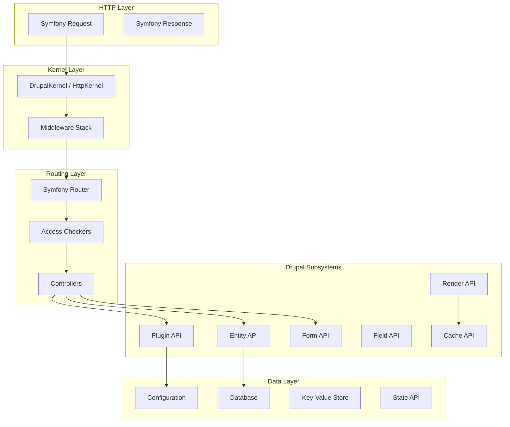

# Drupal 11 Architecture

Drupal 11 follows a layered architecture built on Symfony's HttpKernel, with Drupal-specific subsystems layered on top.

## Architectural layers



## The DrupalKernel

Every HTTP request enters through `index.php`, which bootstraps the kernel:

```php
<?php
// web/index.php (Drupal 11.0–11.3)
use Drupal\Core\DrupalKernel;
use Symfony\Component\HttpFoundation\Request;

$autoloader = require_once 'autoload.php';
$kernel = new DrupalKernel('prod', $autoloader);
$request = Request::createFromGlobals();
$response = $kernel->handle($request);
$response->send();
$kernel->terminate($request, $response);
```

!!! note "Drupal 11.4+: Symfony Runtime"
    From Drupal 11.4, `index.php` hands the request/response cycle to the Symfony Runtime component, which creates the `Request`, calls `handle()`, sends the response and calls `terminate()` for you:

    ```php
    <?php
    use Drupal\Core\DrupalKernel;

    require_once 'autoload_runtime.php';

    return static function () {
      return new DrupalKernel('prod', require 'autoload.php');
    };
    ```

The kernel manages:

1. **Service container** — all dependencies wired via DI
2. **Module system** — discovers and loads enabled modules
3. **Request handling** — delegates to Symfony HttpKernel
4. **Termination** — runs shutdown tasks (logging, profiling)

## Subsystems overview

### Entity API

The Entity API is Drupal's data modeling layer. Everything is an entity:

| Type | Examples | Storage |
|------|----------|---------|
| Content | Node, User, Media, Taxonomy Term | Database tables |
| Config | Views, Fields, Block placement | YAML files + DB |
| Custom | Your content entities | Database tables |

```php
// Load a node entity
$node = \Drupal::entityTypeManager()
  ->getStorage('node')
  ->load(1);

// Create a new node
$node = \Drupal::entityTypeManager()
  ->getStorage('node')
  ->create([
    'type' => 'article',
    'title' => 'Hello Headless World',
    'body' => ['value' => 'Content from Drupal 11.'],
  ]);
$node->save();
```

### Plugin API

Plugins are discoverable, swappable implementations:

```php
// Block plugins, field formatters, views handlers, etc.
#[Block(
  id: "my_custom_block",
  admin_label: new TranslatableMarkup("My Custom Block"),
)]
final class MyCustomBlock extends BlockBase {
  // ...
}
```

### Configuration system

Site configuration is exportable YAML:

```yaml
# config/sync/system.site.yml
langcode: en
name: 'My Headless Site'
mail: admin@example.com
default_langcode: en
```

```bash
# Export configuration
drush config:export -y

# Import configuration
drush config:import -y
```

### Render pipeline

Drupal builds pages as render arrays, not HTML strings:

```php
$build = [
  '#theme' => 'item_list',
  '#title' => 'Recent Articles',
  '#items' => ['Article 1', 'Article 2', 'Article 3'],
  '#cache' => [
    'tags' => ['node_list'],
    'max-age' => 3600,
  ],
];
return $build;
```

## Module system

Modules extend Drupal via hooks, plugins, services, and routes:

```
modules/custom/my_module/
├── my_module.info.yml          # Module metadata
├── my_module.module            # Legacy procedural hooks
├── my_module.services.yml      # Service definitions
├── my_module.routing.yml       # Route definitions
├── my_module.permissions.yml   # Permission definitions
├── config/
│   └── install/                # Default config
├── src/
│   ├── Controller/             # Route controllers
│   ├── Form/                   # Form classes
│   ├── Plugin/                 # Plugin implementations
│   ├── Hook/                   # OOP hook classes (11.1+)
│   └── Service/                # Business logic services
└── templates/                  # Twig templates
```

## Request flow summary

1. `index.php` creates `Request` from globals
2. `DrupalKernel::handle()` bootstraps container
3. HttpKernel dispatches `KernelEvents::REQUEST`
4. Router matches URL to route + controller
5. Access checker validates permissions
6. Controller executes, returns `Response` or render array
7. Render system converts render arrays to HTML (or JSON for APIs)
8. HttpKernel dispatches `KernelEvents::RESPONSE`
9. Response sent to client
10. `DrupalKernel::terminate()` runs shutdown tasks

See [Request Lifecycle](../internals/request-lifecycle.md) for a detailed walkthrough.
