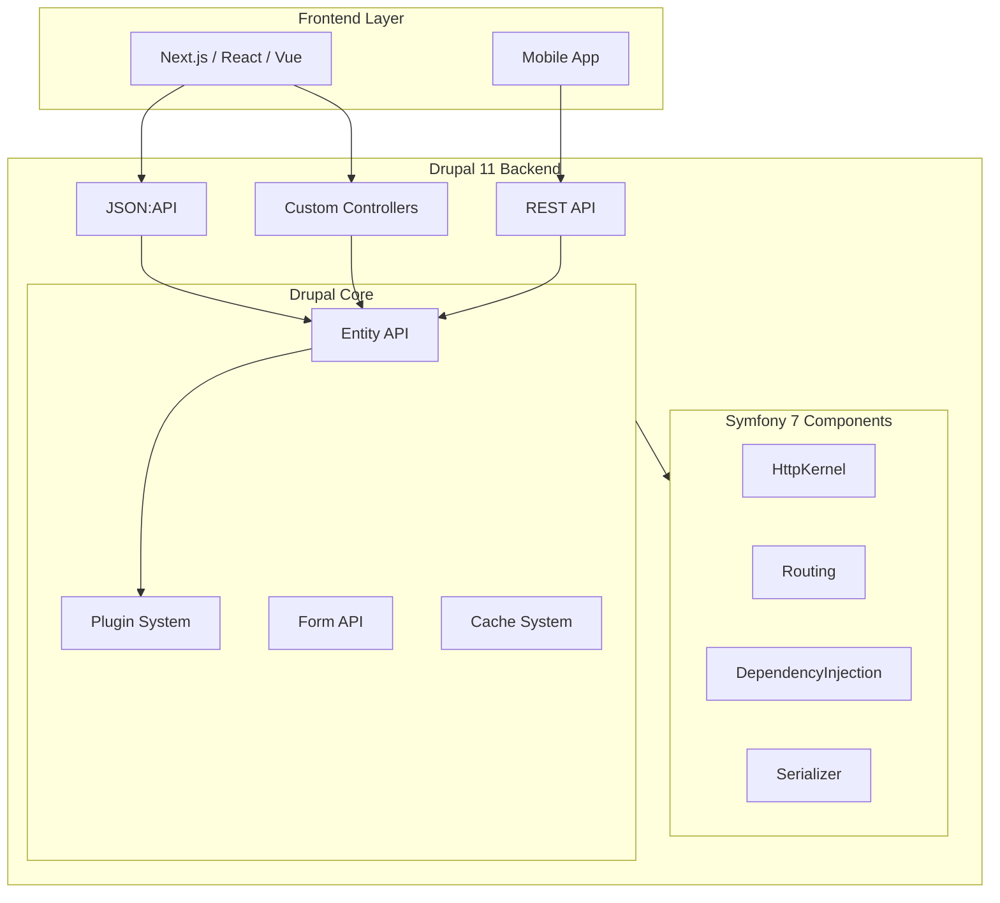

# Introduction

This section covers the foundational concepts you need before writing custom code or building headless applications with Drupal 11.

## Chapters

- **[What Changed in Drupal 11](what-changed.md)** — PHP 8.3+, Symfony 7, OOP hooks, removed modules
- **[Drupal 11 Architecture](architecture.md)** — layered architecture, kernel, subsystems
- **[Modern PHP Standards](modern-php.md)** — typed properties, enums, attributes, readonly
- **[Symfony Foundation](symfony-foundation.md)** — why Drupal is built on Symfony components
- **[Composer-First Development](composer-first.md)** — managing Drupal as a Composer project
- **[Why Headless Drupal](why-headless.md)** — decoupled vs traditional, when to go headless

## Drupal 11 at a glance

