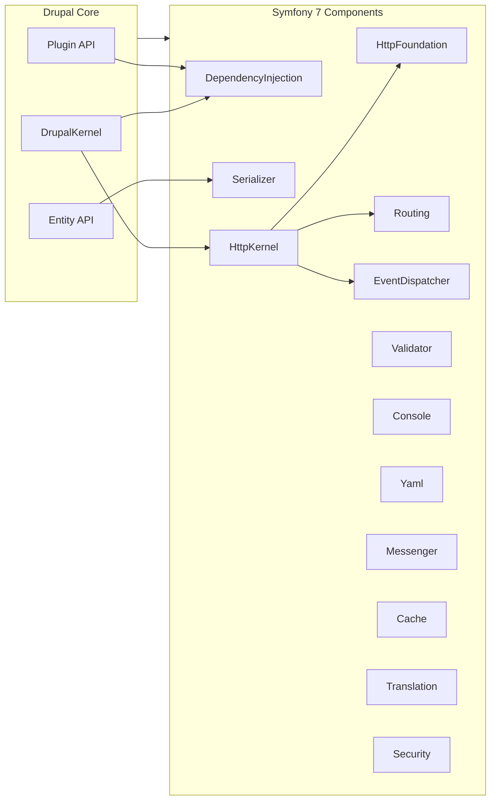

# Symfony Foundation

Drupal is not built *on* Symfony — it is built *with* Symfony components. Understanding this distinction is critical for custom development.

## Drupal vs Symfony

| Aspect | Symfony Framework | Drupal |
|--------|-------------------|--------|
| Purpose | General PHP framework | Content management system |
| Routing | YAML/attributes | YAML + dynamic route subscribers |
| Controllers | Any class | `ControllerBase` + plugins |
| DI Container | Symfony ContainerBuilder | Drupal ContainerBuilder (extends Symfony) |
| Events | Symfony events | Symfony events + Drupal hooks |
| ORM | Doctrine | Entity API (custom) |

Drupal cherry-picks Symfony components and wraps them with CMS-specific APIs.

## Symfony components in Drupal 11



## How Drupal wires Symfony

### HttpKernel handles every request

```php
// core/lib/Drupal/Core/DrupalKernel.php (conceptual)
class DrupalKernel extends HttpKernel {
  public function handle(
    Request $request,
    int $type = HttpKernelInterface::MAIN_REQUEST,
    bool $catch = TRUE,
  ): Response {
  }
}
```

### DependencyInjection builds the container

Drupal's container is compiled from YAML service definitions across all enabled modules:

```yaml
# my_module.services.yml
services:
  my_module.product_manager:
    class: Drupal\my_module\Service\ProductManager
    arguments: ['@entity_type.manager', '@logger.channel.my_module']
```

At compile time, Drupal's `DrupalContainerBuilder` (extending Symfony's) merges all `*.services.yml` files.

### EventDispatcher powers hooks and subscribers

Drupal's hook system ultimately dispatches through the event dispatcher:

```php
// Dispatching a custom event
$event = new ProductCreatedEvent($product);
\Drupal::service('event_dispatcher')
  ->dispatch($event, ProductEvents::CREATED);
```

### Serializer powers JSON:API

JSON:API uses Symfony's Serializer with Drupal-specific normalizers:

```php
// Simplified flow
$serializer = \Drupal::service('serializer');
$json = $serializer->serialize($node, 'json', [
  'jsonapi_include' => ['field_image', 'uid'],
]);
```

## Component reference

Each component has a dedicated page in the [Symfony Components](../symfony/index.md) section:

| Component | Drupal usage |
|-----------|-------------|
| [HttpFoundation](../symfony/http-foundation.md) | Request/Response objects |
| [Routing](../symfony/routing.md) | URL-to-controller mapping |
| [HttpKernel](../symfony/http-kernel.md) | Request lifecycle |
| [EventDispatcher](../symfony/event-dispatcher.md) | Hooks, event subscribers |
| [DependencyInjection](../symfony/dependency-injection.md) | Service container |
| [Serializer](../symfony/serializer.md) | JSON:API, REST serialization |
| [Validator](../symfony/validator.md) | Entity/field validation |
| [Console](../symfony/console.md) | Drush commands |
| [Messenger](../symfony/messenger.md) | Status messages |
| [Cache](../symfony/cache.md) | Cache backends |
| [Yaml](../symfony/yaml.md) | Config file parsing |
| [Translation](../symfony/translation.md) | String translation |
| [Security](../symfony/security.md) | Password hashing, CSRF |

## Extending Symfony in custom code

You can use Symfony classes directly in custom modules:

```php
<?php

declare(strict_types=1);

namespace Drupal\my_module\Controller;

use Drupal\Core\Controller\ControllerBase;
use Symfony\Component\HttpFoundation\JsonResponse;
use Symfony\Component\HttpFoundation\Request;

final class ApiController extends ControllerBase {

  public function search(Request $request): JsonResponse {
    $query = $request->query->get('q', '');
    $results = $this->searchService->search($query);

    return new JsonResponse([
      'query' => $query,
      'count' => count($results),
      'results' => $results,
    ]);
  }
}
```

!!! note "Use Drupal abstractions when available"
    Prefer `\Drupal::service()` and Drupal APIs over raw Symfony where Drupal provides a wrapper. Use Symfony directly for HTTP primitives (`Request`, `Response`, `JsonResponse`).
