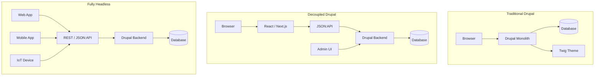

# Why Headless Drupal

Headless (decoupled) Drupal separates the **content backend** from the **presentation frontend**, exposing content via APIs.

## Architecture comparison



## Three approaches

### 1. Traditional (coupled)

Drupal renders HTML via Twig themes. Best for:

- Marketing sites with standard layouts
- Teams without frontend JavaScript expertise
- Projects needing rapid delivery with contrib themes

### 2. Decoupled (progressive)

Drupal admin UI remains; frontend is separate. Best for:

- Content teams using familiar Drupal admin
- Interactive frontends (React, Vue, Svelte)
- Multi-channel content (web + mobile)

### 3. Fully headless

Drupal is API-only; no public-facing theme. Best for:

- Mobile-first applications
- Multi-platform content distribution
- Microservices architectures
- IoT and voice interfaces

## Why choose headless Drupal?

### Content powerhouse

Drupal's Entity API, Field API, Media system, and Workflow modules provide enterprise-grade content modeling that pure headless CMS platforms lack.

```php
// Complex content relationships are first-class
$article = Node::create([
  'type' => 'article',
  'title' => 'Annual Report 2026',
  'field_author' => $author->id(),
  'field_tags' => [1, 5, 12],
  'field_hero_image' => $media->id(),
  'field_related' => [23, 45, 67],
]);
```

### API-ready out of the box

JSON:API is in core — no additional modules required:

```bash
drush en jsonapi -y

# Immediately available
curl https://my-site.com/jsonapi/node/article
```

### Mature ecosystem

| Capability | Solution |
|------------|----------|
| Authentication | Simple OAuth, JWT, session cookies |
| API customization | JSON:API Extras, custom normalizers |
| Frontend integration | next-drupal, Gatsby source plugin |
| Caching | Cache tags propagated to frontend |
| Content workflow | Workspaces, Content Moderation |
| Media management | Media Library, image styles, responsive images |

### Multi-channel delivery

One content source, many outputs:

```
Drupal CMS
  ├── Next.js website
  ├── React Native mobile app
  ├── Digital signage
  ├── Voice assistant (Alexa/Google)
  └── Email newsletters
```

## When NOT to go headless

- Simple brochure sites (overhead not justified)
- Teams without JavaScript frontend skills
- Projects needing contrib theme ecosystems
- SEO-critical sites without SSR/SSG expertise
- Tight budgets (two codebases to maintain)

## Headless stack example

| Layer | Technology |
|-------|------------|
| CMS | Drupal 11 |
| API | JSON:API + custom REST endpoints |
| Auth | Simple OAuth 2.0 |
| Frontend | Next.js 15 with App Router |
| Bridge | next-drupal |
| Hosting (CMS) | Platform.sh / Acquia / Pantheon |
| Hosting (FE) | Vercel / Netlify |
| CDN | Cloudflare |

## Getting started with headless

```bash
# 1. Install Drupal 11
composer create-project drupal/recommended-project my-headless-site

# 2. Enable API modules
cd my-headless-site
composer require drush/drush drupal/jsonapi_extras drupal/simple_oauth
# (install the site first: see Getting Started → Fresh Installation)
drush en jsonapi jsonapi_extras simple_oauth consumers -y

# 3. Configure CORS (web/sites/default/services.yml)
# See headless/auth/ section

# 4. Create content types and content via admin UI

# 5. Consume from your frontend
curl -H "Accept: application/vnd.api+json" \
  https://my-site.com/jsonapi/node/article
```

Continue to [Headless Architecture](../headless/architecture.md) for detailed implementation patterns.
