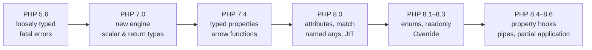

# PHP 5 to PHP 8

PHP has changed more between 5.6 (2014) and 8.6 (2026) than in any other period of its history. The language gained a type system, a new engine roughly twice as fast, exceptions for engine errors, enums, attributes, readonly data, and a long list of syntax that makes everyday code shorter and safer. At the same time, whole extensions and idioms that PHP 5 code relied on were removed.

This section is a framework-neutral guide to that journey. It applies to any PHP codebase: plain PHP, Laravel, Symfony, WordPress, Drupal, or a homegrown framework.

## Chapters

- **[PHP 7.0 – 7.4](php-7.md)**: the new engine, scalar and return types, `??`, `<=>`, typed properties, arrow functions
- **[PHP 8.0 – 8.3](php-8.md)**: named arguments, attributes, `match`, nullsafe `?->`, enums, readonly, `#[\Override]`
- **[PHP 8.4 – 8.6](php-8-4-plus.md)**: property hooks, asymmetric visibility, pipe operator, clone-with, partial function application
- **[Breaking Changes](breaking-changes.md)**: what was removed or behaves differently, grouped by upgrade step
- **[Upgrade Strategy](upgrading.md)**: a step-by-step plan with Rector, PHPStan, and PHPCompatibility
- **[Cheat Sheet](cheat-sheet.md)**: PHP 5 idioms side by side with their modern equivalents

## Release timeline

| Version | Released | Headline changes | Support status (Nov 2026) |
|---------|----------|------------------|---------------------------|
| 5.6 | Aug 2014 | Variadics, argument unpacking, `**` | End of life (Dec 2018) |
| 7.0 | Dec 2015 | New engine, scalar and return types, `??`, `<=>`, `Throwable` | End of life |
| 7.1 | Dec 2016 | Nullable types, `void`, multi-catch, `[]` destructuring | End of life |
| 7.2 | Nov 2017 | `object` type, libsodium, Argon2 | End of life |
| 7.3 | Dec 2018 | Flexible heredoc, `array_key_first()`, `JSON_THROW_ON_ERROR` | End of life |
| 7.4 | Nov 2019 | Typed properties, arrow functions, `??=`, preloading | End of life (Nov 2022) |
| 8.0 | Nov 2020 | JIT, named arguments, attributes, `match`, union types, `?->` | End of life (Nov 2023) |
| 8.1 | Nov 2021 | Enums, readonly properties, fibers, `never` | End of life (Dec 2025) |
| 8.2 | Dec 2022 | Readonly classes, DNF types, Random extension | Security fixes until 31 Dec 2026 |
| 8.3 | Nov 2023 | Typed class constants, `#[\Override]`, `json_validate()` | Security fixes until 31 Dec 2027 |
| 8.4 | Nov 2024 | Property hooks, asymmetric visibility, `array_find()` | Active until 31 Dec 2026 |
| 8.5 | Nov 2025 | Pipe operator, clone-with, `#[\NoDiscard]`, URI extension | Active until 31 Dec 2027 |
| 8.6 | Nov 2026 | Partial function application, `clamp()`, `Time\Duration` | Active until 31 Dec 2028 |

!!! warning "Anything older than 8.2 gets no security fixes"
    PHP 5.x, every 7.x release, 8.0 and 8.1 receive no patches at all, not even for security holes. 8.2 leaves security support on **31 December 2026**. Check [php.net/supported-versions](https://www.php.net/supported-versions.php) for the current schedule.

## Where PHP 5 left off

"PHP 5" covers a decade of releases, and late PHP 5 already had several features people think of as modern. If your code targets 5.6 you can already use:

| Since | Feature | Example |
|-------|---------|---------|
| 5.3 | Namespaces | `namespace App\Billing;` |
| 5.3 | Closures | `function ($x) use ($rate) { return $x * $rate; }` |
| 5.3 | Late static binding | `return new static();` |
| 5.3 | Short ternary | `$name = $input ?: 'Anonymous';` |
| 5.4 | Traits | `trait Timestampable { … }` |
| 5.4 | Short array syntax | `$list = [1, 2, 3];` |
| 5.4 | Dereferencing a call result | `getItems()[0]` |
| 5.5 | Generators | `yield $row;` |
| 5.5 | `finally` | `try { … } finally { fclose($fh); }` |
| 5.5 | `::class` | `User::class` |
| 5.5 | Password hashing API | `password_hash($plain, PASSWORD_DEFAULT)` |
| 5.6 | Variadics and unpacking | `function sum(...$n) {}`, `sum(...$values)` |
| 5.6 | Exponent operator | `2 ** 10` |
| 5.6 | `use function` / `use const` | `use function App\Util\slugify;` |

What PHP 5 did **not** have: scalar type declarations, return types, typed properties, `??`, a way to catch engine errors, enums, attributes, or readonly data. Those arrived in 7.x and 8.x and are the focus of this section.

## The big shifts

1. **Performance.** PHP 7.0's rewritten engine (PHPNG) roughly halved CPU time and memory for typical web apps compared with 5.6. 8.0 added an optional JIT, which helps CPU-bound work more than typical request/response code.
2. **Types.** PHP went from docblock-only types to native parameter, return, property, and class-constant types, with union, intersection, and DNF types. `declare(strict_types=1)` turns off silent coercion per file.
3. **Errors become exceptions.** Since 7.0, most fatal engine errors throw `Error`. Since 8.0, internal functions throw `TypeError` or `ValueError` instead of returning `null` with a warning.
4. **Safer defaults.** 8.0 changed `0 == "foo"` to `false`, made `E_ALL` the default error level, and stopped `@` from hiding fatal errors.
5. **Expressive syntax.** `??`, `?->`, `match`, named arguments, constructor promotion, enums, readonly classes, property hooks, and the pipe operator remove a great deal of boilerplate.

## How to read this section

- If you maintain **PHP 5 code**, read [Breaking Changes](breaking-changes.md) first, then [Upgrade Strategy](upgrading.md).
- If you are a **PHP 5 developer** learning modern PHP, read the feature chapters in order, then keep the [Cheat Sheet](cheat-sheet.md) open.
- If you are already on **PHP 8**, skip to [PHP 8.4 – 8.6](php-8-4-plus.md) for the newest additions.

Code samples run on PHP 8.5 unless a heading or tab names an older version. Samples marked **PHP 8.6** use syntax added on 19 November 2026.

!!! info "Framework minimums"
    Frameworks raise their PHP floor over time, which is often what forces an upgrade:

    | Framework | Version | Minimum PHP |
    |-----------|---------|-------------|
    | Drupal | 10 | 8.1 |
    | Drupal | 11 | 8.3 |
    | Drupal | 12 (December 2026) | 8.5 |
    | Symfony | 7.x | 8.2 |
    | Laravel | 12 | 8.2 |

    The rest of this site covers Drupal-specific PHP in [Modern PHP Standards](../intro/modern-php.md).
