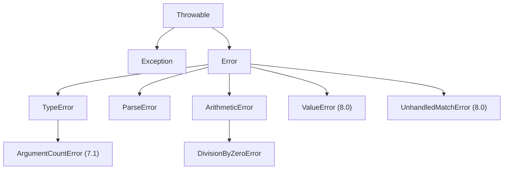

# PHP 7.0 – 7.4

PHP 7 skipped version 6 (an abandoned Unicode rewrite) and delivered two things at once: a rewritten engine that roughly doubled throughput, and the start of a real type system. Every release from 7.0 to 7.4 built on both.

## PHP 7.0: the new engine

The PHPNG engine changed how values (`zval`s), arrays, and objects are stored in memory. Most applications saw requests run about twice as fast with noticeably lower memory, with no code changes. That alone justified many upgrades.

### Scalar type declarations

PHP 5 could type-hint classes, interfaces, `array`, and `callable`, but not `int`, `float`, `string`, or `bool`. PHP 7.0 added them.

=== "PHP 5.6"

    ```php
    /**
     * @param int $quantity
     * @param float $price
     * @return float
     */
    function lineTotal($quantity, $price)
    {
        if (!is_int($quantity)) {
            throw new InvalidArgumentException('Quantity must be an int');
        }
        return $quantity * $price;
    }
    ```

=== "PHP 7.0+"

    ```php
    function lineTotal(int $quantity, float $price): float
    {
        return $quantity * $price;
    }
    ```

By default PHP **coerces** scalars: `lineTotal("3", "2.5")` works and returns `7.5`. Add `declare(strict_types=1)` as the first statement of a file to make calls *from that file* reject the wrong type with a `TypeError`:

```php
<?php

declare(strict_types=1);

function lineTotal(int $quantity, float $price): float
{
    return $quantity * $price;
}

lineTotal(3, 2.5);    // 7.5
lineTotal('3', 2.5);  // TypeError: Argument #1 ($quantity) must be of type int, string given
lineTotal(3, 2);      // 6.0 (int to float widening is still allowed)
```

!!! tip "strict_types is per file, and the caller decides"
    The declaration affects calls made *from* the file that contains it, not functions defined in it. Most modern codebases put it in every file so behaviour is predictable.

### Return type declarations

```php
function findUserName(array $row): string
{
    return $row['name'];
}
```

`void`, nullable returns, and `static` came later (7.1 and 8.0).

### Null coalescing `??`

`??` returns the left operand if it exists and is not `null`, otherwise the right. Unlike `?:`, it does not raise an "undefined index" notice.

=== "PHP 5.6"

    ```php
    $page = isset($_GET['page']) ? $_GET['page'] : 1;
    $name = isset($user['profile']['name']) ? $user['profile']['name'] : 'Guest';
    ```

=== "PHP 7.0+"

    ```php
    $page = $_GET['page'] ?? 1;
    $name = $user['profile']['name'] ?? 'Guest';
    ```

### Spaceship operator `<=>`

Returns `-1`, `0`, or `1`, which is exactly what sort callbacks need.

=== "PHP 5.6"

    ```php
    usort($products, function ($a, $b) {
        if ($a['price'] == $b['price']) {
            return 0;
        }
        return ($a['price'] < $b['price']) ? -1 : 1;
    });
    ```

=== "PHP 7.0+"

    ```php
    usort($products, function ($a, $b) {
        return $a['price'] <=> $b['price'];
    });
    ```

### Catching engine errors: `Throwable` and `Error`

In PHP 5, calling a method on `null` or a type mismatch was a **fatal error**: the script died and no `catch` block could intervene. PHP 7 turns most of these into exceptions of class `Error`, which sits beside `Exception` under a new `Throwable` interface.



```php
try {
    $user = null;
    $user->getName();
} catch (Error $e) {
    // "Call to a member function getName() on null"
    error_log($e->getMessage());
}
```

!!! warning "`catch (Exception $e)` does not catch `Error`"
    Code that used `catch (Exception $e)` as a catch-all will not see `Error` instances. Catch `Throwable` at your application's top level (error handlers, queue workers, CLI entry points).

### Anonymous classes

Useful for one-off implementations, test doubles, and small adapters:

```php
interface Logger
{
    public function log(string $message);
}

// Pass a throwaway implementation without declaring a named class.
$report = new ReportGenerator(new class implements Logger {
    public function log(string $message)
    {
        echo '[report] ', $message, PHP_EOL;
    }
});
```

### Generator improvements

Generators (from 5.5) gained `yield from` delegation and return values:

```php
function readLines(string $path): Generator
{
    $fh = fopen($path, 'r');
    $count = 0;
    try {
        while (($line = fgets($fh)) !== false) {
            $count++;
            yield rtrim($line, "\n");
        }
    } finally {
        fclose($fh);
    }
    return $count;                              // 7.0: generators can return a value
}

function readAll(array $paths): Generator
{
    $total = 0;
    foreach ($paths as $path) {
        $total += yield from readLines($path);  // delegate, then receive the return value
    }
    return $total;
}

$lines = readAll(['a.log', 'b.log']);
foreach ($lines as $line) {
    // process each line from both files
}
echo $lines->getReturn();                       // total number of lines read
```

### Other 7.0 additions

| Feature | Example |
|---------|---------|
| Group `use` declarations | `use App\Model\{User, Order, Invoice};` |
| Constant arrays with `define()` | `define('ROLES', ['admin', 'editor']);` |
| Integer division | `intdiv(7, 2)` returns `3` |
| Secure random numbers | `random_int(1, 6)`, `random_bytes(16)` |
| Unicode escapes | `"\u{1F600}"` |
| `Closure::call()` | `$fn->call($object)` binds and calls in one step |
| Safer `unserialize()` | `unserialize($data, ['allowed_classes' => false])` |

!!! danger "Stop using `rand()` and `mt_rand()` for secrets"
    `random_int()` and `random_bytes()` use the operating system's CSPRNG. Use them for tokens, password reset codes, and anything an attacker should not be able to predict.

## PHP 7.1

### Nullable types and `void`

```php
function findUser(int $id): ?User      // returns User or null
{
    return $this->users[$id] ?? null;
}

function setNickname(?string $nickname): void   // accepts string or null; returns nothing
{
    $this->nickname = $nickname;
}
```

### Multi-catch

```php
try {
    $client->send($request);
} catch (ConnectException | TimeoutException $e) {
    $this->retryLater($request);
}
```

### Symmetric array destructuring

`[]` can now be used instead of `list()`, and keys are supported:

=== "PHP 5.6"

    ```php
    list($id, $name) = $row;
    $email = $record['email'];
    $role = $record['role'];
    ```

=== "PHP 7.1+"

    ```php
    [$id, $name] = $row;
    ['email' => $email, 'role' => $role] = $record;

    foreach ($points as [$x, $y]) {
        echo "($x, $y)\n";
    }

    // Swap two variables
    [$a, $b] = [$b, $a];
    ```

### More 7.1 additions

| Feature | Example |
|---------|---------|
| Class constant visibility | `private const API_KEY_HEADER = 'X-Api-Key';` |
| `iterable` pseudo-type | `function process(iterable $items): void` |
| Negative string offsets | `'hello'[-1]` returns `'o'` |
| `Closure::fromCallable()` | `Closure::fromCallable([$this, 'handle'])` |
| `ArgumentCountError` | Calling a user function with too few arguments throws instead of warning |

## PHP 7.2

| Feature | Example |
|---------|---------|
| `object` type | `function hydrate(object $target): object` |
| Parameter type widening | A child method may drop a parameter's type |
| Abstract method overriding | An abstract class may redeclare an inherited abstract method |
| libsodium in core | `sodium_crypto_secretbox($msg, $nonce, $key)` |
| Argon2 password hashing | `password_hash($plain, PASSWORD_ARGON2ID)` (Argon2id since 7.3) |
| Trailing comma in grouped `use` | `use App\{A, B, C,};` |

!!! note "mcrypt was removed in 7.2"
    The `mcrypt` extension (unmaintained since 2007) moved to PECL. Use `sodium_*` for new code or `openssl_*` when you need interoperability with existing ciphertext.

7.2 also **deprecated** `create_function()`, `each()`, `__autoload()`, and the `(unset)` cast. All of them were removed in 8.0; see [Breaking Changes](breaking-changes.md).

## PHP 7.3

### Flexible heredoc and nowdoc

The closing marker may be indented, and that indentation is removed from every line. Heredocs can now live inside indented code:

```php
function emailBody(string $name): string
{
    return <<<TEXT
        Hello {$name},

        Your order has shipped.
        TEXT;
}
```

### More 7.3 additions

| Feature | Example |
|---------|---------|
| Trailing comma in calls | `sprintf('%s %s', $first, $last,)` |
| First and last array key | `array_key_first($map)`, `array_key_last($map)` |
| `is_countable()` | `if (is_countable($value)) { count($value); }` |
| JSON exceptions | `json_decode($json, true, 512, JSON_THROW_ON_ERROR)` |
| Reference destructuring | `[$a, &$b] = $array;` |
| High-resolution timer | `hrtime(true)` returns nanoseconds |
| `SameSite` cookies | `setcookie('id', $v, ['samesite' => 'Lax', 'secure' => true])` |

!!! tip "Prefer `JSON_THROW_ON_ERROR`"
    Without it, `json_decode()` returns `null` for invalid JSON, which is indistinguishable from the valid JSON `null`. With it, you get a `JsonException` with a message.

## PHP 7.4

### Typed properties

Properties can declare a type. An unset typed property is *uninitialized* (not `null`), and reading it throws an `Error`.

=== "PHP 5.6"

    ```php
    class Order
    {
        /** @var int */
        private $id;

        /** @var string[] */
        private $items = array();

        /** @var DateTimeImmutable|null */
        private $shippedAt;
    }
    ```

=== "PHP 7.4+"

    ```php
    class Order
    {
        private int $id;
        private array $items = [];
        private ?DateTimeImmutable $shippedAt = null;
    }
    ```

### Arrow functions

`fn` closures are a single expression and capture outer variables **by value automatically**, so `use (...)` is no longer needed:

=== "PHP 5.6"

    ```php
    $rate = 1.2;
    $gross = array_map(function ($net) use ($rate) {
        return $net * $rate;
    }, $prices);
    ```

=== "PHP 7.4+"

    ```php
    $rate = 1.2;
    $gross = array_map(fn($net) => $net * $rate, $prices);
    ```

### Null coalescing assignment `??=`

```php
$options['timeout'] ??= 30;      // set only if missing or null
$this->cache[$key] ??= $this->compute($key);
```

### More 7.4 additions

| Feature | Example |
|---------|---------|
| Spread in array literals | `[...$defaults, ...$overrides]` (integer keys only until 8.1) |
| Numeric literal separator | `1_000_000`, `0xFF_FF` |
| Covariant returns, contravariant parameters | A child may return a narrower type or accept a wider one |
| Weak references | `WeakReference::create($object)` |
| New serialization hooks | `__serialize()` / `__unserialize()` replace `Serializable` |
| Preloading | `opcache.preload` loads framework classes once at server start |
| FFI | Call C libraries from PHP via `FFI::cdef()` |

### Deprecated in 7.4 (removed in 8.0)

- Nested ternaries without parentheses: `$a ? $b : $c ? $d : $e`
- Curly-brace string and array offsets: `$str{0}` (use `$str[0]`)
- The `(real)` cast and `is_real()`
- `array_key_exists()` on objects
- Unparenthesized `.` and `+` mixing: `"Total: " . $a + $b` (precedence changed in 8.0)

Next: [PHP 8.0 – 8.3](php-8.md).
