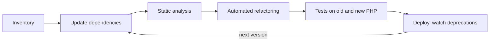

# Upgrade Strategy

Upgrading a codebase from PHP 5 to PHP 8 is mostly mechanical work that tools can do for you, plus a smaller set of behaviour changes that need a human and a test suite. This page lays out an order of work that keeps the application shippable at every step.



## 1. Take inventory

```bash
php -v                          # what production runs today
php -m                          # loaded extensions (look for mysql, mcrypt, ereg, imap…)
composer check-platform-reqs    # do installed packages accept this PHP and its extensions?
composer why-not php 8.5        # which packages block PHP 8.5?
```

Write down:

- the **current** and **target** PHP versions
- extensions that were removed or moved to PECL (see [Breaking Changes](breaking-changes.md))
- dependencies that are abandoned or pinned to old major versions. These are usually the real blockers, not your own code.

## 2. Pick the path

You can upgrade one version at a time or jump straight to the target. A practical middle ground for PHP 5 code is three hops:

| Hop | Why stop here |
|-----|---------------|
| 5.6 → 7.4 | Removes `mysql_*`/`ereg`; the code runs on the new engine; 7.4 still *warns* about everything 8.0 removes |
| 7.4 → 8.0 | The big tightening: removals, stricter comparisons, exceptions from internal functions |
| 8.0 → latest | Mostly deprecations, which tools fix almost entirely |

Stopping on 7.4 matters: every feature removed in 8.0 emits a deprecation on 7.4, so a clean deprecation log on 7.4 means a mostly clean 8.0 upgrade.

## 3. Resolve dependencies for the target version

Tell Composer which PHP version to resolve for, even before your servers run it:

```json
{
    "require": {
        "php": ">=8.3"
    },
    "config": {
        "platform": {
            "php": "8.3.0"
        }
    }
}
```

```bash
composer update --with-all-dependencies
```

Composer now installs only package versions that support PHP 8.3. If it fails, the error names the packages that need upgrading or replacing.

## 4. Find problems with static analysis

### PHPCompatibility

[PHPCompatibility](https://github.com/PHPCompatibility/PHPCompatibility) is a PHP_CodeSniffer standard that flags removed functions, new reserved words, and syntax that doesn't exist in a given version range:

```bash
composer require --dev phpcompatibility/php-compatibility
vendor/bin/phpcs -p --standard=PHPCompatibility --runtime-set testVersion 7.4-8.5 src/
```

`testVersion 7.4-8.5` reports anything that won't work on *every* version in that range, which is what you want while the code must run on old and new servers.

!!! note "Use a release that knows your target version"
    The long-lived 9.3.x line predates PHP 8 and misses most 8.x changes. Make sure Composer installs a release that covers your target (the 10.x line).

### PHPStan

[PHPStan](https://phpstan.org/) finds type errors, wrong argument counts and calls to undefined methods, many of which become `TypeError`s in PHP 8:

```neon
# phpstan.neon
parameters:
    level: 5
    phpVersion: 80500     # analyse as PHP 8.5
    paths:
        - src
        - tests
```

```bash
composer require --dev phpstan/phpstan
vendor/bin/phpstan analyse
```

Start at a low level and raise it over time. Use a baseline (`--generate-baseline`) so existing issues don't block new work.

## 5. Automate the mechanical changes with Rector

[Rector](https://getrector.com/) rewrites code: it replaces removed functions, adds parentheses to nested ternaries, converts `list()` to `[]`, adds `?` to implicitly nullable parameters, and applies newer syntax such as constructor promotion and `match`.

```bash
composer require --dev rector/rector
```

```php
<?php
// rector.php

declare(strict_types=1);

use Rector\Config\RectorConfig;

return RectorConfig::configure()
    ->withPaths([__DIR__ . '/src', __DIR__ . '/tests'])
    // One step at a time: start with php74, then php80, … up to your target.
    ->withPhpSets(php74: true);
```

```bash
vendor/bin/rector process --dry-run   # review the diff
vendor/bin/rector process             # apply it
```

!!! tip "Rector runs on modern PHP, even for PHP 5 code"
    Rector itself needs a recent PHP runtime, but the code it processes can be much older. Run it from a container or a separate PHP install if production still runs PHP 5.

Commit each version's set separately (`php70`, `php71`, …) so each commit is small and reviewable.

## 6. Test on both versions

Run the test suite on the current **and** target PHP versions until the switch is complete. In GitHub Actions:

```yaml
jobs:
  tests:
    runs-on: ubuntu-latest
    strategy:
      matrix:
        php: ['7.4', '8.3', '8.5']
    steps:
      - uses: actions/checkout@v7
      - uses: shivammathur/setup-php@v2
        with:
          php-version: ${{ matrix.php }}
          ini-values: error_reporting=E_ALL, zend.assertions=1
          coverage: none
      - run: composer install --no-progress
      - run: vendor/bin/phpunit
```

Locally, a container avoids installing several PHP versions:

```bash
docker run --rm -v "$PWD":/app -w /app php:8.5-cli vendor/bin/phpunit
```

!!! warning "Behaviour changes need tests, not tools"
    Static analysis cannot tell you that `0 == $input` now behaves differently, or that a `catch (Exception $e)` no longer catches a `TypeError`. Add tests around authentication, input validation, money calculations and error handling before the 7.4 → 8.0 hop.

## 7. Log deprecations in staging and production

Deprecations only show up when the code path runs. Log them from real traffic before the next upgrade:

```php
set_error_handler(function (int $errno, string $message, string $file, int $line): bool {
    if ($errno === E_DEPRECATED || $errno === E_USER_DEPRECATED) {
        error_log(sprintf('[deprecated] %s in %s:%d', $message, $file, $line));
        return true;   // handled; don't display it
    }
    return false;      // let PHP's normal handling continue
});
```

Make sure `error_reporting` includes `E_DEPRECATED` in staging (`E_ALL` is the default since 8.0), while production keeps `display_errors=Off`.

## 8. Review `php.ini` changes

Defaults changed over the years, and a hand-copied `php.ini` may hide or reverse them:

| Setting | Note |
|---------|------|
| `error_reporting` | Default is `E_ALL` since 8.0 |
| `opcache.enable` | Turn it on in production; OPcache has been bundled since 5.5 |
| `opcache.jit` / `opcache.jit_buffer_size` | JIT is off unless configured: on 8.0–8.3 set a non-zero `jit_buffer_size`; from 8.4 set `opcache.jit=tracing`. It helps CPU-bound work most |
| `session.use_strict_mode`, `session.cookie_httponly`, `session.cookie_samesite` | Secure values are the default from 8.6; set them explicitly on older versions |
| `zend.assertions` | `1` in development, `-1` in production |

## Checklist

1. Current and target versions agreed; hop plan written down
2. `composer why-not php X.Y` is clean; abandoned packages replaced
3. PHPCompatibility passes for the target range
4. PHPStan runs in CI with `phpVersion` set to the target
5. Rector sets applied one version at a time, each in its own commit
6. Test suite green on both old and new PHP
7. Deprecation log reviewed from staging traffic
8. `php.ini` reviewed for the new version
9. Rollback plan: the previous PHP version stays available until the new one is proven in production
