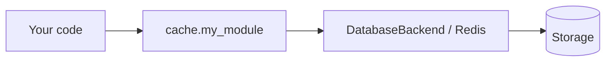

# Cache

The **Cache** component implements PSR-6 (`CacheItemPoolInterface`) cache pools with pluggable backends. Drupal's cache system extends this with **cache tags**, **contexts**, and **max-age** for precise invalidation.

## Core concepts

| Symfony | Drupal extension |
|---------|------------------|
| Cache pool | `cache.backend.*` factory services |
| Cache item | `CacheItem` with key, value, expiration |
| Adapter | Database, APCu, Memcache, Redis backends |
| — | Cache tags (`node:1`, `config:views.view.frontpage`) |
| — | Cache contexts (`user`, `languages:language_interface`) |



## How Drupal uses Cache

### Cache bins

Drupal organizes cache into **bins** — separate services you inject:

| Service | Purpose |
|---------|---------|
| `cache.default` | General-purpose |
| `cache.data` | Short-lived computed data |
| `cache.discovery` | Plugin/routing discovery |
| `cache.entity` | Entity lookups |
| `cache.render` | Rendered output |
| `cache.config` | Configuration |

### Basic get/set/delete

```php
<?php

declare(strict_types=1);

/** @var \Drupal\Core\Cache\CacheBackendInterface $cache */
$cache = \Drupal::cache('default');

$cid = 'my_module:product_list:published';

if ($item = $cache->get($cid)) {
  $products = $item->data;
}
else {
  $products = load_products_from_database();
  $cache->set($cid, $products, time() + 3600, ['my_module:products', 'node_list']);
}
```

### Custom cache bin

```yaml
# my_module.services.yml
services:
  cache.my_module:
    class: Drupal\Core\Cache\CacheBackendInterface
    tags:
      - { name: cache.bin }
    factory: ['@cache_factory', 'get']
    arguments: [my_module]
```

```php
<?php

declare(strict_types=1);

namespace Drupal\my_module\Service;

use Drupal\Core\Cache\CacheBackendInterface;

final class ProductCacheService {

  public function __construct(
    private readonly CacheBackendInterface $cache,
  ) {}

  public function getFeatured(): array {
    $cid = 'my_module:featured_products';

    if ($cached = $this->cache->get($cid)) {
      return $cached->data;
    }

    $data = $this->loadFeatured();
    $this->cache->set($cid, $data, CacheBackendInterface::CACHE_PERMANENT, [
      'my_module:featured',
    ]);

    return $data;
  }

  private function loadFeatured(): array {
    // Expensive query…
    return [];
  }

}
```

```yaml
  my_module.product_cache:
    class: Drupal\my_module\Service\ProductCacheService
    arguments: ['@cache.my_module']
```

## Symfony Cache pools in Drupal

Drupal's `cache_factory` can use chained backends. For Redis in production, enable `redis` module and configure in `settings.php`:

```php
<?php

declare(strict_types=1);

// settings.php (excerpt)
$settings['redis.connection']['interface'] = 'PhpRedis';
$settings['redis.connection']['host'] = 'redis';
$settings['cache']['default'] = 'cache.backend.redis';
```

!!! tip "Use cache tags, not arbitrary TTLs"
    Prefer `cache_tags.invalidator` and entity hooks to invalidate by tag instead of short TTLs that hide stale data bugs.

## Invalidation

```php
<?php

declare(strict_types=1);

use Drupal\Core\Cache\Cache;

// Invalidate by tag
Cache::invalidateTags(['my_module:products']);

// Invalidate specific bin CID
\Drupal::cache('my_module')->delete('my_module:featured_products');

// Invalidate all bins (drush cr)
drupal_flush_all_caches();
```

## Custom module example: cached API aggregator

=== "Service"

    ```php
    <?php

    declare(strict_types=1);

    namespace Drupal\my_module\Service;

    use Drupal\Core\Cache\CacheBackendInterface;
    use Drupal\Core\Cache\CacheableMetadata;
    use Drupal\Core\Entity\EntityTypeManagerInterface;

    final class ProductStatsService {

      public function __construct(
        private readonly CacheBackendInterface $cache,
        private readonly EntityTypeManagerInterface $entityTypeManager,
      ) {}

      public function getStats(): array {
        $cid = 'my_module:product_stats';

        if ($cached = $this->cache->get($cid)) {
          return $cached->data;
        }

        $storage = $this->entityTypeManager->getStorage('product');
        $total = $storage->getQuery()->accessCheck(FALSE)->count()->execute();
        $published = $storage->getQuery()
          ->accessCheck(FALSE)
          ->condition('status', 1)
          ->count()
          ->execute();

        $stats = [
          'total' => $total,
          'published' => $published,
          'updated' => time(),
        ];

        $this->cache->set($cid, $stats, CacheBackendInterface::CACHE_PERMANENT, [
          'my_module:product_stats',
          'product_list',
        ]);

        return $stats;
      }

      public function getCacheableMetadata(): CacheableMetadata {
        return (new CacheableMetadata())->addCacheTags(['my_module:product_stats']);
      }

    }
    ```

=== "Hook invalidate on entity save"

    ```php
    <?php

    declare(strict_types=1);

    use Drupal\Core\Cache\Cache;
    use Drupal\Core\Entity\EntityInterface;

    function my_module_entity_insert(EntityInterface $entity): void {
      if ($entity->getEntityTypeId() === 'product') {
        Cache::invalidateTags(['my_module:product_stats']);
      }
    }
    ```

=== "JSON controller"

    ```php
    <?php

    declare(strict_types=1);

    namespace Drupal\my_module\Controller;

    use Drupal\Core\Controller\ControllerBase;
    use Drupal\my_module\Service\ProductStatsService;
    use Symfony\Component\HttpFoundation\JsonResponse;

    final class StatsController extends ControllerBase {

      public function __construct(
        private readonly ProductStatsService $stats,
      ) {}

      public static function create($container): static {
        return new static($container->get('my_module.product_stats'));
      }

      public function json(): JsonResponse {
        $response = new JsonResponse($this->stats->getStats());
        $metadata = $this->stats->getCacheableMetadata();
        // For CDN: attach cache tags via response headers in custom middleware.
        return $response;
      }

    }
    ```

## Related reading

- [Caching section](../caching/index.md)
- [Cache Tags](../caching/cache-tags.md)
- [Headless: Cache Invalidation](../headless/cache-invalidation.md)
