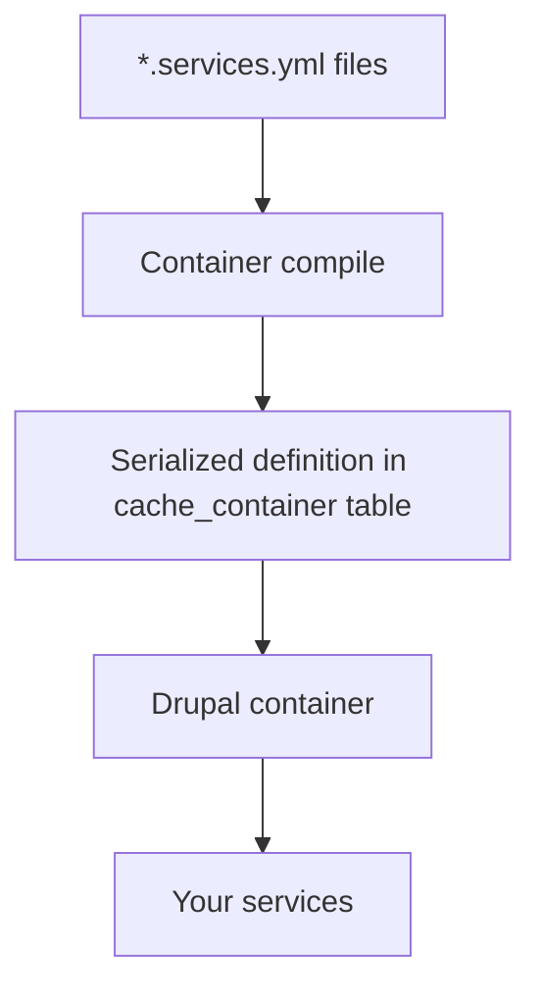

# Dependency Injection

Symfony's **DependencyInjection** component compiles service definitions into a fast, lazy-loaded container. Drupal extends this with its own `Drupal\Core\DependencyInjection\ContainerBuilder`, YAML discovery across modules, and tagged service collectors.

!!! tip "Full DI guide"
    For in-depth Drupal DI patterns — constructor injection, decoration, tagged services — see the dedicated **[Dependency Injection section](../dependency-injection/index.md)**.

## Core concepts

| Symfony | Drupal |
|---------|--------|
| `ContainerBuilder` | `Drupal\Core\DependencyInjection\ContainerBuilder` (extends Symfony's) |
| `services.yaml` | `*.services.yml` per module |
| `services.xml` | Rare in Drupal; YAML preferred |
| Autowiring | Partial; explicit arguments common |
| Compiler passes | `Drupal\Core\DependencyInjection\Compiler` passes |



## How Drupal uses DependencyInjection

### Service definitions

Every enabled module contributes `modulename.services.yml`:

```yaml
# my_module.services.yml
services:
  my_module.product_repository:
    class: Drupal\my_module\Repository\ProductRepository
    arguments: ['@database', '@entity_type.manager']

  my_module.product_sync:
    class: Drupal\my_module\Service\ProductSyncService
    arguments:
      - '@my_module.product_repository'
      - '@http_client'
      - '@logger.channel.my_module'

  logger.channel.my_module:
    parent: logger.channel_base
    arguments: ['my_module']
```

### Constructor injection (preferred)

```php
<?php

declare(strict_types=1);

namespace Drupal\my_module\Service;

use Drupal\Core\Entity\EntityTypeManagerInterface;
use Drupal\my_module\Repository\ProductRepository;
use GuzzleHttp\ClientInterface;
use Psr\Log\LoggerInterface;

final class ProductSyncService {

  public function __construct(
    private readonly ProductRepository $repository,
    private readonly ClientInterface $httpClient,
    private readonly LoggerInterface $logger,
  ) {}

  public function syncFromApi(string $endpoint): int {
    $response = $this->httpClient->get($endpoint);
    $items = json_decode($response->getBody()->getContents(), TRUE, 512, JSON_THROW_ON_ERROR);
    $count = 0;

    foreach ($items as $item) {
      $this->repository->upsert($item);
      $count++;
    }

    $this->logger->info('Synced @count products from @url', [
      '@count' => $count,
      '@url' => $endpoint,
    ]);

    return $count;
  }

}
```

### Factory and synthetic services

Some core services use factories or are set at runtime:

```yaml
# Pattern: factory method
services:
  my_module.cached_data:
    class: Drupal\my_module\CachedData
    factory: ['Drupal\my_module\CachedDataFactory', 'create']
    arguments: ['@cache.default', '@config.factory']
```

### Tagged services

Collect implementations by tag — plugin managers use this extensively:

```yaml
services:
  my_module.handler.pdf:
    class: Drupal\my_module\Export\PdfExportHandler
    tags:
      - { name: my_module.export_handler, format: pdf }

  my_module.handler.csv:
    class: Drupal\my_module\Export\CsvExportHandler
    tags:
      - { name: my_module.export_handler, format: csv }

  my_module.export_manager:
    class: Drupal\my_module\Export\ExportManager
    arguments: [!tagged_iterator { tag: my_module.export_handler, index_by: format }]
```

## Drupal vs Symfony DI differences

| Feature | Symfony Framework | Drupal |
|---------|-------------------|--------|
| Autoconfigure | Default on | Opt-in via tags |
| Service IDs | Class FQCN common | Short IDs (`entity_type.manager`) |
| Parameters | `%kernel.project_dir%` | `%app.root%`, `%site.path%` |
| Container cache | `var/cache` | `cache.container` bin (`cache_container` table) |
| Public by default | No (Symfony 4+) | Most services public |

!!! note "Avoid \Drupal:: static calls in new code"
    Prefer constructor injection. Use `\Drupal::service()` only in procedural `.module` files or one-off scripts.

## Service decoration

Wrap core services without altering core:

```yaml
services:
  my_module.http_client:
    class: Drupal\my_module\Http\LoggingHttpClient
    decorates: http_client
    arguments: ['@my_module.http_client.inner', '@logger.channel.my_module']
```

See [Service Decoration](../dependency-injection/service-decoration.md).

## Custom module example: full DI wiring

=== "services.yml"

    ```yaml
    services:
      _defaults:
        autowire: false
        autoconfigure: false

      my_module.export.pdf:
        class: Drupal\my_module\Export\PdfExportHandler
        tags:
          - { name: my_module.export_handler, format: pdf }

      my_module.export.csv:
        class: Drupal\my_module\Export\CsvExportHandler
        tags:
          - { name: my_module.export_handler, format: csv }

      my_module.export_manager:
        class: Drupal\my_module\Export\ExportManager
        arguments: [!tagged_iterator { tag: my_module.export_handler, index_by: format }]

      # Lets ControllerBase autowire ExportManager into ExportController;
      # no controller service definition is needed.
      Drupal\my_module\Export\ExportManager: '@my_module.export_manager'
    ```

=== "ExportManager"

    ```php
    <?php

    declare(strict_types=1);

    namespace Drupal\my_module\Export;

    final class ExportManager {

      /**
       * @var array<string, ExportHandlerInterface>
       */
      private readonly array $handlers;

      /**
       * @param iterable<string, ExportHandlerInterface> $handlers
       */
      public function __construct(iterable $handlers) {
        // !tagged_iterator injects a lazy RewindableGenerator, which does not
        // support isset() or [] access. Materialize it, keeping the format keys.
        $this->handlers = iterator_to_array($handlers);
      }

      public function export(string $format, array $products): string {
        if (!isset($this->handlers[$format])) {
          throw new \InvalidArgumentException("Unknown format: {$format}");
        }
        return $this->handlers[$format]->export($products);
      }

    }
    ```

=== "Controller"

    ```php
    <?php

    declare(strict_types=1);

    namespace Drupal\my_module\Controller;

    use Drupal\Core\Controller\ControllerBase;
    use Drupal\my_module\Export\ExportManager;
    use Symfony\Component\HttpFoundation\Request;
    use Symfony\Component\HttpFoundation\Response;

    final class ExportController extends ControllerBase {

      public function __construct(
        private readonly ExportManager $exportManager,
      ) {}

      public function export(Request $request): Response {
        $format = $request->query->getString('format', 'csv');
        $storage = $this->entityTypeManager()->getStorage('product');
        $products = $storage->loadMultiple();

        $content = $this->exportManager->export($format, $products);

        return new Response($content, 200, [
          'Content-Type' => $format === 'pdf' ? 'application/pdf' : 'text/csv',
          'Content-Disposition' => "attachment; filename=products.{$format}",
        ]);
      }

    }
    ```

## Rebuild the container

After changing `*.services.yml`:

```bash
drush cr
```

Or programmatically:

```php
<?php

declare(strict_types=1);

\Drupal::service('kernel')->invalidateContainer();
drupal_flush_all_caches();
```

## Related reading

- [Dependency Injection section](../dependency-injection/index.md) — full DI guide
- [What DI Solves](../dependency-injection/what-di-solves.md)
- [Tagged Services](../dependency-injection/tagged-services.md)
- [Internals: Service Container](../internals/service-container.md)
- [Controllers](controllers.md) — `create()` factory pattern
