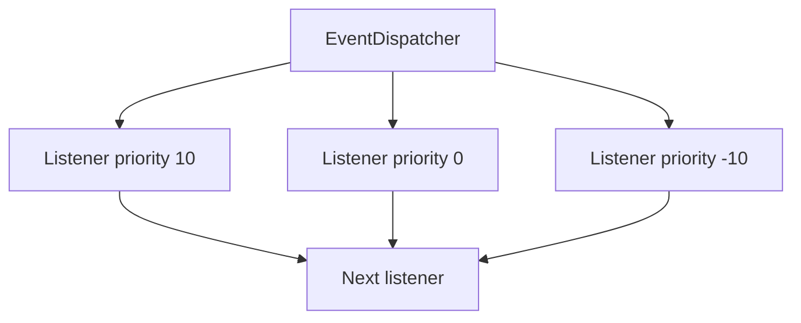

# Event Dispatcher

The **EventDispatcher** component implements the Observer pattern: objects dispatch events, and registered listeners (or subscribers) react without the dispatcher knowing about them. Drupal uses it for kernel lifecycle events, config changes, entity hooks, and custom module events.

## Core concepts

| Term | Meaning |
|------|---------|
| Event | An object carrying contextual data (extends `Event` or is a plain object in Symfony 5+) |
| Listener | Callable registered for a single event name |
| Subscriber | Class implementing `EventSubscriberInterface` with multiple events |
| Priority | Integer — higher runs first (default `0`) |



## How Drupal uses the event dispatcher

### Kernel events (Symfony)

`DrupalKernel` dispatches standard HttpKernel events:

| Event | Constant | When |
|-------|----------|------|
| Request | `KernelEvents::REQUEST` | After routing, before controller |
| Controller | `KernelEvents::CONTROLLER` | Before controller is invoked |
| Response | `KernelEvents::RESPONSE` | After controller returns |
| Exception | `KernelEvents::EXCEPTION` | On uncaught exceptions |
| Terminate | `KernelEvents::TERMINATE` | After response is sent |
| Finish request | `KernelEvents::FINISH_REQUEST` | After subrequest completes |

### Drupal-specific events

Drupal defines hundreds of events in `core/lib/Drupal/Core/` — entity insert/update/delete, config save, routing alter, and more. The procedural hook system often wraps these:

```php
<?php

declare(strict_types=1);

// Entity events are dispatched from EntityStorage.
use Drupal\Core\Entity\EntityInterface;
use Drupal\hook_event_dispatcher\Event\Entity\EntityInsertEvent;

// OOP hook equivalent (Drupal 11.1+):
// #[Hook('entity_insert')]
// public function onEntityInsert(EntityInterface $entity): void { }
```

### Accessing the dispatcher

```php
<?php

declare(strict_types=1);

/** @var \Symfony\Contracts\EventDispatcher\EventDispatcherInterface $dispatcher */
$dispatcher = \Drupal::service('event_dispatcher');
$dispatcher->dispatch(new MyCustomEvent($data), MyCustomEvents::PROCESSED);
```

## EventSubscriberInterface

Subscribers declare all handled events in one method:

```php
<?php

declare(strict_types=1);

namespace Drupal\my_module\EventSubscriber;

use Symfony\Component\EventDispatcher\EventSubscriberInterface;
use Symfony\Component\HttpKernel\Event\RequestEvent;
use Symfony\Component\HttpKernel\KernelEvents;

final class ApiRequestSubscriber implements EventSubscriberInterface {

  public static function getSubscribedEvents(): array {
    return [
      // Method name => priority
      KernelEvents::REQUEST => ['addApiHeaders', 0],
    ];
  }

  public function addApiHeaders(RequestEvent $event): void {
    if (!$event->isMainRequest()) {
      return;
    }

    $request = $event->getRequest();
    if (!str_starts_with($request->getPathInfo(), '/api/')) {
      return;
    }

    $request->attributes->set('_my_module_api', TRUE);
  }

}
```

Register in services:

```yaml
# my_module.services.yml
services:
  my_module.api_request_subscriber:
    class: Drupal\my_module\EventSubscriber\ApiRequestSubscriber
    tags:
      - { name: event_subscriber }
```

## Priorities in practice

When multiple subscribers react to the same event, priority controls order:

=== "High priority (runs first)"

    ```php
    <?php

    declare(strict_types=1);

    public static function getSubscribedEvents(): array {
      return [
        KernelEvents::REQUEST => ['authenticateEarly', 100],
      ];
    }
    ```

=== "Low priority (runs last)"

    ```php
    <?php

    declare(strict_types=1);

    public static function getSubscribedEvents(): array {
      return [
        KernelEvents::RESPONSE => ['addDebugHeader', -100],
      ];
    }
    ```

!!! tip "Match core priorities"
    When altering responses alongside Page Cache or Big Pipe, inspect core subscriber priorities in `core.services.yml` to avoid running too early or too late.

## Custom events

=== "Event class"

    ```php
    <?php

    declare(strict_types=1);

    namespace Drupal\my_module\Event;

    use Drupal\my_module\Entity\Product;
    use Symfony\Contracts\EventDispatcher\Event;

    final class ProductOrderedEvent extends Event {

      public function __construct(
        private readonly Product $product,
        private readonly int $quantity,
      ) {}

      public function getProduct(): Product {
        return $this->product;
      }

      public function getQuantity(): int {
        return $this->quantity;
      }

    }
    ```

=== "Event constants"

    ```php
    <?php

    declare(strict_types=1);

    namespace Drupal\my_module\Event;

    final class ProductEvents {

      public const ORDERED = 'my_module.product.ordered';

    }
    ```

=== "Dispatching"

    ```php
    <?php

    declare(strict_types=1);

    namespace Drupal\my_module\Service;

    use Drupal\my_module\Event\ProductEvents;
    use Drupal\my_module\Event\ProductOrderedEvent;
    use Drupal\my_module\Entity\Product;
    use Symfony\Contracts\EventDispatcher\EventDispatcherInterface;

    final class OrderService {

      public function __construct(
        private readonly EventDispatcherInterface $eventDispatcher,
      ) {}

      public function placeOrder(Product $product, int $quantity): void {
        // Process order…
        $this->eventDispatcher->dispatch(
          new ProductOrderedEvent($product, $quantity),
          ProductEvents::ORDERED,
        );
      }

    }
    ```

=== "Subscriber"

    ```php
    <?php

    declare(strict_types=1);

    namespace Drupal\my_module\EventSubscriber;

    use Drupal\my_module\Event\ProductEvents;
    use Drupal\my_module\Event\ProductOrderedEvent;
    use Psr\Log\LoggerInterface;
    use Symfony\Component\EventDispatcher\EventSubscriberInterface;

    final class OrderNotificationSubscriber implements EventSubscriberInterface {

      public function __construct(
        private readonly LoggerInterface $logger,
      ) {}

      public static function getSubscribedEvents(): array {
        return [
          ProductEvents::ORDERED => 'onProductOrdered',
        ];
      }

      public function onProductOrdered(ProductOrderedEvent $event): void {
        $product = $event->getProduct();
        $this->logger->info('Order placed for @title (qty: @qty)', [
          '@title' => $product->label(),
          '@qty' => $event->getQuantity(),
        ]);
      }

    }
    ```

```yaml
# my_module.services.yml
services:
  my_module.order_notification_subscriber:
    class: Drupal\my_module\EventSubscriber\OrderNotificationSubscriber
    arguments: ['@logger.channel.my_module']
    tags:
      - { name: event_subscriber }

  logger.channel.my_module:
    parent: logger.channel_base
    arguments: ['my_module']
```

## Stoppable events

Some Symfony events implement `StoppableEventInterface`. Calling `$event->stopPropagation()` prevents lower-priority listeners from running. Kernel exception handling uses this pattern.

```php
<?php

declare(strict_types=1);

use Symfony\Component\HttpKernel\Event\ExceptionEvent;

public function onException(ExceptionEvent $event): void {
  $exception = $event->getThrowable();
  if ($exception instanceof MyModuleApiException) {
    $event->setResponse(new JsonResponse(['error' => $exception->getMessage()], 400));
    $event->stopPropagation();
  }
}
```

## Custom module example: entity sync on order

Full workflow — dispatch on service action, react in subscriber, alter third-party behavior:

```php
<?php

declare(strict_types=1);

namespace Drupal\my_module\EventSubscriber;

use Drupal\Core\Entity\EntityTypeManagerInterface;
use Drupal\my_module\Event\ProductEvents;
use Drupal\my_module\Event\ProductOrderedEvent;
use Symfony\Component\EventDispatcher\EventSubscriberInterface;

final class InventorySyncSubscriber implements EventSubscriberInterface {

  public function __construct(
    private readonly EntityTypeManagerInterface $entityTypeManager,
  ) {}

  public static function getSubscribedEvents(): array {
    return [
      ProductEvents::ORDERED => ['decrementStock', 0],
    ];
  }

  public function decrementStock(ProductOrderedEvent $event): void {
    $product = $event->getProduct();
    $stock = (int) $product->get('stock')->value;
    $product->set('stock', max(0, $stock - $event->getQuantity()));
    $product->save();
  }

}
```

## Related reading

- [HttpKernel](http-kernel.md) — kernel event lifecycle
- [Custom Modules: Hooks](../custom-coding/hooks.md) — OOP hooks vs events
