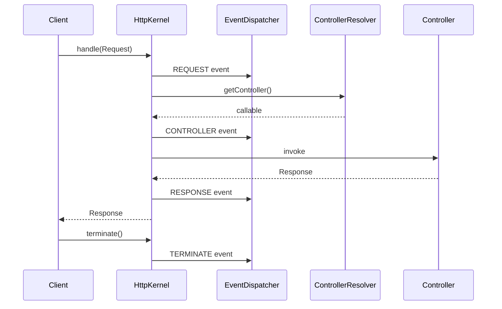

# HttpKernel

The **HttpKernel** component orchestrates the conversion of a `Request` into a `Response`. `DrupalKernel` extends Symfony's `HttpKernel`, adding bootstrap, site settings, and Drupal's service container.

## Core concepts

The kernel follows a **handle → terminate** pattern:



| Phase | Event | Purpose |
|-------|-------|---------|
| Enter | `KernelEvents::REQUEST` | Authentication, routing, maintenance mode |
| Resolve | `KernelEvents::CONTROLLER` | Substitute or wrap the controller |
| Exit | `KernelEvents::RESPONSE` | Add headers, compress, attach cookies |
| Error | `KernelEvents::EXCEPTION` | Convert exceptions to error pages |
| Cleanup | `KernelEvents::TERMINATE` | Log, queue items, send emails |

## How Drupal uses HttpKernel

### DrupalKernel bootstrap

Before the parent `handle()` runs, Drupal boots configuration, the database, and the container:

```php
<?php

declare(strict_types=1);

// Conceptual flow in Drupal\Core\DrupalKernel
public function handle(
  Request $request,
  int $type = HttpKernelInterface::MAIN_REQUEST,
  bool $catch = TRUE,
): Response {
  $this->boot();
  $this->preHandle($request);
  return parent::handle($request, $type, $catch);
}
```

### Main request vs subrequest

| Type | Constant | Example |
|------|----------|---------|
| Main | `HttpKernelInterface::MAIN_REQUEST` | Browser page load |
| Sub | `HttpKernelInterface::SUB_REQUEST` | ESI, internal `render()` with isolated context |

Always check `$event->isMainRequest()` in subscribers to avoid running logic on embedded blocks or Big Pipe placeholders.

### Exception handling

Uncaught exceptions trigger `KernelEvents::EXCEPTION`. Drupal's exception subscriber renders themed error pages or JSON errors for API requests:

```php
<?php

declare(strict_types=1);

namespace Drupal\my_module\EventSubscriber;

use Symfony\Component\EventDispatcher\EventSubscriberInterface;
use Symfony\Component\HttpFoundation\JsonResponse;
use Symfony\Component\HttpKernel\Event\ExceptionEvent;
use Symfony\Component\HttpKernel\Exception\HttpExceptionInterface;
use Symfony\Component\HttpKernel\KernelEvents;

final class ApiExceptionSubscriber implements EventSubscriberInterface {

  public static function getSubscribedEvents(): array {
    return [KernelEvents::EXCEPTION => ['onException', 50]];
  }

  public function onException(ExceptionEvent $event): void {
    $request = $event->getRequest();
    if ($request->getRequestFormat() !== 'json') {
      return;
    }

    $throwable = $event->getThrowable();
    $status = $throwable instanceof HttpExceptionInterface
      ? $throwable->getStatusCode()
      : 500;

    $event->setResponse(new JsonResponse([
      'error' => $throwable->getMessage(),
      'status' => $status,
    ], $status));
  }

}
```

## Request event: early interception

`KernelEvents::REQUEST` is the primary hook for redirects, IP blocking, and API versioning:

```php
<?php

declare(strict_types=1);

namespace Drupal\my_module\EventSubscriber;

use Symfony\Component\EventDispatcher\EventSubscriberInterface;
use Symfony\Component\HttpFoundation\RedirectResponse;
use Symfony\Component\HttpKernel\Event\RequestEvent;
use Symfony\Component\HttpKernel\KernelEvents;

final class MaintenanceBypassSubscriber implements EventSubscriberInterface {

  public static function getSubscribedEvents(): array {
    return [KernelEvents::REQUEST => ['checkMaintenance', 30]];
  }

  public function checkMaintenance(RequestEvent $event): void {
    if (!$event->isMainRequest()) {
      return;
    }

    $request = $event->getRequest();
    if ($request->getPathInfo() === '/health') {
      // Allow health checks during maintenance.
      $request->attributes->set('_maintenance_bypass', TRUE);
    }
  }

}
```

## Response event: modify outgoing response

```php
<?php

declare(strict_types=1);

namespace Drupal\my_module\EventSubscriber;

use Symfony\Component\EventDispatcher\EventSubscriberInterface;
use Symfony\Component\HttpKernel\Event\ResponseEvent;
use Symfony\Component\HttpKernel\KernelEvents;

final class SecurityHeaderSubscriber implements EventSubscriberInterface {

  public static function getSubscribedEvents(): array {
    return [KernelEvents::RESPONSE => ['addHeaders', 0]];
  }

  public function addHeaders(ResponseEvent $event): void {
    if (!$event->isMainRequest()) {
      return;
    }

    $response = $event->getResponse();
    $response->headers->set('X-Content-Type-Options', 'nosniff');
    $response->headers->set('Referrer-Policy', 'strict-origin-when-cross-origin');
  }

}
```

## Terminate event: post-response work

`KernelEvents::TERMINATE` fires after the response is sent to the client — ideal for non-blocking logging:

```php
<?php

declare(strict_types=1);

namespace Drupal\my_module\EventSubscriber;

use Psr\Log\LoggerInterface;
use Symfony\Component\EventDispatcher\EventSubscriberInterface;
use Symfony\Component\HttpKernel\Event\TerminateEvent;
use Symfony\Component\HttpKernel\KernelEvents;

final class RequestLogSubscriber implements EventSubscriberInterface {

  public function __construct(
    private readonly LoggerInterface $logger,
  ) {}

  public static function getSubscribedEvents(): array {
    return [KernelEvents::TERMINATE => 'onTerminate'];
  }

  public function onTerminate(TerminateEvent $event): void {
    $request = $event->getRequest();
    $response = $event->getResponse();

    $this->logger->info('{method} {path} → {status}', [
      'method' => $request->getMethod(),
      'path' => $request->getPathInfo(),
      'status' => $response->getStatusCode(),
    ]);
  }

}
```

!!! warning "Keep terminate handlers fast"
    PHP may still block the worker process during terminate. For heavy work, push to a queue (`queue.api`) instead of doing it synchronously.

## Custom module example: API timing middleware

Combines REQUEST (start timer) and RESPONSE (add header):

=== "Subscriber"

    ```php
    <?php

    declare(strict_types=1);

    namespace Drupal\my_module\EventSubscriber;

    use Symfony\Component\EventDispatcher\EventSubscriberInterface;
    use Symfony\Component\HttpKernel\Event\RequestEvent;
    use Symfony\Component\HttpKernel\Event\ResponseEvent;
    use Symfony\Component\HttpKernel\KernelEvents;

    final class ApiTimingSubscriber implements EventSubscriberInterface {

      public static function getSubscribedEvents(): array {
        return [
          KernelEvents::REQUEST => ['startTimer', 100],
          KernelEvents::RESPONSE => ['addTimingHeader', -10],
        ];
      }

      public function startTimer(RequestEvent $event): void {
        if (!$event->isMainRequest()) {
          return;
        }
        $request = $event->getRequest();
        if (!str_starts_with($request->getPathInfo(), '/api/')) {
          return;
        }
        $request->attributes->set('_my_module_start', microtime(TRUE));
      }

      public function addTimingHeader(ResponseEvent $event): void {
        if (!$event->isMainRequest()) {
          return;
        }
        $request = $event->getRequest();
        $start = $request->attributes->get('_my_module_start');
        if ($start === NULL) {
          return;
        }
        $ms = round((microtime(TRUE) - $start) * 1000, 2);
        $event->getResponse()->headers->set('X-Response-Time', "{$ms}ms");
      }

    }
    ```

=== "Service definition"

    ```yaml
    my_module.api_timing_subscriber:
      class: Drupal\my_module\EventSubscriber\ApiTimingSubscriber
      tags:
        - { name: event_subscriber }
    ```

## Related reading

- [Event Dispatcher](event-dispatcher.md)
- [Internals: Request Lifecycle](../internals/request-lifecycle.md)
- [HttpFoundation](http-foundation.md)
