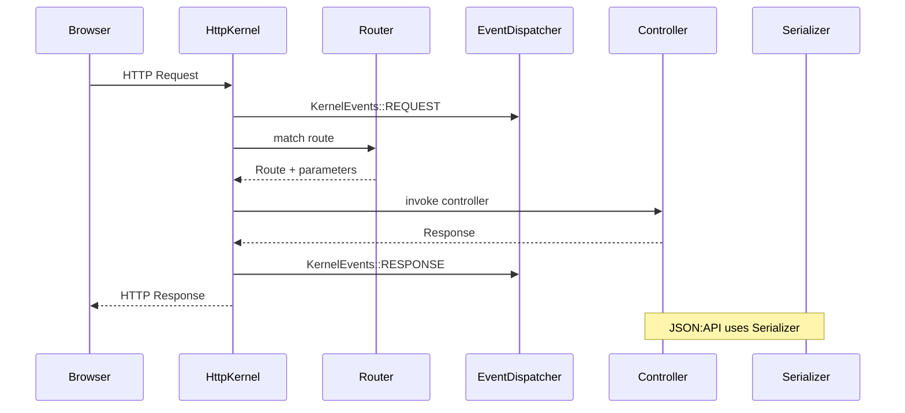

# Symfony Components in Drupal 11

Drupal 11 is built **with** Symfony 7 components, not as a Symfony application. Core cherry-picks components and wraps them with CMS-specific APIs (Entity API, Plugin system, hooks). This section documents each component, how Drupal wires it, and how to use it in custom modules.

!!! info "Symfony 7, not the full framework"
    Drupal ships individual `symfony/*` packages via Composer. You will not find a `symfony/framework-bundle` or Doctrine ORM in core — only the components listed below.

## Component overview

| Component | Package | Primary Drupal usage | Doc |
|-----------|---------|---------------------|-----|
| HttpFoundation | `symfony/http-foundation` | `Request`, `Response`, sessions, cookies, file uploads | [http-foundation.md](http-foundation.md) |
| Routing | `symfony/routing` | URL-to-controller mapping, route parameters | [routing.md](routing.md) |
| HttpKernel | `symfony/http-kernel` | Request lifecycle, exception handling | [http-kernel.md](http-kernel.md) |
| EventDispatcher | `symfony/event-dispatcher` | Hooks, event subscribers, kernel events | [event-dispatcher.md](event-dispatcher.md) |
| DependencyInjection | `symfony/dependency-injection` | Compiled service container | [dependency-injection.md](dependency-injection.md) |
| Serializer | `symfony/serializer` | JSON:API, REST, entity normalization | [serializer.md](serializer.md) |
| Validator | `symfony/validator` | Entity/field constraints, form validation | [validator.md](validator.md) |
| Console | `symfony/console` | Drush commands, `drupal` CLI | [console.md](console.md) |
| Messenger | `symfony/messenger` | Status/flash messages in the admin UI | [messenger.md](messenger.md) |
| Cache | `symfony/cache` | PSR-6 cache backends (database, APCu, Redis) | [cache.md](cache.md) |
| Yaml | `symfony/yaml` | `*.yml` config, routing, services | [yaml.md](yaml.md) |
| Translation | `symfony/translation` | String translation, locale handling | [translation.md](translation.md) |
| Security (PasswordHasher) | `symfony/password-hasher` | User password hashing and verification | [security.md](security.md) |
| Process | `symfony/process` | Running external binaries (ImageMagick, etc.) | [process.md](process.md) |
| Filesystem | `symfony/filesystem` | Safe file copy/move/remove operations | [filesystem.md](filesystem.md) |
| Mime | `symfony/mime` | MIME type detection, file metadata | [mime.md](mime.md) |
| PSR HTTP Bridge | `symfony/psr-http-message-bridge` | Bridging PSR-7 messages to HttpFoundation | — |

## How components connect

## Controllers: Drupal layer on Symfony

Drupal does not use Symfony's `AbstractController` directly. Instead, controllers extend `ControllerBase` and are registered via routing YAML. See [controllers.md](controllers.md) for the full pattern.

## Where to go next

| Goal | Start here |
|------|-----------|
| Understand a single HTTP request | [HttpKernel](http-kernel.md) → [HttpFoundation](http-foundation.md) |
| Build a custom API endpoint | [Routing](routing.md) → [Controllers](controllers.md) |
| React to core or custom events | [Event Dispatcher](event-dispatcher.md) |
| Inject services into your code | [Dependency Injection](dependency-injection.md) + [DI section](../dependency-injection/index.md) |
| Expose entities as JSON | [Serializer](serializer.md) |
| Add Drush commands | [Console](console.md) |

!!! tip "Prefer Drupal wrappers"
    Use Symfony classes directly for HTTP primitives (`Request`, `Response`, `JsonResponse`). For everything else, check whether Drupal provides a service or API first — it usually handles cache tags, access checks, and config sync for you.
